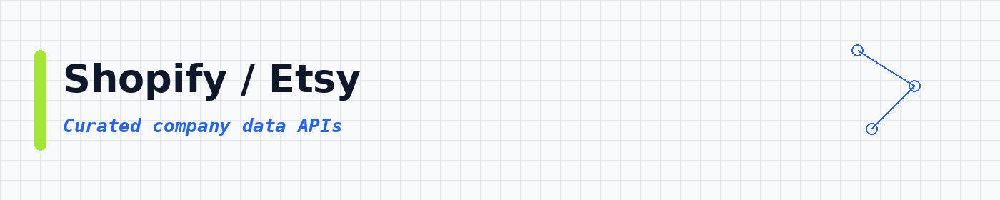
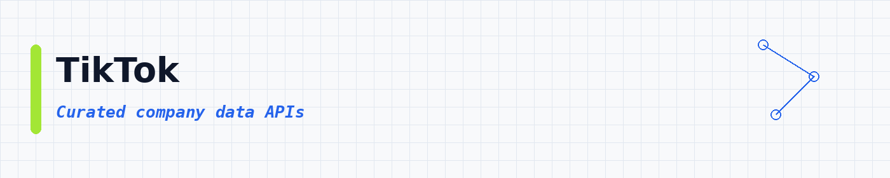
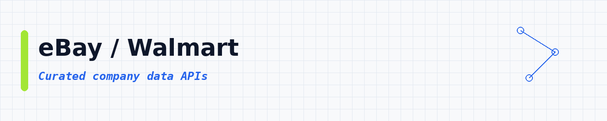

# Company Data APIs: Get Facts About Any Business in Seconds

 

 
 
 

 <a href="#top-10-most-popular">Top 10</a> ·
 <a href="#table-of-contents">Categories</a> ·
 <a href="#more-lists">More lists</a>

Want to learn about a company without hours of Googling? Give one of these APIs a company name or website, and it returns the facts: size, industry, location, funding and more. **28,568 ready-to-use APIs**, sorted by real users so the best ones come first.

These company data APIs help you collect firmographics, business registry records, funding and investor data, employee counts and hiring signals. Use them for B2B data enrichment, CRM cleanup, market sizing, Crunchbase, LinkedIn, ZoomInfo and Dun & Bradstreet style lookups, and company-domain matching. Each API runs in the cloud and exports clean JSON, CSV or Excel.

---

## Collection statistics

| Metric | Count |
|--------|-------|
| **Company Data APIs** | **28,568** |
| **Categories** | **18** |
| **Last updated** | 2026-11-02 |

---

## What is a company data API?

A company data API is a tool you call to pull facts about a business. Things like name, website, size, industry, HQ address, funding and contact details. You give it a company name or domain. It gives you clean rows you can save as CSV or JSON.

People also call this a company data scraper, a firmographics API or a business data API. Same idea: get company info without copying it by hand.

---

## What can you build?

These **28,568 ready-to-use company data APIs** help you pull business data into your own apps. You can:

- Find company names, websites and HQ details for research
- Enrich CRM rows with firmographics (size, industry, revenue range)
- Pull registry and legal entity records
- Track funding, investors and similar companies
- Collect hiring signals from job boards for company intel
- Grab public emails and phones tied to a company domain
- Watch reviews and brand pages for competitor notes

Pick an API below, open it, try a small run, then export the results.

---

## Star this repository

If this list helped you, a star helps other people find it too.

---

## Table of contents

- [Jobs / Recruiting](#jobs-recruiting) : **6,999**
- [Other / General](#other-general) : **6,644**
- [Email / Phone](#email-phone) : **3,372**
- [Company / B2B](#company-b2b) : **2,947**
- [LinkedIn](#linkedin) : **1,785**
- [SEO / SERP](#seo-serp) : **1,684**
- [AI / Agents / MCP](#ai-agents-mcp) : **1,433**
- [Reviews / Brand](#reviews-brand) : **1,200**
- [Google / Maps](#google-maps) : **707**
- [Real Estate](#real-estate) : **673**
- [News / Content](#news-content) : **338**
- [Shopify / Etsy](#shopify-etsy) : **222**
- [TikTok](#tiktok) : **134**
- [Instagram](#instagram) : **122**
- [Amazon](#amazon) : **109**
- [eBay / Walmart](#ebay-walmart) : **72**
- [Facebook / Meta](#facebook-meta) : **70**
- [X / Twitter](#x-twitter) : **57**

---

## Top 10 most popular

| API | What it does | Users | Rating | Price |
|-----|-------------|-------|--------|-------|
| [Linkedin Jobs Scraper](https://apify.com/curious_coder/linkedin-jobs-scraper?fpr=data) | Scrape Linkedin jobs from jobs search results using search URLs or filters. Get full job details, job poster and company details. | 178.0K | 4.51 | Pay per event |
| [LinkedIn Jobs Scraper \| Remove Duplicate Jobs \| Pay Per Result](https://apify.com/cheap_scraper/linkedin-job-scraper?fpr=data) | Scrape LinkedIn jobs by keywords and location or by LinkedIn search URLs, or both. Export to JSON, CSV or Excel. No login or cookies needed… | 54.9K | 4.37 | Pay per event |
| [✨Leads Finder - $1.5/1k leads with Emails [Apollo Alternative]](https://apify.com/code_crafter/leads-finder?fpr=data) | ✅ Affordable alternative to ZoomInfo, Lusha & Apollo. ✅ Get Business email, 📞Mobile Number, Personal email, LinkedIn profiles, company deta… | 49.7K | 3.44 | Pay per event |
| [LinkedIn Company Employees Scraper (No Cookies)](https://apify.com/harvestapi/linkedin-company-employees?fpr=data) | Extract all LinkedIn Company employees with filters and detailed profile information, including complete work experience, and more. No cook… | 41.9K | 4.02 | Pay per event |
| [Linkedin Post Search Scraper (No Cookies)](https://apify.com/harvestapi/linkedin-post-search?fpr=data) | Search LinkedIn Posts with advanced filters by target profiles or companies. No cookies or account required. | 40.0K | 4.95 | Pay per event |
| [💡 Indeed Jobs Scraper](https://apify.com/valig/indeed-jobs-scraper?fpr=data) | $0.1/1K jobs \| Scrape job listings, salaries, and company details from Indeed with customizable search filters. | 38.2K | 4.73 | Pay per event |
| [LinkedIn Company Details Scraper (No Cookies)](https://apify.com/harvestapi/linkedin-company?fpr=data) | Extract detailed information from LinkedIn Companies such as company name, address, phone numbers, website, employee count, and more. Find… | 31.2K | 4.86 | Pay per event |
| [🚀 Indeed jobs scraper [PPR]](https://apify.com/borderline/indeed-scraper?fpr=data) | Pay per result: Fast and reliable Indeed Job Scraper! 🚀 Extract job listings with company details effortlessly with advanced filters, avoid… | 28.7K | 4.63 | Pay per event |
| [TikTok Profile Scraper (Private & Public)](https://apify.com/abe/tiktok-profile-scraper?fpr=data) | Scrapes basic profile info for a TikTok page for a given username(s), both private & public. Info returned includes counts for followers, f… | 24.6K | 4.60 | Pay per event |
| [🍏 Leads Finder: Email 📧 + Mobile Number 📞​](https://apify.com/microworlds/leads-finder?fpr=data) | ✅ Cheap alternative to Apollo, ZoomInfo & Lusha. ✅ Get business emails, LinkedIn profiles, company details etc.. With verified email 📧 and… | 23.2K | 2.85 | Pay per event |

---

## Jobs / Recruiting

**6,999 APIs in this category** | [View all →](lists/jobs-recruiting.md)

| API | What it does | Users | Rating | Price |
|-----|-------------|-------|--------|-------|
| [💡 Indeed Jobs Scraper](https://apify.com/valig/indeed-jobs-scraper?fpr=data) | $0.1/1K jobs \| Scrape job listings, salaries, and company details from Indeed with customizable search filters. | 38.2K | 4.73 | Pay per event |
| [🚀 Indeed jobs scraper [PPR]](https://apify.com/borderline/indeed-scraper?fpr=data) | Pay per result: Fast and reliable Indeed Job Scraper! 🚀 Extract job listings with company details effortlessly with advanced filters, avoid… | 28.7K | 4.63 | Pay per event |
| [Naukri Job Scraper \| India & Gulf Jobs](https://apify.com/muhammetakkurtt/naukri-job-scraper?fpr=data) | Naukri Job Scraper extracts job postings from Naukri.com (India) and NaukriGulf.com (Gulf). Scrape job title, company, salary, experience,… | 21.8K | 4.42 | Pay per event |
| [Naukri Jobs Scraper (India)](https://apify.com/valig/naukri-jobs-scraper?fpr=data) | $0.4/1K jobs \| Scrape detailed job listings, salaries, and company insights instantly from Naukri to power your research. | 12.4K | n/a | Pay per event |
| [Indeed Jobs Scraper: Most Comprehensive](https://apify.com/kaix/indeed-scraper?fpr=data) | 🔥 ~$0.05/1K jobs 🔥 Extract accurate, structured job data from Indeed. Get ALL page results, not just the first page. 60+ fields per job wit… | 8.4K | 4.34 | Pay per event |
| [Naukri Job Scraper 💰 Just $0.27/1k: Salary, Skills & Detail](https://apify.com/blackfalcondata/naukri-jobs-feed?fpr=data) | Naukri Job Scraper for naukri.com: India's largest job board (500K+ listings). Salary, walk-in contacts, skills, company profiles, full des… | 5.9K | 5.00 | Pay per event |
| [Indeed jobs scraper](https://apify.com/curious_coder/indeed-scraper?fpr=data) | This is an actively maintained indeed scraper which can extract job postings and hiring company details at scale from any indeed search res… | 5.2K | 4.85 | Pay per event |
| [Naukri Job Scraper: India + Gulf · Emails & 41 Fields](https://apify.com/memo23/naukri-scraper?fpr=data) | $0.80/1K jobs: or pay only for what changed: incremental mode bills just the new and updated postings. Naukri + NaukriGulf in one run, so y… | 5.1K | 4.73 | Pay per event |
| [Google Jobs Scraper](https://apify.com/johnvc/Google-Jobs-Scraper?fpr=data) | The most advanced Google Jobs Scraper available! Built with enterprise-grade flexibility, lightning-fast performance, and comprehensive cus… | 4.5K | 4.55 | Pay per event |
| [🔥 Glassdoor jobs scraper](https://apify.com/bebity/glassdoor-jobs-scraper?fpr=data) | ℹ️ Elevate your job search with the sleek Glassdoor Scraper for. Tailor-made for the modern job seeker, it's your secret weapon in the job… | 3.5K | 4.37 | Pay per event |
| [All Jobs Scraper (39 Sites)](https://apify.com/agentx/all-jobs-scraper?fpr=data) | All Jobs Scraper is a job scraper API for 42 platforms that returns 41 unified job, salary, company, application, and public contact fields… | 3.2K | 3.69 | Pay per event |
| [Naukri.com Job Scraper](https://apify.com/automation-lab/naukri-scraper?fpr=data) | Scrape job listings from Naukri.com, India's largest job board. Extract title, company, salary, location, experience, skills & description.… | 2.7K | n/a | Pay per event |
| [Wellfound Startup Job Scraper: Equity Ranges & Job Alerts](https://apify.com/blackfalcondata/wellfound-scraper?fpr=data) | Scrape wellfound.com startup jobs with salary and equity ranges, location, remote status, experience level, and company name and size. Comp… | 2.5K | 5.00 | Pay per event |
| [Glassdoor Reviews & Jobs · No 200-Cap · AI Employer Intel](https://apify.com/memo23/glassdoor-scraper-ppr?fpr=data) | Glassdoor scraper with no login and no 200-review cap: full reviews with sub-ratings, pros/cons, employer replies, plus jobs, salaries & in… | 2.0K | 4.57 | Pay per event |
| [StepStone Job Scraper [Only $1💰] Keyword/URL Search + Emails](https://apify.com/memo23/stepstone-search-cheerio-ppr?fpr=data) | 💰 $1/1,000 results. StepStone job scraper: keyword & listing search on StepStone Germany, Austria & Belgium, or drop in any job link for on… | 1.8K | 5.00 | Pay per event |
| [Bulk Email Finder](https://apify.com/icypeas_official/bulk-email-finder?fpr=data) | Bulk email finder powered by Icypeas API. Upload a list of prospects (up to 5000) with their name and company domain to find their professi… | 1.8K | 1.00 | Pay per event |
| [Dice Job Scraper](https://apify.com/shahidirfan/Dice-Job-Scraper?fpr=data) | Unlock the tech job market! Effortlessly extract job listings, salaries, and company details from Dice.com. This high-performance tool is r… | 1.8K | 4.54 | Pay per event |
| [SEEK Job Scraper: Australia & New Zealand Job Listings](https://apify.com/blackfalcondata/seek-scraper?fpr=data) | Scrape SEEK job listings from seek.com.au and seek.co.nz. Turn on incremental mode and scheduled runs return only new or changed jobs, so y… | 1.7K | 5.00 | Pay per event |
| [Google Jobs Scraper](https://apify.com/gio21/google-jobs-scraper?fpr=data) | Scrape Google for Jobs. 22+ fields per posting (title, company, salary, apply links, remote flag). US/BR/MX/CA/UK/IN/AU/JP/SG. Pay only per… | 1.5K | 2.44 | Pay per event |
| [Internshala Scraper [Just 💰$0.4]: Internships & Fresher Jobs](https://apify.com/blackfalcondata/internshala-scraper?fpr=data) | 💰 $0.4 per 1,000 listings: the cheapest Internshala scraper. Scrape internships & fresher jobs across India with structured stipend · requi… | 1.4K | n/a | Pay per event |
| [Greenhouse Job Scraper](https://apify.com/bytepulselabs/greenhouse-job-scraper?fpr=data) | Scrape all Greenhouse job postings. Add one or more company job site URLs and extract job listings, requirements, benefits, and application… | 1.4K | 5.00 | Pay per event |
| [🔥 Indeed Jobs Scraper API/Keyword or URL/No Login · Emails](https://apify.com/memo23/apify-indeed-cheerio-ppr?fpr=data) | Indeed jobs + company-leads scraper: search by keyword or URL. Returns salaries, GPS, full descriptions, the resolved external/ATS apply UR… | 1.3K | 4.51 | Pay per event |
| [Wellfound Jobs Scraper: Fast & cheap](https://apify.com/clearpath/wellfound-api-ppe?fpr=data) | Extract startup job listings from Wellfound (formerly AngelList) as structured JSON, CSV, or Excel. Get job titles, salaries, equity, compa… | 1.1K | n/a | Pay per event |
| [GLASSDOOR: Reviews &Jobs &Interviews&Locations &Salary&Overview](https://apify.com/memo23/apify-glassdoor-reviews-scraper?fpr=data) | Glassdoor scraper that bypasses the 200-result review cap, no login needed. Reviews with sub-ratings, pros/cons & employer replies, plus jo… | 1.1K | 4.53 | Pay per event |
| [G2 Scraper · Reviews, Products, Categories & Search](https://apify.com/omkar-cloud/g2-product-scraper?fpr=data) | Scrape G2 reviews ⚡ fast, 🎯 accurate and 🔍 detailed: reviewer job title, company size, industry, split answers and badges: plus products, p… | 1.1K | 4.23 | Pay per event |
| [Attorney Contact List & Lawyer Directory Data: Justia](https://apify.com/jungle_synthesizer/justia-scraper?fpr=data) | Build an attorney contact list or law firm database from Justia.com. Extract names, contact details, practice areas, education, bar admissi… | 1.1K | n/a | Pay per event |
| [Job Search](https://apify.com/truefetch/job-search?fpr=data) | Job Search is a job search API for 42 sources that returns 41 normalized job, salary, company, application, and public contact fields. One… | 1.0K | 5.00 | Pay per event |
| [Himalayas Remote Jobs Scraper](https://apify.com/inlifeprojects/himalayas-jobs-scraper?fpr=data) | Scrape remote job listings from Himalayas.app public API. Filter by keyword, seniority, employment type, country, and worldwide availabilit… | 1.0K | n/a | Pay per event |
| [Naukrigulf Job Scraper: Gulf Job Board](https://apify.com/blackfalcondata/naukrigulf-scraper?fpr=data) | Scrape naukrigulf.com: 13 markets across the Gulf and wider MENA, from UAE and Saudi Arabia to Egypt and Lebanon. Title, company, location… | 971 | 5.00 | Pay per event |
| [Welcome to the Jungle Scraper: WTTJ Jobs Fast Export](https://apify.com/clearpath/welcome-to-the-jungle-jobs-api?fpr=data) | Extract job listings from Welcome to the Jungle (WTTJ) with filters for location, salary, remote work, contract type, experience level, and… | 953 | n/a | Pay per event |
| [Naukri Jobs Scraper](https://apify.com/easyapi/naukri-jobs-scraper?fpr=data) | Extract detailed job listings from Naukri.com with this powerful scraper. Collect comprehensive job information including titles, salaries,… | 942 | n/a | Pay per event |
| [Naukri Jobs Scraper: India & Gulf Jobs, 60+ Fields](https://apify.com/thirdwatch/naukri-jobs-scraper?fpr=data) | Extract Naukri.com and Naukrigulf job listings at scale: title, company, salary, experience, skills, location, posted date and 50+ more fie… | 927 | 5.00 | Pay per event |
| [Remote Jobs Scraper: Worldwide vs US-only Filter, 6 Boards](https://apify.com/benthepythondev/remote-jobs-aggregator?fpr=data) | Remote jobs from six boards, each tagged worldwide, region-restricted or hybrid, with the employer's sentence as proof. Set eligibleFrom to… | 918 | 5.00 | Pay per event |
| [Ats Jobs API](https://apify.com/jobo.world/ats-jobs-api?fpr=data) | Search for jobs directly from 75+ ATS platforms (Greenhouse, Lever, Ashby, Workday, iCIMS, Taleo, SuccessFactors, and dozens more). Support… | 874 | 4.58 | Pay per event |
| [Naukri Jobs Search Scraper](https://apify.com/stealth_mode/naukri-jobs-search-scraper?fpr=data) | Efficiently scrape job listings from Naukri.com, India's #1 job site with 75+ million registered users. Extract comprehensive data includin… | 854 | n/a | Pay per event |
| [Foundit Monster India Jobs \| 20 Fields, Monitor Mode](https://apify.com/themineworks/foundit-jobs-scraper?fpr=data) | Scrape Foundit.in (formerly Monster India) job search by keyword, city, experience, salary and job-freshness. Structured JSON: title, compa… | 834 | 5.00 | Pay per event |
| [Instahyre Jobs Scraper: India Tech Jobs & Hiring Monitor](https://apify.com/getascraper/instahyre-jobs-scraper?fpr=data) | Search and monitor Instahyre public India tech jobs by function, skill, location, company size, and job type. Optional enrichment adds desc… | 833 | n/a | Pay per event |
| [Naukri Jobs Scraper API: Latest Jobs by Keyword & Location](https://apify.com/nuclear_quietude/naukri-job-scraper?fpr=data) | Scrape latest job listings from Naukri.com using keyword, location, experience, salary, and job age filters. Extract job title, company, sa… | 823 | n/a | Pay per event |
| [Dice Jobs Scraper](https://apify.com/worldunboxer/dice-jobs-scraper?fpr=data) | Boost your job search with our Dice Job Scraper! Easily extract job listings, company details, salaries, and full job descriptions from Dic… | 792 | 4.41 | Pay per event |
| [Hiring.Cafe [Only $1.25💰] Search by URLs or Filters/Keywords](https://apify.com/memo23/apify-hiring-cafe-scraper?fpr=data) | 💰$1.25 per 1,000 jobs, including job titles, descriptions, requirements, company information, compensation details, and location data. User… | 786 | 5.00 | Pay per event |

[View all 6,999 in this section →](lists/jobs-recruiting.md)

## Other / General

**6,644 APIs in this category** | [View all →](lists/other-general.md)

| API | What it does | Users | Rating | Price |
|-----|-------------|-------|--------|-------|
| [Snapchat Profile Scraper](https://apify.com/argusapi/snapchat-profile-scraper?fpr=data) | Scrape profile data of snapchat accounts, supports scraping private (normal) / public (influencer) / banned / no existing accounts. | 7.2K | 3.46 | Free |
| [Instant web data scraper: Scrape any website](https://apify.com/curious_coder/instant-web-scraper?fpr=data) | Scrape any public and private website data by providing just URL and optionally cookies and proxy information. This scraper is similar to i… | 2.3K | 4.94 | Pay per event |
| [Wappalyzer Alternative: Tech Stack Detector & BuiltWith API](https://apify.com/nexgendata/wappalyzer-replacement?fpr=data) | Wappalyzer alternative and tech stack detector: point it at any website and get its technologies as clean JSON: CMS, analytics, ecommerce,… | 1.5K | n/a | Pay per event |
| [Thisvid Video Downloader \| How to Download Thisvid Videos](https://apify.com/how-to-download-videos/how-to-download-thisvid-videos?fpr=data) | Download ThisVid videos for offline use. Fast, private ThisVid downloader. | 1.3K | n/a | Free |
| [Coomer Video Downloader \| How to Download Coomer Videos](https://apify.com/serpxxx/coomer-downloader?fpr=data) | Download Coomer media posts for offline use. Fast, private Coomer downloader. | 1.2K | n/a | Free |
| [Snapchat Profile & Spotlight Scraper](https://apify.com/karamelo/snapchat-profile-scraper?fpr=data) | Extract 1 or 1000s of public Snapchat profiles data, including username, bio, subscriber count, profile picture, and much much more. Scrape… | 982 | 4.00 | Pay per event |
| [Kickstarter Scraper](https://apify.com/epctex/kickstarter-scraper?fpr=data) | The ultimate and most all-encompassing Kickstarter tool you'll ever discover. With powerful search features, you can instantly locate and a… | 887 | 5.00 | Pay per event |
| [Pinterest Scraper: Scrape Pins, Boards & Profiles](https://apify.com/logiover/pinterest-scraper?fpr=data) | Pinterest API alternative: scrape pins, boards & profiles without login. Export Pinterest data to CSV/JSON: images, videos, links & save co… | 862 | n/a | Pay per event |
| [Snapchat Scraper](https://apify.com/automation-lab/snapchat-scraper?fpr=data) | Scrape Snapchat profiles: subscriber count, bio, website, verified badge, category, profile picture, highlights, lenses, related accounts.… | 714 | 5.00 | Pay per event |
| [AliExpress Scraper](https://apify.com/logical_scrapers/aliexpress-scraper?fpr=data) | AliExpress scraper for search, category and product pages. Scrape AliExpress products with price, discount, rating, sales count, variants w… | 557 | 4.98 | Pay per event |
| [Website Tech Stack Scanner \| Website Technology Detector](https://apify.com/misterkhan/website-tech-stack-scanner?fpr=data) | Scan any website to detect 7,000+ technologies, from CMSs, analytics, and marketing pixels to JS frameworks, CDNs, and hosting. Use it for… | 511 | 5.00 | Pay per event |
| [Boyfriendtv Video Downloader \| Download Boyfriendtv Videos](https://apify.com/how-to-download-videos/how-to-download-boyfriendtv-videos?fpr=data) | Download BoyfriendTV videos for offline use. Fast, private BoyfriendTV downloader. | 475 | n/a | Free |
| [Discord Member Scraper](https://apify.com/louisdeconinck/discord-member-scraper?fpr=data) | Get a list of all members in a Discord server, with detailed profile information such as social media profiles, name, bio & avatar. Perfect… | 454 | 4.37 | Free |
| [Tech Stack Detector](https://apify.com/automation-lab/tech-stack-detector?fpr=data) | Affordable BuiltWith and Wappalyzer alternative. Detect 45+ technologies on any website: JavaScript frameworks, CMS, analytics, CDN, and ho… | 410 | n/a | Pay per event |
| [Discord User Search Scraper](https://apify.com/easyapi/discord-user-search-scraper?fpr=data) | Search Discord users by username or display name. Extract user ID, avatar, badges, clan tag, server count, and invite count. Perfect for us… | 403 | 5.00 | Pay per event |
| [TradingView Screener: Stock Signals & Market Scanner](https://apify.com/viralanalyzer/tradingview-screener?fpr=data) | Scan stocks across 67 markets with the TradingView screener. Get technical indicators (RSI, MACD, Bollinger), moving averages, analyst reco… | 383 | 5.00 | Pay per event |
| [OnlyFans Scraper Pro \| Posts, Media & Profiles](https://apify.com/pintxuki/onlyfans-scrapper?fpr=data) | Scrape OnlyFans profiles with ease. Extract posts, images, videos, bio info, engagement stats, and pricing. Perfect for research, analysis,… | 359 | 5.00 | Free |
| [Telegram Groups Scraper](https://apify.com/i-scraper/telegram-groups-scraper?fpr=data) | ⚡️ Telegram Groups Scraper: Extract messages from public & private Telegram groups. | 340 | n/a | Pay per event |
| [AliExpress Product Variants Scraper](https://apify.com/nifty.codes/aliexpress-product-ariants-scraper?fpr=data) | Extract product variants including SKU ID, price, stock, and attributes from individual AliExpress product pages. Powered by AliExpress Scr… | 321 | n/a | Pay per event |
| [Minecraft Server Scanner](https://apify.com/mr-brogrammer/minecraft-server-scanner?fpr=data) | Minecraft Server Scanner: Finds public and private Minecraft servers at scale. Scans IPv4 ranges for port 25565 (the default minecraft serv… | 317 | 5.00 | Pay per event |
| [ForexFactory Economic Calendar Feed (No Login)](https://apify.com/scrapemint/forexfactory-economic-calendar?fpr=data) | Pull the public ForexFactory economic calendar by date range. Returns event date, time, currency, impact rating (high/med/low), title, actu… | 262 | 5.00 | Pay per event |
| [Avito Scraper: Listings, Prices & Sellers \| Парсер Авито](https://apify.com/dami_studio/avito-listings-scraper?fpr=data) | Avito scraper (парсер Авито): Avito.ru ads by Russian search term, category, city or pasted search link. Each row has the title, price in r… | 244 | 5.00 | Pay per event |
| [Spotify Profile Scraper](https://apify.com/paco_nassa/spotify-profile-scraper?fpr=data) | Scrape public Spotify user profiles to extract usernames, avatars, follower counts, recently played artists, top artists, and public playli… | 230 | n/a | Pay per event |
| [Advanced Clay People Scraper Verified Leads](https://apify.com/solana/advanced-clay-people-scraper-verified-leads?fpr=data) | WORKS WITH FREE ACCOUNTS (without any credits). Extract accurate Clay People leads: full names, roles & companies. Blazing-fast, enhanced,… | 227 | 5.00 | Free |
| [For Sale By Owner Scraper](https://apify.com/kobimantzur/fsbo-scraper?fpr=data) | FSBO Detail Scraper is an innovative tool designed for real estate investors targeting off-market, discounted properties. This scraper spec… | 221 | n/a | Free |
| [DNB Companies Scraper](https://apify.com/dtrungtin/dnb-companies-scraper?fpr=data) | Filtering and extracting data about companies from Easily filtering results by different criteria such as revenue minimum, number of employ… | 220 | 1.00 | Pay per event |
| [Thisvid Video Downloader \| How to Download Thisvid Videos](https://apify.com/serpdownloaders/thisvid-video-downloader-how-to-download-thisvid-videos?fpr=data) | Download ThisVid videos for offline use. Fast, private ThisVid downloader. | 219 | n/a | Free |
| [Website Tech Stack Detector](https://apify.com/magicfingers/techstack-detector?fpr=data) | Detect the complete technology stack of any website. Identifies CMS, frameworks, analytics, CDN, hosting, payments, and 100+ technologies w… | 207 | 4.31 | Free |
| [[Aug25] BuiltWith Bulk Technology Scraper: fast & low cost](https://apify.com/scrapegoats/builtwith-scraper?fpr=data) | Extract tech stack data from any list of websites using BuiltWith. Fast, simple, and exportable. | 196 | 1.47 | Free |
| [US Customs Records & Import Trade Data Scraper: ImportYeti](https://apify.com/jungle_synthesizer/importyeti-bill-of-lading-scraper?fpr=data) | Search US customs records and import/export trade data from ImportYeti. Pull US import records: bill-of-lading shipments: dates, BOL number… | 194 | n/a | Pay per event |
| [Transfermarkt Scraper](https://apify.com/webdatalabs/transfermarkt-scraper?fpr=data) | Extract structured football data from Transfermarkt: player profiles, current and peak market values, the full value history, complete tran… | 188 | 5.00 | Pay per event |
| [Tech Stack Detector: BuiltWith Alternative](https://apify.com/alizarin_refrigerator-owner/tech-stack-detector?fpr=data) | Detect website technology stack including CMS, frameworks, analytics, and marketing tools. A free alternative to BuiltWith. CMS detection F… | 184 | 1.00 | Pay per event |
| [OpenTable](https://apify.com/canadesk/opentable?fpr=data) | Find restaurants, compare cuisines and ratings, and check reservation availability across locations. | 179 | 5.00 | Pay per event |
| [Corporate Decision Intelligence: KYC, Compliance, Supplier Risk](https://apify.com/ryanclinton/opencorporates-search?fpr=data) | Resolve, score, and monitor companies across 140+ jurisdictions. Each record carries a stable entity ID, a deterministic risk score with ev… | 177 | n/a | Pay per event |
| [Threads User Profile Scraper](https://apify.com/apibox/threads-user-profile-scraper?fpr=data) | Extract User Profile from Threads, including id, username, bio, avatar, follower count and verified. Easily collect and analyze user-genera… | 177 | n/a | Free |
| [Kickstarter Scraper 🚀](https://apify.com/shahidirfan/Kickstarter-Scraper?fpr=data) | Unlock crowdfunding insights with this powerful extraction tool. Scrape Kickstarter campaigns to track funding goals, backers, rewards, and… | 173 | 5.00 | Pay per event |
| [Pitchbook Scraper \| Fund Data](https://apify.com/parseforge/pitchbook-scraper-fund-data?fpr=data) | Updated Oct 2026. Advance your private equity and venture capital research with our comprehensive Pitch Book Funds Scraper! Access detailed… | 166 | 5.00 | Pay per event |
| [Rental Cars Price Scraper](https://apify.com/malikgen/rental-cars-price-scraper?fpr=data) | Compare rental car prices worldwide. Scrapes Booking.com Cars (Budget, Hertz, Avis, Sixt, Europcar, Enterprise & more) and Sunnycars all-in… | 164 | 5.00 | Pay per event |
| [Rednote xiaohongshu downloader (No Watermark)](https://apify.com/mohamed.k.sirag/rednote-xiaohongshu-downloader-no-watermark?fpr=data) | Scrape data from rednote (xiaohongshu) app, get video (no watermark) url, get list of images from story, get media info like (title, descri… | 149 | n/a | Free |
| [Skool Content Scraper & Skool API: Videos, Posts, Members](https://apify.com/crustapi/skool-content-scraper?fpr=data) | Scrape and download everything inside a Skool.com community: classroom videos, posts, nested comments, and members. Save an entire course o… | 142 | n/a | Pay per event |

[View all 6,644 in this section →](lists/other-general.md)

## Email / Phone

**3,372 APIs in this category** | [View all →](lists/email-phone.md)

| API | What it does | Users | Rating | Price |
|-----|-------------|-------|--------|-------|
| [Email Verifier by Million Verifier - $1/1k emails](https://apify.com/account56/email-verifier?fpr=data) | ✅ #1 Email Verification Service ✅ Only pay for valid and invalid emails ✅ No charge for catch all emails ✅ Easily verify emails from apollo… | 18.4K | 4.46 | Pay per event |
| [Decision makers Email finder📧 $1/1K Emails, Super cheap.](https://apify.com/snipercoder/decision-maker-email-finder?fpr=data) | \|Input: Domain\| \|Output: Name, Email, Title, Company, etc of Decision makers.\| Perfect for Lead Generation, Email campaigns, Data Enric… | 3.2K | 3.96 | Pay per event |
| [Email Finder & Verifier: B2B Email Lookup API](https://apify.com/clearpath/email-finder-api?fpr=data) | Find verified business emails using first name, last name, and company domain. Tests common patterns and validates with SMTP checks. Upload… | 2.7K | 3.84 | Pay per event |
| [Extract Emails, Socials and Contacts from Any Website](https://apify.com/logical_scrapers/extract-email-from-any-website?fpr=data) | Extract emails from websites in bulk. Website email scraper and email extractor: extract email from website pages, plus social links and ph… | 2.5K | 5.00 | Pay per event |
| [Naver Product Detail Scraper](https://apify.com/delicious_zebu/naver-product-detail-scraper?fpr=data) | Scrape complete product data from any Naver SmartStore or Brand Store URL: price, discount, per-SKU options & stock, images, reviews, deliv… | 2.1K | 5.00 | Pay per event |
| [Email Domain Scraper: Extract Emails From Websites by Domain](https://apify.com/s-r/free-email-domain-scraper?fpr=data) | Enter up to 10 company domains or website URLs and get the email addresses published for each one: one row per address with its domain, rea… | 1.9K | 5.00 | Pay per event |
| [Apollo Companies Leads Scraper](https://apify.com/coladeu/apollo-organizations-scraper?fpr=data) | This API can scrape structured companies data from Apollo.io, including emails and phone numbers. It does not require Apollo account cookie… | 1.3K | 1.00 | Pay per event |
| [Website Email & Contact Scraper](https://apify.com/maximedupre/website-emails-scraper?fpr=data) | Find public contact emails on websites from URLs or company details. Get one unique, normalized email per row with its source page, plus ph… | 1.3K | 5.00 | Pay per event |
| [Avvo Scraper with Mails \| US Lawyer Directory](https://apify.com/fatihtahta/avvo-scraper?fpr=data) | Get verified US attorney profiles from Avvo.com including names, contacts, firms, ratings, practice areas, and locations. Build legal direc… | 1.3K | 5.00 | Pay per event |
| [Website Contact Scraper: Email, Phone & Social](https://apify.com/logiover/website-contact-scraper?fpr=data) | Bulk email and contact extractor for any website. Scrape emails, phones and social links with no API and export leads to CSV or JSON. | 1.1K | n/a | Pay per event |
| [Bulk Decision makers Email finder📧 💲$0.8/1K Emails, cheap.](https://apify.com/snipercoder/bulk-decision-makers-email-finder?fpr=data) | \|Input: Domain\| \|Output: Name, Email, Title, Company, etc of Decision makers In Bulk.\| Perfect for Lead Generation, Email campaigns, an… | 1.1K | 1.56 | Pay per event |
| [Sales Navigator Search Scraper ⚡ No Cookies ✅](https://apify.com/pratikdani/sales-navigator-search-scraper-no-cookies?fpr=data) | This tool efficiently scrapes contact and company data from Sales Navigator search results without needing cookies. It extracts individual… | 1.0K | n/a | Pay per event |
| [Contact Info Scraper](https://apify.com/delicious_zebu/contact-info-scraper?fpr=data) | Crawl any website and get one deduplicated row per company: emails with deliverability checks (MX, role mailbox), validated phone numbers,… | 1.0K | 5.00 | Pay per event |
| [Business Address Finder: Company HQ Address From Any Domain](https://apify.com/s-r/free-addresses-scraper---find-hq-addresses-from-any-domain?fpr=data) | Turn a list of company domains into structured business addresses: company name, street with number, city, state or province, postal code a… | 983 | 5.00 | Pay per event |
| [Website Lead Intelligence: Find the Right Person, Verified](https://apify.com/ryanclinton/website-contact-scraper?fpr=data) | Turn company websites into ready-to-email decision-makers. Verified emails, named contacts ranked by seniority, buying-committee classifica… | 883 | 4.38 | Pay per event |
| [ImmoScout24 Scraper: Listings, Price Cuts & Agency Contacts](https://apify.com/memo23/immobilienscout24-scraper?fpr=data) | [From $1.14] ImmobilienScout24.de/.at/.ch: search, listing detail and 100+ fields, every recorded price cut and days on market, plus an ins… | 829 | 5.00 | Pay per event |
| [Phone Number Lookup & Enrichment: Reverse Phone & Carrier](https://apify.com/logical_vivacity/phone-number-enrichment?fpr=data) | Turn phone numbers into people. Validates any number worldwide (E.164, carrier, line type, location) and, for US numbers, identifies the ow… | 813 | n/a | Pay per event |
| [SKOOL \| Members/Groups \| Discovery Search \| Scraper (PPE)](https://apify.com/memo23/skool-members-scraper?fpr=data) | No login needed for public Skool communities: export members: name, bio, location, social links, join date. Roster, admins and member searc… | 791 | 3.98 | Pay per event |
| [Email Pattern Finder: Discover Company Email Formats](https://apify.com/ryanclinton/email-pattern-finder?fpr=data) | Detect the email naming convention any company uses (first.last, flast, first_last, etc.) from public sources: website, GitHub, WHOIS, and… | 761 | 1.00 | Pay per event |
| [Lead Extractor: JustDial](https://apify.com/happitap/lead-extractor---justdial?fpr=data) | Lead Extractor is an automation tool that extracts business leads and contact details from Justdial. Instantly collect company names, phone… | 759 | 5.00 | Pay per event |
| [Website Contact Extractor](https://apify.com/betterdevsscrape/contact-details-extractor?fpr=data) | The cheapest contact scraper on. Extract emails, phone numbers, company names, addresses & 25+ social profiles at $0.001/page: 50% less tha… | 745 | 5.00 | Pay per event |
| [ThomasNet Suppliers Real-Time Scraper (2026)](https://apify.com/zen-studio/thomasnet-suppliers-scraper?fpr=data) | Extract 70+ ThomasNet supplier fields: phone numbers, company data, products, locations and certifications, plus the emails suppliers publi… | 717 | 4.54 | Pay per event |
| [Social & Email Scraper](https://apify.com/lead.gen.labs/social-email-scraper?fpr=data) | Empower your data quest! The Social & Email Scraper APIs: your precision-driven solution for effortlessly extracting vital contact details… | 675 | 1.11 | Free |
| [Map Your Show Exhibitor List Scraper](https://apify.com/skython/map-your-show-exhibitor-list-scraper?fpr=data) | Extract complete exhibitor lists from any Map Your Show trade show: AAPEX, Pack Expo, CES, RE+, IBC, NACS Show, and more. Collect company d… | 649 | 5.00 | Pay per event |
| [ImportYeti Scraper: US Import Records & Supplier Data](https://apify.com/zen-studio/importyeti-scraper?fpr=data) | Extract supplier profiles, shipment records, and trade data from ImportYeti. Search by company, product, or address. 60+ fields per result:… | 624 | 5.00 | Pay per event |
| [Pagesjaunes Scraper](https://apify.com/saswave/pagesjaunes-scraper?fpr=data) | $0.8 / 1000 results. Non official French Yellow page scraper. Pagesjaunes.fr scraper. Extract non protected, public available informations… | 605 | 5.00 | Pay per event |
| [German Imprint Scraper](https://apify.com/dominic-quaiser/imprint-contact-scraper?fpr=data) | An API that automatically locates and scrapes key contact details from German website imprint pages (Impressum). It extracts information su… | 581 | 3.92 | Pay per event |
| [WhatsApp Messages Scraper](https://apify.com/extremescrapes/whatsapp-messages-scraper?fpr=data) | Scrape and monitor WhatsApp group or private chat messages in real time. Scan the QR code to connect and start collecting structured WhatsA… | 558 | 3.95 | Free |
| [Pitchbook Scraper \| Investor Email and Contact Data Extractor](https://apify.com/parseforge/pitchbook-investors-scraper?fpr=data) | Updated Oct 2026. PitchBook Investors Scraper for private equity and venture capital research. Pull investor contact details including emai… | 550 | 5.00 | Pay per event |
| [Website Email & Contact Scraper · Emails, Phones & Socials](https://apify.com/omkar-cloud/website-email-contact-scraper?fpr=data) | Extract emails ⚡ fast, 🎯 accurate and 🔍 complete from any website: phones, 17 social networks, company details and tech stack, every contac… | 536 | 5.00 | Pay per event |
| [Trustpilot Company Search Scraper](https://apify.com/burbn/trustpilot-search-scraper?fpr=data) | Easily search Trustpilot by keyword or industry and extract valuable company details. Generate high-quality B2B leads by scraping company n… | 512 | n/a | Pay per event |
| [Crunchbase Scraper Pro](https://apify.com/vulnv/crunchbase-scraper-pro?fpr=data) | Professional Crunchbase company data scraper. Extract comprehensive business intelligence including funding rounds, leadership teams, conta… | 508 | 5.00 | Pay per event |
| [Skip Trace: Name, Address, Phone & Email People Lookup](https://apify.com/intelscrape/skip-trace-pro?fpr=data) | Skip trace people by name, address, phone or email. Skip tracing for real estate investors, collections and process servers: phones, emails… | 485 | 1.00 | Pay per event |
| [Crunchbase: 200K Company DB, Funding, Investors & News ($8/1k)](https://apify.com/memo23/crunchbase-scraper?fpr=data) | Crunchbase four ways: live company scrape (Cloudflare handled), the Instant Database of 200K+ profiles served in seconds, 19,000+ VC firms… | 475 | 5.00 | Pay per event |
| [Trustpilot Scraper: Reviews, Companies, Categories, Contacts](https://apify.com/sourabhbgp/trustpilot-scraper?fpr=data) | Scrape Trustpilot reviews with ratings, replies and reviewer details, then go further: find companies by keyword, list a whole category, pu… | 472 | 5.00 | Pay per event |
| [Exhibitor List Scraper: All-In-One](https://apify.com/skython/exhibitor-list-scraper?fpr=data) | Trade Show and Exhibitor Directory Scraper: Extract exhibitor lists from 20+ trade show platforms: Map Your Show, Koelnmesse, Messe Frankfu… | 462 | 5.00 | Pay per event |
| [Gelbe Seiten Scraper: German Business Directory](https://apify.com/plowdata/gelbe-seiten?fpr=data) | Extract German business leads and company information from Gelbe Seiten (gelbeseiten.de). Collect emails, phone numbers, addresses, reviews… | 448 | 5.00 | Pay per event |
| [Contact Details Scraper](https://apify.com/poidata/contact-details-scraper?fpr=data) | 🔥💰 $1.25 / 1K results 💰🔥 Contact Details Scraper extracts public emails, phone numbers, social profiles, company details, and named contact… | 446 | n/a | Pay per event |
| [Waterfall Contact Enrichment: Email & Phone Lookup](https://apify.com/ryanclinton/waterfall-contact-enrichment?fpr=data) | Find business emails, phones, and social profiles from a name + company domain. Cascades through MX validation, website scraping, pattern d… | 426 | n/a | Pay per event |
| [angi.com (Angie's List) Scraper](https://apify.com/igolaizola/angi-scraper?fpr=data) | Extract verified business data from Angi (formerly Angie's List) including phone numbers, ratings, and contact details for home service pro… | 417 | 5.00 | Pay per event |

[View all 3,372 in this section →](lists/email-phone.md)

## Company / B2B

**2,947 APIs in this category** | [View all →](lists/company-b2b.md)

| API | What it does | Users | Rating | Price |
|-----|-------------|-------|--------|-------|
| [Similarweb Scraper](https://apify.com/tri_angle/similarweb-scraper?fpr=data) | A simple but powerful scraper for similarweb.com. Retrieve website popularity information and get it in a JSON/XML/CSV/Excel/HTML table for… | 5.0K | 4.59 | Pay per event |
| [Crunchbase Search Scraper](https://apify.com/curious_coder/crunchbase-scraper?fpr=data) | Scrape Crunchbase companies, people, investors, acquisitions, etc from Crunchbase search results. | 3.4K | 4.00 | Pay per event |
| [Google Ads Scraper](https://apify.com/lexis-solutions/google-ads-scraper?fpr=data) | [From $0.77/ 1,000+Usage] Scrape any company's current & past Google ads: faster than any competitor with unique extra fields they don't ha… | 2.3K | 4.87 | Pay per event |
| [Crunchbase Companies Scraper](https://apify.com/pratikdani/crunchbase-companies-scraper?fpr=data) | The Crunchbase Companies Overview API is a powerful tool that extracts comprehensive company information from Crunchbase URLs. It provides… | 1.1K | 1.49 | Pay per event |
| [Company Domain](https://apify.com/apioracle/company-domain?fpr=data) | Retrieves the official company website and social media links for a given company name. | 1.0K | 4.87 | Pay per event |
| [Company Employees Scraper](https://apify.com/build_matrix/company-employees-scraper?fpr=data) | Fetch all employees from a company. | 897 | 4.40 | Pay per event |
| [Crunchbase Any Search Results Scraper](https://apify.com/saswave/crunchbase-search-results?fpr=data) | Scrape crunchbase and Download ANY Crunchbase search results in a json file (companies, funding, acquisition, peoples...). Only PRO plan ne… | 825 | 5.00 | Pay per event |
| [Zoominfo Scraper](https://apify.com/ecomscrape/zoominfo-company-scraper?fpr=data) | Zoominfo Scraper extracts detailed company data from Zoominfo, providing structured formats like JSON for reports, spreadsheets,.. It suppo… | 738 | 1.97 | Free |
| [Startup Investors Data Scraper](https://apify.com/johnvc/startup-investors-data-scraper?fpr=data) | 10,469 investment firms at your fingertips (as of Dec 2025). The most comprehensive startup investor firm database for finding funding and… | 663 | 3.19 | Pay per event |
| [Crunchbase Companies Bulk Scraper ✅ No Cookies](https://apify.com/pratikdani/crunchbase-companies-bulk-scraper-no-cookies?fpr=data) | The Crunchbase Companies Overview API is a powerful tool that extracts comprehensive company information from Crunchbase URLs. It provides… | 600 | 1.00 | Pay per event |
| [LEI Scraper: GLEIF Legal Entity & Company Registry Data](https://apify.com/logiover/gleif-lei-company-registry-scraper?fpr=data) | Bulk-extract the global Legal Entity Identifier registry: 3.4 million legal entities with legal name, legal and headquarters address, juris… | 590 | n/a | Pay per event |
| [Clutch.co Search Results Scraper ( Pay Per Results)](https://apify.com/gopalakrishnan/clutch-companies-scraper?fpr=data) | This APIs swiftly scrapes Clutch.co search results for lead generation. Get essential company data: names, URLs, ratings: for $2/1000 resul… | 467 | 3.95 | Pay per event |
| [Bulk company domain finder](https://apify.com/unlimitedleadtestinbox/domainapify?fpr=data) | Find company domain url from company name with our company domain finder with bulk or individual search. | 426 | 1.00 | Pay per event |
| [Dun & Bradstreet Business Directory Scraper](https://apify.com/mscraper/dun-bradstreet-business-directory-scraper?fpr=data) | Extract company information such as name, sales revenue, address, and URL from the DNB directory. Get an overview of the number of companie… | 395 | n/a | Pay per event |
| [Brazil Company Registry Data & CNPJ Lookup: Receita Federal](https://apify.com/jungle_synthesizer/brazil-cnpj-receita-federal-crawler?fpr=data) | Business registry data for Brazilian companies (CNPJ) from Receita Federal's open registry. Company registry lookup by state, CNAE industry… | 337 | 5.00 | Pay per event |
| [Advanced Clutch.co Scrapper](https://apify.com/scrapeverse/advanced-clutch-co-scrapper?fpr=data) | Get most detailed response from this Advanced Clutch.co Scrapper. That automates data extraction process for Clutch.co company data. Just a… | 329 | 4.00 | Pay per event |
| [Company Data Enrichment: Firmographics, Revenue & HQ](https://apify.com/foxlabs/company-enrichment?fpr=data) | Enrich a list of company names or domains with clean firmographics: website, industry, HQ, employee count, revenue range, founded year, own… | 320 | 5.00 | Pay per event |
| [Zoominfo Companies Scraper](https://apify.com/pratikdani/zoominfo-companies-scraper?fpr=data) | The ZoomInfo Company Profile Scraper is designed to extract detailed information from valid ZoomInfo company profiles. This tool automates… | 282 | n/a | Pay per event |
| [Firmy Scraper 2.0](https://apify.com/jupri/firmy?fpr=data) | 💼 Scrape Firmy.cz Business data | 278 | 5.00 | Free |
| [Pitchbook Companies Scraper](https://apify.com/pratikdani/pitchbook-companies-scraper?fpr=data) | PitchBook Company Profile Scraper API scrapes detailed company information from PitchBook company profile pages. It extracts comprehensive… | 270 | 1.00 | Pay per event |
| [Handelsregister API](https://apify.com/radeance/handelsregister-api?fpr=data) | Access valuable key company data from the German Commercial Register in realtime from Handelsregister.de: shareholders, executives, address… | 266 | 5.00 | Pay per event |
| [Crunchbase Scraper: Funding Rounds, Companies & Investors](https://apify.com/jungle_synthesizer/crunchbase-pro-companies-scraper?fpr=data) | Scrape Crunchbase funding rounds, companies, and investors. Three modes: row-per-round (company, round type, announcement date, lead invest… | 255 | 1.00 | Pay per event |
| [ImportYeti Scraper](https://apify.com/parseforge/importyeti-scraper?fpr=data) | Scrapes supplier and company profiles from ImportYeti search results. Filter by location, shipment recency, total shipments, or industry an… | 247 | n/a | Pay per event |
| [ReclameAqui Scraper: Brazil Complaints & Company Reputation](https://apify.com/blackfalcondata/reclameaqui-scraper?fpr=data) | Scrape ReclameAqui Brazil: full consumer complaint threads with every company reply, not just a reply count. Reputation scores & response r… | 240 | n/a | Pay per event |
| [Reclame Aqui Scraper: Consumer Complaints BR](https://apify.com/viralanalyzer/reclameaqui-scraper?fpr=data) | Extract Reclame Aqui data: company complaints, ratings, response rates. | 237 | 3.79 | Pay per event |
| [Sales Navigator Company Search Scraper ⚡ No Cookies ✅](https://apify.com/pratikdani/sales-navigator-company-search-scraper-no-cookies?fpr=data) | Unleash powerful sales insights! This tool scrapes Sales Navigator Company Search results effortlessly. Get data without cookies, saving yo… | 223 | 1.00 | Pay per event |
| [Startup Funding Rounds Tracker: Recently Funded Companies](https://apify.com/datahyena/company-funding-rounds?fpr=data) | Track new startup funding rounds as they are announced. Each record has the company, amount, round stage, date, and investors, as one row p… | 220 | 4.59 | Pay per event |
| [🚀Company Details Scraper](https://apify.com/tech_gear/company-details-scraper?fpr=data) | ✅Extract detailed company data.✅Access organizational structure, technologies, employees, funding events, and more.✅Get comprehensive insig… | 219 | 5.00 | Free |
| [Coronavirus stats in Vietnam](https://apify.com/dtrungtin/covid-vi?fpr=data) | Gets an actual number of tested cases, number of confirmed cases and number of deaths by COVID-19 in the Vietnam from | 206 | n/a | Free |
| [Indian Company Data: CIN, Directors & Financials](https://apify.com/foxlabs/indian-company-data?fpr=data) | Look up any Indian company by CIN and get directors, financials, balance sheet, paid-up capital, charges & registry details as clean JSON.… | 203 | n/a | Pay per event |
| [G2 Search Scraper \| Fast & Reliable](https://apify.com/fatihtahta/g2-scraper?fpr=data) | Fast G2 search scraper. Paste any G2 search URL and get clean, deduped product/company data. Ideal for enrichment & market research. | 196 | 1.20 | Pay per event |
| [Messe Frankfurt Exhibitor List Scraper](https://apify.com/skython/messe-frankfurt-exhibitor-list-scraper?fpr=data) | Extract complete exhibitor lists from Messe Frankfurt trade shows: Ambiente, Eurobike, Automechanika, Formnext, Heimtextil, Nordstil, Techt… | 192 | 5.00 | Pay per event |
| [Crunchbase Scraper: Company Data](https://apify.com/alizarin_refrigerator-owner/crunchbase-scraper?fpr=data) | Extract company profiles, funding rounds, investors, acquisitions & employee data from Crunchbase. Perfect for sales prospecting, market re… | 190 | n/a | Pay per event |
| [Startup Funding Rounds Tracker: SEC Form D, TechCrunch & YC](https://apify.com/nexgendata/startup-funding-tracker?fpr=data) | Generate leads and build B2B prospect lists from newly funded startups: funding rounds from SEC EDGAR Form D filings, TechCrunch and Y Comb… | 190 | n/a | Pay per event |
| [FindLaw Scraper](https://apify.com/jungle_synthesizer/findlaw-scraper?fpr=data) | Scrape attorney and law firm data from FindLaw Lawyer Directory to generate high-quality, targeted legal industry leads | 187 | n/a | Pay per event |
| [Bulk Company Name to Domain Finder: Website, Logo & Match](https://apify.com/haketa/bulk-company-domain?fpr=data) | Turn a list of company names into their website domains in bulk. For each company get the domain, resolved name, logo, favicon and alternat… | 176 | 5.00 | Pay per event |
| [Pappers / Sirene Scraper: 26M French Companies SIREN/SIRET](https://apify.com/dltik/pappers-sirene-scraper?fpr=data) | Search 26M+ French companies from the official Sirene database. Get SIREN, SIRET, legal name, address, dirigeants, NAF code, finances, GPS… | 176 | n/a | Pay per event |
| [Dealroom Scraper](https://apify.com/saswave/dealroom-scraper?fpr=data) | $2.5 / 1000 results. Dealroom company scraper. Collect data from companies using their url / domain name. Dealroom web crawler extract data… | 171 | 5.00 | Pay per event |
| [Companies House UK Scraper](https://apify.com/lexis-solutions/companies-house-uk-scraper?fpr=data) | Scrape company info from UK Companies House. Extract company registration number, address, status, incorporation date, URL, and more. | 169 | 4.64 | Pay per event |
| [Clutch Company Search: $0.9/1K · Agency Ratings & Rates](https://apify.com/apivault_labs/clutch-company-search?fpr=data) | Collect Clutch agency search listings; filter source-returned ratings and rates with bounded pagination. No login. Bulk export: JSON, CSV,… | 168 | n/a | Pay per event |

[View all 2,947 in this section →](lists/company-b2b.md)

## LinkedIn

**1,785 APIs in this category** | [View all →](lists/linkedin.md)

| API | What it does | Users | Rating | Price |
|-----|-------------|-------|--------|-------|
| [Linkedin Jobs Scraper](https://apify.com/curious_coder/linkedin-jobs-scraper?fpr=data) | Scrape Linkedin jobs from jobs search results using search URLs or filters. Get full job details, job poster and company details. | 178.0K | 4.51 | Pay per event |
| [LinkedIn Jobs Scraper \| Remove Duplicate Jobs \| Pay Per Result](https://apify.com/cheap_scraper/linkedin-job-scraper?fpr=data) | Scrape LinkedIn jobs by keywords and location or by LinkedIn search URLs, or both. Export to JSON, CSV or Excel. No login or cookies needed… | 54.9K | 4.37 | Pay per event |
| [✨Leads Finder - $1.5/1k leads with Emails [Apollo Alternative]](https://apify.com/code_crafter/leads-finder?fpr=data) | ✅ Affordable alternative to ZoomInfo, Lusha & Apollo. ✅ Get Business email, 📞Mobile Number, Personal email, LinkedIn profiles, company deta… | 49.7K | 3.44 | Pay per event |
| [LinkedIn Company Employees Scraper (No Cookies)](https://apify.com/harvestapi/linkedin-company-employees?fpr=data) | Extract all LinkedIn Company employees with filters and detailed profile information, including complete work experience, and more. No cook… | 41.9K | 4.02 | Pay per event |
| [Linkedin Post Search Scraper (No Cookies)](https://apify.com/harvestapi/linkedin-post-search?fpr=data) | Search LinkedIn Posts with advanced filters by target profiles or companies. No cookies or account required. | 40.0K | 4.95 | Pay per event |
| [LinkedIn Company Details Scraper (No Cookies)](https://apify.com/harvestapi/linkedin-company?fpr=data) | Extract detailed information from LinkedIn Companies such as company name, address, phone numbers, website, employee count, and more. Find… | 31.2K | 4.86 | Pay per event |
| [🍏 Leads Finder: Email 📧 + Mobile Number 📞​](https://apify.com/microworlds/leads-finder?fpr=data) | ✅ Cheap alternative to Apollo, ZoomInfo & Lusha. ✅ Get business emails, LinkedIn profiles, company details etc.. With verified email 📧 and… | 23.2K | 2.85 | Pay per event |
| [🎉Leads Scraper ✅ $1/1k Leads ✅ 50K/Run With EMAILS✅Like Apollo](https://apify.com/pipelinelabs/lead-scraper-apollo-zoominfo-lusha-ppe?fpr=data) | $1/1k Leads: Scrape Up to 50K leads per run with Emails, LinkedIn URL, Phone Numbers, & More! Similar to Apollo, ZoomInfo, Lusha. 250+ Mill… | 17.9K | 2.82 | Pay per event |
| [Advanced LinkedIn Job Search API](https://apify.com/fantastic-jobs/advanced-linkedin-job-search-api?fpr=data) | Access our real-time LinkedIn Jobs database with over 10 million new jobs per month. With detailed company data, recruiter data, and AI enr… | 16.6K | 2.95 | Pay per event |
| [LinkedIn Company Posts Scraper (No Cookies)](https://apify.com/harvestapi/linkedin-company-posts?fpr=data) | Extract posts from LinkedIn companies including content, media, engagement, reactions, comments and more. No cookies or account required. C… | 16.5K | 4.97 | Pay per event |
| [🔥 Linkedin Companies & Profiles Bulk Scraper](https://apify.com/bebity/linkedin-premium-actor?fpr=data) | Companies & Profiles Linkedin scraper. Get comprehensive profiles of individuals and companies based on your keywords and filters. Unleash… | 16.0K | 3.27 | Pay per event |
| [💎 Leads Scraper $1/1K With EMAILS \| 300M base \| Like Apollo](https://apify.com/x_guru/Leads-Scraper-apollo-zoominfo?fpr=data) | Extract up to 100K leads per run with Emails, LinkedIn URLs, Phone Numbers & More! Similar to Apollo, ZoomInfo, Lusha. 300M+ Verified Datab… | 13.6K | 1.98 | Pay per event |
| [LinkedIn Company Search Scraper (No Cookies)](https://apify.com/harvestapi/linkedin-company-search?fpr=data) | Search for LinkedIn companies with filters and extract detailed company information. No cookies or account required. Fast and reliable API | 13.0K | 4.39 | Pay per event |
| [Company Employees Scraper for LinkedIn \| No Cookies](https://apify.com/apimaestro/linkedin-company-employees-scraper-no-cookies?fpr=data) | Extract LinkedIn company employees without sharing your cookies or account. Get structured data including profile details, job titles, and… | 11.8K | 2.92 | Pay per event |
| [🔥Bulk Linkedin Company Profile Scraper (No Cookies)](https://apify.com/dev_fusion/Linkedin-Company-Scraper?fpr=data) | The LinkedIn Company Scraper API efficiently extracts comprehensive company information from LinkedIn, including names, industries, website… | 11.2K | 4.49 | Pay per event |
| [🎉 Leads Scraper ✅ $0.8/1k Leads ✅ 250M+ Database ✅ Like Apollo](https://apify.com/pipelinelabs/lead-scraper-apollo-zoominfo-lusha?fpr=data) | Find Leads With Emails, LinkedIn URL, Phone Numbers, & More! Similar to Apollo, ZoomInfo, Lusha. 250+ Million Verified Database! | 10.3K | 3.74 | Pay per event |
| [LinkedIn Profile Scraper for cheap lead enrichment ✅](https://apify.com/anchor/linkedin-profile-enrichment?fpr=data) | Extract LIVE LinkedIn profile data from LinkedIn URLs. Works with people and companies. Upload a CSV of LinkedIn URLs or use the API. Autom… | 10.2K | 4.86 | Pay per event |
| [Company Posts Scraper for LinkedIn: No Cookies](https://apify.com/apimaestro/linkedin-company-posts?fpr=data) | Extract public posts and activity from companies including post content, reactions, comments count, and media attachments | 9.1K | 4.99 | Pay per event |
| [Career Site Job Listing API](https://apify.com/fantastic-jobs/career-site-job-listing-api?fpr=data) | The perfect Job Posting API for high-quality real jobs! Direct postings from over 275k+ company career sites across 58 ATS platforms like:… | 9.1K | 4.11 | Pay per event |
| [Linkedin Sales Navigator Scraper](https://apify.com/curious_coder/linkedin-sales-navigator-search-scraper?fpr=data) | Scrape Linkedin sales navigator search results, lists, new results, profiles to extract social media urls, company website, positions | 9.0K | 4.41 | Pay per event |
| [Company Detail Scraper for LinkedIn (No Cookies)](https://apify.com/apimaestro/linkedin-company-detail?fpr=data) | Extract detailed LinkedIn company data instantly. Get company overview, employee count, locations, funding info, and more. Perfect for mark… | 6.0K | 2.96 | Pay per event |
| [Linkedin profile scraper](https://apify.com/curious_coder/linkedin-profile-scraper?fpr=data) | Scrape linkedin profile urls and get complete profile details including basic info, position history, skills, company details, bio, locatio… | 5.9K | 1.78 | Pay per event |
| [Linkedin Profile Scraper with Email & Company Data (No Cookie)](https://apify.com/datadoping/linkedin-profile-scraper?fpr=data) | For just $3 per 1,000 profiles, LinkedIn Profile with Email & Company Data and get complete lead information, including verified emails, us… | 5.6K | 3.45 | Pay per event |
| [Job Scraper: LinkedIn Jobs, Indeed Scraper, Glassdoor Scraper](https://apify.com/openclawai/job-board-scraper?fpr=data) | Jobs API & jobs scraper: LinkedIn jobs, Indeed API, Glassdoor jobs, ZipRecruiter & more job boards in one run. A LinkedIn jobs scraper, Ind… | 5.5K | 5.00 | Pay per event |
| [LinkedIn Company URL: Mass Profile Finder](https://apify.com/anchor/LinkedIn-company-url-finder?fpr=data) | Search for LinkedIn company pages based on a company name. Upload a CSV list of company names, and get their LinkedIn company URLs via API… | 5.4K | 4.84 | Pay per event |
| [Jobs Scraper for LinkedIn: No Cookies](https://apify.com/apimaestro/linkedin-jobs-scraper-api?fpr=data) | Extract LinkedIn jobs data including description, titles, company info, application details... Features advanced filtering by location, exp… | 5.3K | 3.73 | Pay per event |
| [Leads ✅ Finder \| Similar to Apollo LinkedIn Leads Generator](https://apify.com/braveleads/leads-finder-linkedin-apollo-leads-generator?fpr=data) | --Maximum Result issue fixed---. Get premium leads similar to apollo, linkedin, zoominfo. ✅ Work emails, Phone numbers and more | 5.3K | 4.47 | Pay per event |
| [🎉 Leads Finder ✅ $1.50/1k with Emails ✅ Apollo Alternative](https://apify.com/pipelinelabs/leads-finder-with-emails-apollo-lusha-zoominfo?fpr=data) | Find verified B2B leads with emails, LinkedIn URLs & phone numbers. 250M+ contact database with 100% email coverage. Apollo, Zoominfo & Lus… | 5.0K | 3.92 | Pay per event |
| [Bulk Linkedin Email Finder⚡ $0.8/1K Emails, Super Cheap.](https://apify.com/snipercoder/bulk-linkedin-email-finder?fpr=data) | \|Input: linkedIn\| \|Output: Name, Email, Title, Company, etc. In Bulk\| Perfect for Email campaigns, Data Enrichment, Linkedin/Linkedin s… | 4.7K | 4.79 | Pay per event |
| [Advanced Linkedin Job Scraper](https://apify.com/curious_coder/linkedin-jobs-search-scraper?fpr=data) | Scrape linkedin job postings and get company and recruiter details. Supports boolean search and other advanced search filters. Success rate… | 4.6K | 4.97 | Pay per event |
| [LinkedIn People Search Scraper](https://apify.com/powerai/linkedin-peoples-search-scraper?fpr=data) | Extract professional profiles from LinkedIn with detailed metadata including names, titles, companies, and direct URLs. Perfect for talent… | 4.0K | 1.00 | Pay per event |
| [LinkedIn Job Scraper](https://apify.com/crawlworks/linkedin-jobs-scraper?fpr=data) | Scrape job listings from LinkedIn.com including title, company, location, and posting details. Fast, reliable LinkedIn jobs data scraper fo… | 3.2K | 4.78 | Pay per event |
| [LinkedIn People Search: Company, Title, Industry, No Login](https://apify.com/memo23/linkedin-people-search?fpr=data) | Search LinkedIn people by keyword, job title, company, school, location, industry, seniority and function: no login, no ban risk. Get name,… | 3.2K | 5.00 | Pay per event |
| [B2B Leads Finder & Scraper: Emails, Phones, Apollo Alternative](https://apify.com/b2bsearch/b2b-leads-finder?fpr=data) | B2B leads finder and scraper, an Apollo alternative: every lead has a live email (work at the current company or personal), the LinkedIn pr… | 3.0K | 5.00 | Pay per event |
| [⭐ Leads Scraper $1.7/1000 with REAL Emails ✅ like Apollo](https://apify.com/amr-mando/lead-finder?fpr=data) | Emails & Linkedin & Description and way more... ✅ Like Apollo, Zoominfo, Lusha, Crunchbase | 2.7K | 3.74 | Pay per event |
| [🔥 Leads Finder ✅ $1/1k with EMAILS ✅ Apollo \| LinkedIn Profile](https://apify.com/boneswill/leads-generator?fpr=data) | ✅ Affordable alternative ✅ to Apollo, ZoomInfo, Lusha & LinkedIn. Extract leads with verified 📞 Mobile Number, verified ✅ Business & Person… | 2.6K | 4.65 | Pay per event |
| [LinkedIn Profile Search: Leads & Recruiting (No Login)](https://apify.com/codetr/linkedin-public-search-lead-extractor?fpr=data) | Find public LinkedIn profile leads from keywords, titles, companies, schools, and locations. Returns normalized lead data without LinkedIn… | 2.6K | 3.98 | Pay per event |
| [LinkedIn Profile Search & Email to Name: No Cookies](https://apify.com/andrew_babo/linkedin-profile-search?fpr=data) | Reverse-look up a work email to the right person: full name, job title, current company: or search LinkedIn people by keyword, company, loc… | 2.3K | n/a | Free |
| [LinkedIn Company Employees Scraper With Decision Makers](https://apify.com/george.the.developer/linkedin-company-employees-scraper?fpr=data) | Discover publicly indexed LinkedIn employee profiles by company, with names, titles, locations, profile URLs and decision-maker classificat… | 2.1K | 1.00 | Pay per event |
| [Companies Search Scraper for LinkedIn \| No Cookies](https://apify.com/apimaestro/linkedin-companies-search-scraper?fpr=data) | Scrape LinkedIn companies using keywords without login and get structured data including company profiles, industries, locations, and follo… | 2.1K | 4.98 | Pay per event |

[View all 1,785 in this section →](lists/linkedin.md)

## SEO / SERP

**1,684 APIs in this category** | [View all →](lists/seo-serp.md)

| API | What it does | Users | Rating | Price |
|-----|-------------|-------|--------|-------|
| [WeChat Official Account Scraper 公众号 \| Articles & Read Counts](https://apify.com/zen-studio/wechat-official-account-scraper?fpr=data) | Extract WeChat Official Account (公众号) data: search articles and accounts by keyword, pull read counts, likes, shares and comments, resolve… | 7.2K | 5.00 | Pay per event |
| [1688 Wholesale Scraper: Products, Pricing & Suppliers](https://apify.com/vulnv/1688-wholesale-scraper?fpr=data) | Scrape 1688.com wholesale products by keyword or offer ID. Get tiered pricing, MOQ, SKU variants, stock, supplier verification, dropship ch… | 2.9K | n/a | Pay per event |
| [Clutch.co Scraper: Company Search, Reviews & Portfolio Data](https://apify.com/epctex/clutchco-scraper?fpr=data) | $2 per 1,000 Clutch.co, The Leading Marketplace for Finding Business Services search results, or $0.002 each, with 8 fields per company. Fi… | 2.7K | 5.00 | Pay per event |
| [Storeleads Scraper](https://apify.com/saswave/storeleads-scraper?fpr=data) | Storeleads scraper. Extract companies results from a search url. Get data about social network, name, monthly sales, visits, location, prod… | 721 | 4.98 | Pay per event |
| [SimilarWeb Scraper Pro](https://apify.com/burbn/similarweb-scraper-pro?fpr=data) | Scrape SimilarWeb website analytics for any domain: traffic, rankings, competitors, keywords, demographics, and tech stack. | 431 | n/a | Pay per event |
| [Ultimate Keyword Research Tool](https://apify.com/eneiromatos/ultimate-keyword-research-tool?fpr=data) | Elevate your keyword research to new heights with our comprehensive keyword research tool that fetches the latest trending keywords from Go… | 405 | 5.00 | Free |
| [Similarweb Scraper API: Website Traffic & Competitor Analysis](https://apify.com/trakk/similarweb-scraper?fpr=data) | Website traffic checker and analytics for any domain, powered by Similarweb data: monthly visits, global & country rank, traffic sources, k… | 388 | n/a | Pay per event |
| [Reddit Comments Search Scraper](https://apify.com/maximedupre/reddit-comments-search-scraper?fpr=data) | Search public Reddit comments by keyword, with optional subreddit filters. Export comment text, authors, scores, links, post context, times… | 332 | n/a | Pay per event |
| [Telegram Groups Search Scraper](https://apify.com/powerai/telegram-groups-search-scraper?fpr=data) | Search and rank Telegram groups by keyword. Get member counts, rankings, language, avatars, and Telegram links with automatic pagination. 📊 | 288 | 5.00 | Pay per event |
| [Crunchbase Scraper](https://apify.com/magicfingers/crunchbase-scraper?fpr=data) | Scrape Crunchbase company profiles, funding rounds, founders/executives, and investor data. Search by keyword, industry, location, or fundi… | 242 | 1.00 | Free |
| [VK People Scraper](https://apify.com/easyapi/vk-people-scraper?fpr=data) | Scrape VK.com user profiles based on search keywords. Extract detailed user information including usernames, profile URLs, locations, and a… | 230 | n/a | Pay per event |
| [Shopee Product Scraper](https://apify.com/sian.agency/shopee-product-scraper?fpr=data) | Scrape Shopee products, prices, SKU variants, shops and reviews across Taiwan, Indonesia and Thailand. Keyword-search the marketplace, pull… | 192 | n/a | Pay per event |
| [Mercado Libre Search Results Scraper](https://apify.com/maximedupre/mercado-libre-search-scraper?fpr=data) | Search Mercado Libre and Mercado Livre by keyword or results URL. Save product prices, sellers, shipping, ratings, images, and search posit… | 181 | n/a | Pay per event |
| [Companies House Scraper: UK Companies, Directors & PSCs](https://apify.com/scrapesage/companies-house-scraper?fpr=data) | Scrape the UK Companies House register: company profiles, directors, PSCs (beneficial owners), SIC codes, addresses, accounts dates, filing… | 171 | n/a | Pay per event |
| [Home Depot Product Scraper](https://apify.com/sian.agency/home-depot-product-scraper?fpr=data) | Scrape Home Depot products: price, ratings, images, specs & store inventory. Keyword or category search, full detail enrichment, clean JSON… | 153 | n/a | Pay per event |
| [Company Website Finder by Keyword: B2B URL Finder](https://apify.com/rp_openpro.ai/b2b-url-finder?fpr=data) | Find company websites by keyword. Industry + city → clean, deduplicated business domains. Filters socials and directories. $0.002/URL. | 141 | n/a | Pay per event |
| [Poshmark Sold Listings Scraper](https://apify.com/caffein.dev/poshmark-sold-listings?fpr=data) | Scrape real Poshmark sold listings before you list or buy. Filter by keyword, brand, department, and price range. Returns confirmed sales w… | 129 | 5.00 | Pay per event |
| [Kalshi Prediction Market Scraper: Live Event Odds](https://apify.com/scrapemint/kalshi-prediction-market-scraper?fpr=data) | Live odds from Kalshi, the regulated US event contract exchange: sports, elections, economics, weather, and culture markets with yes/no pri… | 127 | 5.00 | Pay per event |
| [GBP Audit: Google Business Profile Auditor (GMB)](https://apify.com/acebuilds/gbp-auditor?fpr=data) | Local SEO audit for any Google Business Profile (Google My Business / GMB) in seconds. Get a 0: 90 score, letter grade, severity-ranked iss… | 122 | n/a | Pay per event |
| [Google Trends API: Interest Over Time & Related Queries](https://apify.com/s-r/free-google-trends-scraper?fpr=data) | Get Google Trends data for your keywords: interest over time, top and rising related queries and interest by region, for any country, langu… | 121 | n/a | Pay per event |
| [Google News Scraper for Monitoring & Alerts](https://apify.com/andok/google-news-scraper?fpr=data) | Schedule Google News monitoring for brand mentions, competitor coverage, and crisis keywords. Structured RSS-backed articles for PR clippin… | 113 | n/a | Pay per event |
| [Wildberries Product Scraper: Specs, Ratings, Rank \| Парсер WB](https://apify.com/getascraper/wildberries-scraper?fpr=data) | Scrape Wildberries products by keyword, link, brand, category or article number: full specs, seller company and INN, ratings, review counts… | 113 | n/a | Pay per event |
| [IMDb Search Work API](https://apify.com/coder_zoro/imdb-search-work-actor?fpr=data) | Search IMDb for movies, TV series, persons, episodes, companies, or keywords. Returns structured JSON results for the selected type and sea… | 110 | n/a | Pay per event |
| [Pro SEO Audit Tool: Get Your Website Data for Search Engines](https://apify.com/dainty_screw/seo-audit-tool-pro?fpr=data) | Elevate your website's search engine ranking with our SEO Audit Tool Pro. Conduct comprehensive SEO audits to identify broken links, missin… | 108 | n/a | Pay per event |
| [Company Funding Tracker](https://apify.com/automation-lab/company-funding-tracker?fpr=data) | Track startup funding rounds from SEC EDGAR Form D filings. Search by keyword, browse recent filings, or look up specific companies. Extrac… | 107 | n/a | Pay per event |
| [BidNet Direct Government Bids Scraper](https://apify.com/parseforge/governmentbids-scraper?fpr=data) | Collect public government bid listings from BidNetDirect using direct listing URLs or live search filters such as keywords, status, categor… | 103 | n/a | Pay per event |
| [Google Ads Scraper](https://apify.com/maximedupre/google-ads-scraper?fpr=data) | Scrape Google Ads Transparency Center creatives from domains, keywords, advertiser IDs, or URLs. Export dates, formats, media URLs, copy, t… | 103 | n/a | Pay per event |
| [Upwork Freelancer Scraper: Rates, Earnings, JSS, Work History](https://apify.com/moxlade/upwork-freelancers?fpr=data) | Search Upwork freelancers by keyword, skills, rate, JSS, badge, country, hours and tenure. Per profile: exact earnings, every contract with… | 98 | n/a | Pay per event |
| [PR Newswire Press Release Scraper](https://apify.com/parseforge/pr-newswire-scraper?fpr=data) | Scrape PR Newswire press releases by keyword, company, industry, or date range. Returns headline, date, full text, and optional media. Expo… | 88 | 5.00 | Pay per event |
| [Tokopedia Product Scraper](https://apify.com/sian.agency/tokopedia-product-scraper?fpr=data) | Scrape Tokopedia: Indonesia's #1 marketplace: for prices (IDR), ratings, per-star reviews, sold counts, full specs, variants & child SKUs,… | 88 | n/a | Pay per event |
| [Handelsregister.de [$8💰] German Company Registry](https://apify.com/memo23/handelsregister-scraper?fpr=data) | Scrape the official German company register (handelsregister.de): register number, court, status, legal form, registered address, officers… | 87 | 5.00 | Pay per event |
| [Patent Trademark Search](https://apify.com/hanamira/patent-trademark-search?fpr=data) | Search patents and trademarks by keyword, company, or inventor. Get structured data with patent IDs, titles, abstracts, and direct URLs. Pe… | 84 | n/a | Pay per event |
| [UI/UX Auditor](https://apify.com/lenient_grove/ai-ux-auditor-apify?fpr=data) | 🚀 Ultimate AI based UI/UX Auditor for Website: Comprehensive analysis covering UX/UI, performance, accessibility, SEO, mobile, conversion &… | 83 | 1.90 | Pay per event |
| [Court Records Scraper](https://apify.com/automation-lab/court-records-scraper?fpr=data) | Search and extract federal court records from CourtListener. Find court opinions, dockets, and case parties by keyword, court, and date. No… | 80 | 5.00 | Pay per event |
| [VK Groups Scraper](https://apify.com/khadinakbar/vk-groups-scraper?fpr=data) | Scrape public VK (VKontakte) groups by URL, handle, ID or keyword for CIS social research and community lead mapping. Returns name, URL, me… | 76 | n/a | Pay per event |
| [ClickBank Marketplace Scraper \| Gravity, Sales, Refund Rate](https://apify.com/bovi/clickbank-marketplace-scraper?fpr=data) | Scrape the ClickBank marketplace by keyword or category. Returns gravity, initial/average sale $, average rebill $, refund rate, EPC stats,… | 74 | n/a | Pay per event |
| [PitchBook Scraper: Companies & Investors](https://apify.com/memo23/pitchbook-scraper?fpr=data) | Scrape PitchBook company & investor profiles without a login: financing status, competitors, employees, deal history, investor type, HQ, ac… | 69 | 5.00 | Pay per event |
| [Freelancer.com Scraper](https://apify.com/solidcode/freelancer-com-scraper?fpr=data) | [💰 $0.95 / 1K] Extract active project listings from Freelancer.com: titles, descriptions, skills, budgets, bid counts, and employer flags.… | 68 | n/a | Pay per event |
| [Google News API: News Scraper by Keyword, Country & Language](https://apify.com/s-r/google-news?fpr=data) | Use the Google News API to search news by keyword, country and language and receive every article as a row: headline, Google News link, pub… | 68 | n/a | Pay per event |
| [Leroy Merlin Product Scraper](https://apify.com/sian.agency/leroy-merlin-product-scraper?fpr=data) | Scrape Leroy Merlin (leroymerlin.fr) products: price in EUR, ratings, images, EAN & seller data. Keyword or category search, full detail en… | 68 | n/a | Pay per event |

[View all 1,684 in this section →](lists/seo-serp.md)

## AI / Agents / MCP

**1,433 APIs in this category** | [View all →](lists/ai-agents-mcp.md)

| API | What it does | Users | Rating | Price |
|-----|-------------|-------|--------|-------|
| [Trustpilot All Reviews Scraper 💰$0.65+ · No Cap · AI Insights](https://apify.com/memo23/trustpilot-scraper-ppe?fpr=data) | [From 💰$0.65/1K] Export every Trustpilot review: past the ~200-review web cap. Incremental mode: pull only reviews newer than a date, so da… | 3.4K | 4.88 | Pay per event |
| [G2 Software Reviews Scraper · Battlecards + Switching Data](https://apify.com/factden/g2-reviews-scraper?fpr=data) | G2.com reviews scraper API: scrape G2 software reviews & ratings for B2B SaaS. 27 fields/review: sub-ratings, pros/cons, NPS, switched-from… | 316 | 5.00 | Pay per event |
| [Brave Search MCP Server](https://apify.com/agentify/brave-search-mcp-server?fpr=data) | The Brave Search MCP Server powers query processing and data handling for Brave Search, enabling fast and private search results. | 275 | n/a | Pay per event |
| [US Business Entity Search: Bulk Multi-State KYB Registry API](https://apify.com/pink_comic/us-business-entity-search?fpr=data) | Bulk US business entity search: 16 no-key SOS registries + optional CA. KYB/merchant/vendor checks: status, agents, officers, addresses. $0… | 232 | n/a | Pay per event |
| [Company Research & Analysis Agent](https://apify.com/pratikdani/company-research-analysis-agent?fpr=data) | Comprehensive company research AI agent that gathers detailed information about companies using their domain name. Provides insights on com… | 197 | n/a | Pay per event |
| [Pige Immo FR: 20 Portals, Address + Price Tracking](https://apify.com/dltik/pige-immo-fr-scraper?fpr=data) | Scrape 20 French real estate portals in one run: Leboncoin, SeLoger, PAP, iad, Orpi, Century 21, Foncia, Capifrance, SAFTI and more. Resolv… | 197 | 5.00 | Pay per event |
| [Secretary of State Business Entity Search (KYB)](https://apify.com/whetstonetools/secretary-of-state-business-search?fpr=data) | Search official US Secretary of State business registries across 25 states by company name. Returns normalized entity records: name, type,… | 184 | n/a | Pay per event |
| [Website Technology Detector: CMS & Tech Stack](https://apify.com/motivational_nickel/website-technology-detector?fpr=data) | Detect CMS, JavaScript frameworks, ecommerce platforms, analytics, CDNs, and hosting with deterministic, evidence-based detection. Returns… | 180 | n/a | Pay per event |
| [Crunchbase Company API \| Funding, Investors & Firmographics](https://apify.com/johnvc/crunchbase-company-api?fpr=data) | Collect Crunchbase company data as clean, structured JSON. Send one or many organization URLs and get funding, investors, industries, HQ lo… | 169 | 5.00 | Pay per event |
| [AI Company Researcher Agent](https://apify.com/louisdeconinck/ai-company-researcher-agent?fpr=data) | AI-powered agent that performs comprehensive company research and generates detailed business reports. | 161 | 1.11 | Pay per event |
| [EUIPO Trademarks Scraper: 100M+ EU/Global Trademarks via TMview](https://apify.com/dltik/euipo-trademarks-scraper?fpr=data) | Search 100M+ trademarks from EUIPO + 70 IP offices (USPTO, INPI, DPMA, WIPO Madrid). Nice class, status, dates, goods & services. AI brand-… | 154 | n/a | Pay per event |
| [Sports Betting Intelligence: Odds & Arbitrage AI](https://apify.com/viralanalyzer/sports-betting-intelligence?fpr=data) | Real-time odds comparison across 20+ bookmakers. Arbitrage detection. | 142 | 5.00 | Pay per event |
| [Github Repository Analyzer](https://apify.com/constant_quadruped/github-repository-analyzer?fpr=data) | Analyze any GitHub repo: quality scores, bus factor, tech stack, dependencies, activity metrics & AI insights. Perfect for due diligence, h… | 136 | n/a | Free |
| [Secretary of State Business Entity Search + UCC Liens: KYB](https://apify.com/shelvick/business-entity-lien-search?fpr=data) | Secretary of State (SOS) registry search, 48 states + DC, Florida Sunbiz search. Company registration lookup: look up company registration,… | 129 | n/a | Pay per event |
| [Techstars Scraper](https://apify.com/michael.g/techstars-scraper?fpr=data) | Scrape data on Techstars companies from the Techstars portfolio. Export scraped data, schedule via API, and integrate with other tools or A… | 119 | 5.00 | Pay per event |
| [SEC Edgar Filings Scraper](https://apify.com/constant_quadruped/sec-edgar-filings-scraper?fpr=data) | Extract SEC EDGAR filings data: 10-K, 10-Q, 8-K, Form 4, and more. Get 100+ fields per filing including company info, financial metadata, i… | 114 | n/a | Free |
| [OpenTable Booker: AI Restaurant Reservations (MCP Server)](https://apify.com/clearpath/opentable-booker?fpr=data) | MCP server for AI agents to search, book, and manage OpenTable restaurant reservations. 7 tools: search restaurants with availability, chec… | 108 | n/a | Pay per event |
| [🔍 GPT Search [Private API]](https://apify.com/openapi/gpt-search-private-api?fpr=data) | Use OpenAI's GPT4o Search mode via API! No cookie or proxy is required. Fast, cheap and reliable. | 92 | 5.00 | Free |
| [Sunbiz Florida Business Leads: New LLC Daily Filing Scraper](https://apify.com/pink_comic/sunbiz-florida-business-leads?fpr=data) | Sunbiz Florida business leads from the official daily LLC and corporation filing feed. Export new Florida business leads with names, office… | 86 | n/a | Pay per event |
| [Saas Enrichment](https://apify.com/fiery_dream/saas-enrichment?fpr=data) | Free alternative to Crunchbase, PitchBook, and ZoomInfo. AI-powered company enrichment using 15+ free public data sources. | 80 | n/a | Pay per event |
| [Xporience Exhibitor List Scraper V2](https://apify.com/skython/xporience-exhibitor-list-scraper-2?fpr=data) | Extract complete exhibitor lists from Xporience trade shows: Gitex Global, Gitex Europe, Gitex Africa, Gitex Asia, Gulfood, Gisec Global, D… | 77 | 5.00 | Pay per event |
| [AI Company Researcher](https://apify.com/bala-ceg/ai-company-researcher?fpr=data) | AI Company Researcher is an APIs that automates company research using Tavily Search API and AI-powered insights. It gathers company detail… | 76 | n/a | Free |
| [Trustpilot Reviews Scraper](https://apify.com/azzouzana/trustpilot-scraper?fpr=data) | From $0.4/1k 💰 Scrape Trustpilot reviews at scale with 70+ data points (ratings, text, country, names, replies, full business profiles, rev… | 76 | 5.00 | Pay per event |
| [Texas Business Entity Search: Bulk LLC Lookup & SOS API](https://apify.com/pink_comic/texas-business-leads?fpr=data) | Texas business entity search and LLC/corporation lookup using official Comptroller records. Get SOS status, right-to-transact evidence, off… | 72 | n/a | Pay per event |
| [ImportYeti Bill of Lading Scraper: No Login, $1.4/1k](https://apify.com/fortuitous_pirate/bill-of-lading-scraper?fpr=data) | ImportYeti scraper: US customs bills of lading for bulk lists of importers, suppliers, HS codes or addresses. Shipper, consignee, cargo, we… | 71 | n/a | Pay per event |
| [Secretary of State Business Search: KYB, Officers, Agents](https://apify.com/seibs.co/business-registry-intel?fpr=data) | Unifies US Secretary-of-State business registries into one normalized entity schema: status, type, formation date, registered agent, office… | 71 | n/a | Pay per event |
| [AI Web Scraper: Webscraper with AI based Summery or answer](https://apify.com/sidjain/apify-webscrap?fpr=data) | Web Page Scraper + AI Summary/Answer: Scrapes any URL, extracts content (text, links, images, tables, lists,raw html,tech stack), auto-fall… | 70 | n/a | Free |
| [Trip.com & Ctrip Reviews Scraper: Tripcom Hotels 携程](https://apify.com/factden/ctrip-trip-reviews-scraper?fpr=data) | Scrape Trip.com & Ctrip (携程) hotel reviews: guest reviews, star ratings, sub-ratings, review text, travel type, owner responses and reviewe… | 70 | 5.00 | Pay per event |
| [HTTP Request Runner: Single or Bulk API Calls with curl Import](https://apify.com/getascraper/http-request-runner?fpr=data) | Send one API call or thousands per run. Paste curl commands, fill URL templates from your rows, follow pagination, retry safely and extract… | 65 | n/a | Pay per event |
| [Resy Booker: MCP Server for AI Restaurant Reservations](https://apify.com/clearpath/resy-booker?fpr=data) | MCP server for AI assistants to search, book, and manage Resy restaurant reservations. 6 tools: search restaurants, check availability, boo… | 63 | n/a | Pay per event |
| [California SoS Business Scraper: Agent & Status](https://apify.com/regdata/california-sos-business-scraper?fpr=data) | Scrape the California Secretary of State business registry (bizfileOnline): entity name, number, status, standing, type, formation date and… | 60 | n/a | Pay per event |
| [Florida Sunbiz Business Entity Scraper](https://apify.com/copious_atoll/fl-sunbiz-scraper?fpr=data) | Scrape Florida business entities from Sunbiz.org. Extract LLC, corporation, and partnership data including officers, registered agents, fil… | 60 | n/a | Pay per event |
| [Multi-State Corporate & Business Entity Registry (CO, CT, OR)](https://apify.com/scrapebench/socrata-multi-state-corporate-business-entity-registry?fpr=data) | Daily-delta business entity formations & registrations, normalized to one schema: entity ID, name, status, address, registered agent, forma… | 60 | n/a | Pay per event |
| [Secretary of State Business Entity Search: KYB, 50 + DC](https://apify.com/clearpath/us-business-entity-search?fpr=data) | KYB company lookup across the official business registries of all 50 states and DC. Returns the full entity record, not the search-result r… | 58 | n/a | Pay per event |
| [EU TED Tenders Scraper: Public Procurement & RFP Data](https://apify.com/foxlabs/ted-tenders?fpr=data) | Fetch EU public procurement notices from the official TED (Tenders Electronic Daily) API: tenders, contract awards (CAN), RFPs & bid data.… | 55 | 5.00 | Pay per event |
| [Finviz Stock Screener: US Market Data API](https://apify.com/nexgendata/finviz-stock-screener?fpr=data) | Screen US (NYSE/Nasdaq) stocks via any Finviz screener URL: ticker, sector, market cap, P/E, price as clean JSON. For analysts and AI agent… | 53 | n/a | Pay per event |
| [Venture Capital & Startup News Intelligence](https://apify.com/visita/venture-capital-startup-intelligence?fpr=data) | 🚀 Turn noisy news into structured Deal Flow. Scrapes top sources (TechCrunch, Sifted) and uses AI to extract Deal Size 💰, Round Stage, and… | 52 | n/a | Pay per event |
| [Florida New Business Leads (Sunbiz)](https://apify.com/great_pistachio/florida-business-leads?fpr=data) | Get fresh Florida business filings daily: LLC/Corp registrations with officer names, addresses, registered agents, and filing details. Sour… | 51 | n/a | Pay per event |
| [Company Analysis AI Agent](https://apify.com/harvestlabs/company-analysis-ai-agent?fpr=data) | | 50 | n/a | Pay per event |
| [California Business & UCC Lien Search: bizfileOnline](https://apify.com/dz_omar/california-bizfile-scraper?fpr=data) | Search the official California Secretary of State bizfileOnline registers. Look up business entities (status, standing, type, registered ag… | 49 | n/a | Pay per event |

[View all 1,433 in this section →](lists/ai-agents-mcp.md)

## Reviews / Brand

**1,200 APIs in this category** | [View all →](lists/reviews-brand.md)

| API | What it does | Users | Rating | Price |
|-----|-------------|-------|--------|-------|
| [Xiaohongshu Comments Scraper: Reply Threads (RedNote)](https://apify.com/zen-studio/rednote-comments-scraper?fpr=data) | Extract every Xiaohongshu (RedNote) comment with nested reply threads, author profile, avatar URL, IP city, like counts, attached pictures,… | 9.7K | n/a | Pay per event |
| [Trustpilot Reviews Scraper](https://apify.com/automation-lab/trustpilot?fpr=data) | Extract Trustpilot reviews with ratings, replies, reviewer info, and company data. Tiered per-review pricing applies, plus a $0.005 run sta… | 3.6K | 5.00 | Pay per event |
| [Trustpilot reviews scraper](https://apify.com/casper11515/trustpilot-reviews-scraper?fpr=data) | Easily filter and extract thousands of reviews with data such as title, description, score, reviewer, country, company response, and much m… | 3.1K | 4.06 | Pay per event |
| [🔥 Trustpilot reviews scraper](https://apify.com/nikita-sviridenko/trustpilot-reviews-scraper?fpr=data) | ✅ FREE to use ✅ Easily filter and extract thousands of reviews with data such as title, description, score, reviewer, country, company resp… | 2.1K | 3.96 | Free |
| [Clutch.co Listings Scraper](https://apify.com/piotrv1001/clutch-listings-scraper?fpr=data) | The Clutch.co Listings Scraper extracts paginated business data from Clutch.co URLs, capturing company titles, logos, hourly rates, reviews… | 1.3K | 1.00 | Pay per event |
| [G2 Reviews & Products Scraper](https://apify.com/automation-lab/g2-scraper?fpr=data) | Scrape G2.com reviews, ratings, and product data. Extract NPS scores, reviewer sentiment, ease-of-use ratings, switching data, and product… | 1.1K | 5.00 | Pay per event |
| [Clutch Scraper](https://apify.com/curious_coder/clutch-scraper?fpr=data) | Scrape clutch listings and get companies information including website, name, hourly rate, reviews, logo and many more details | 987 | 4.09 | Pay per event |
| [Sherlock Username Recon](https://apify.com/datacach/userrecon?fpr=data) | Scan 400+ social networks for any username in minutes. Returns confirmed profile URLs with platform categories and metadata. Built for OSIN… | 897 | 5.00 | Pay per event |
| [Trustpilot Review Scraper: Ratings, Replies & Filters](https://apify.com/zen-studio/trustpilot-review-scraper?fpr=data) | Scrape Trustpilot reviews for any business. Get ratings, review text, reviewer details, company replies, and verification status. Filter by… | 808 | 5.00 | Pay per event |
| [Trustpilot Reviews Scraper](https://apify.com/getwally.net/trustpilot-reviews-scraper?fpr=data) | Import customer reviews from Trustpilot. Get review headline, text, rating, avatar, name, date, and URL. Download the data in JSON, CSV, an… | 746 | n/a | Pay per event |
| [Trustpilot Reviews Scraper [💰$0.25]: All Reviews, No 200 Cap](https://apify.com/blackfalcondata/trustpilot-reviews-scraper?fpr=data) | 💰 $0.25 per 1,000 reviews. Scrape the full Trustpilot review history of any company, past the 200-review public limit: ratings & owner repl… | 686 | 5.00 | Pay per event |
| [AliExpress Product Scraper: Prices, Variants & Reviews](https://apify.com/zen-studio/aliexpress-scraper?fpr=data) | Extract AliExpress products with exact sales counts, prices, every variant with its own stock, seller stats, and buyer reviews with photos.… | 664 | n/a | Pay per event |
| [🔥Vinted Scraper](https://apify.com/bebity/vinted-premium-actor?fpr=data) | 🚀 Vinted Data Scraper: Fast & Robust! 🔥 🛒 Items and catalogs 👥 User profiles with stats and balances 🏷️ Brands 🌟 Seamlessly integrate with… | 535 | 2.92 | Pay per event |
| [Unlimited Trustpilot Reviews Scraper](https://apify.com/saswave/unlimited-trustpilot-reviews-scraper?fpr=data) | $0.2 / 1000 results in 20 seconds, no proxies. Trustpilot reviews scraper handles requests at scale for faster output return and results. U… | 385 | 5.00 | Pay per event |
| [iFood Restaurant Scraper](https://apify.com/yasmany.casanova/ifood-scraper?fpr=data) | Find restaurants in a nationwide index of 98,000+ iFood Brazil establishments, with address, opening hours and the public company registry,… | 307 | 5.00 | Pay per event |
| [Capterra Reviews Scraper](https://apify.com/getdataforme/capterra-reviews-scraper-bulk?fpr=data) | Scrape detailed customer reviews from Capterra with the Capterra Reviews Scraper APIs. Extract ratings, pros/cons, reviewer info, and more… | 297 | 1.67 | Pay per event |
| [Clutch Reviews Scraper](https://apify.com/powerai/clutch-reviews-scraper?fpr=data) | Scrape client reviews from Clutch.co company profiles with automatic pagination and comprehensive review data extraction. | 281 | 5.00 | Pay per event |
| [Trustpilot Company & Transparency Scraper](https://apify.com/saswave/trustpilot-company-infos?fpr=data) | Trustpilot scraper collect data from the review and transparency page. Allows you to search a list of domain names on trustpilot and get th… | 279 | 5.00 | Pay per event |
| [Capterra reviews (It works)](https://apify.com/dionysus_way/capterra-reviews?fpr=data) | Scrape Capterra.com reviews with deep metadata: full ratings, reviewer info, pros/cons & dates. Features smart anti-blocking, residential p… | 226 | n/a | Pay per event |
| [Trustpilot Scraper](https://apify.com/automation-lab/trustpilot-scraper?fpr=data) | Scrape Trustpilot reviews and business profiles for brand reputation monitoring: ratings, review text, dates, verified status, and company… | 225 | 5.00 | Pay per event |
| [Trendyol Scraper: Product & Reviews](https://apify.com/maximedupre/trendyol-scraper?fpr=data) | Collect public Trendyol products from searches, categories, stores, and product URLs. Export prices, ratings, sellers, product details, rev… | 207 | n/a | Pay per event |
| [Naver Place Reviews](https://apify.com/oxygenated_quagmire/naver-place-reviews?fpr=data) | Scrape visitor reviews, ratings & statistics from Naver Place (네이버 플레이스): Korea's #1 local business platform. Extract korean business revie… | 201 | 5.00 | Pay per event |
| [BBB Scraper](https://apify.com/alizarin_refrigerator-owner/bbb-scraper?fpr=data) | Scrape Better Business Bureau (BBB) business profiles, ratings, complaints, reviews, and accreditation data. Get comprehensive trust signal… | 177 | n/a | Pay per event |
| [Ransomware & Dark Web Data Breach Monitor](https://apify.com/lofomachines/ransomware-dark-web-data-breach-monitor?fpr=data) | Monitor ransomware attacks and data breaches from the dark web. Track ransomware groups like LockBit, BlackCat, Play, and more. Get real-ti… | 168 | 5.00 | Pay per event |
| [Trustpilot Scraper](https://apify.com/happitap/trustpilot-scraper?fpr=data) | Trustpilot Reviews Scraper extracts customer reviews from any company's Trustpilot page. Simply provide the Trustpilot review page URL, and… | 168 | n/a | Pay per event |
| [Google Hotels Scraper: Prices, OTA Rates, Room Rates & Reviews](https://apify.com/factden/google-hotels-scraper?fpr=data) | Scrape Google Hotels for any destination and dates: live per-night prices, the full OTA price ladder (Booking.com, Agoda, Expedia, Hotels.c… | 151 | 5.00 | Pay per event |
| [All Trails Hiking Trail Data Scraper](https://apify.com/parseforge/alltrails-scraper?fpr=data) | Scrape hiking trail data (difficulty, length, elevation, ratings, reviews) by park, state, city or coordinates. Independent tool, not affil… | 140 | 4.11 | Pay per event |
| [TrustRadius Review Scraper: Ratings, Pros/Cons & More](https://apify.com/zen-studio/trustradius-review-scraper?fpr=data) | Extract structured reviews from any TrustRadius product page. Get ratings, pros/cons, feature scores, reviewer firmographics, ROI, and alte… | 140 | n/a | Pay per event |
| [Clutch.co Scraper](https://apify.com/automation-lab/clutch-scraper?fpr=data) | Extract B2B service provider data from Clutch.co. Get company names, ratings, reviews, locations, hourly rates, project sizes, and service… | 137 | 1.00 | Pay per event |
| [Judge.me Store Scraper](https://apify.com/saswave/judge-me-store-scraper?fpr=data) | Advanced Judme.me scraper. Collect company informations, reviews at scale. Reviews have a limit of 10 000 per store | 137 | 5.00 | Pay per event |
| [Ozon.ru Seller & Competitor Scraper \| Парсер продавцов Ozon](https://apify.com/zen-studio/ozon-seller-scraper?fpr=data) | Seller profiles for any Ozon URL: ratings, orders, legal entity, OGRN, confirmed brands, and all competing sellers with prices. Competitors… | 137 | n/a | Pay per event |
| [Capterra Company Reviews](https://apify.com/hello.datawizards/Capterra-Company-Reviews?fpr=data) | The Capterra Company Reviews APIs scrapes detailed Capterra reviews in structured JSON, including ratings, comments, and reviewer details.… | 133 | 1.92 | Pay per event |
| [AliExpress 速卖通 Scraper: Prices, Sold Counts & Sellers](https://apify.com/cryptosignals/aliexpress-scraper?fpr=data) | Scrape AliExpress search results and product pages: price, original price, discount %, units sold, star rating, review count, seller rating… | 129 | n/a | Pay per event |
| [Capterra Reviews Scraper: Star & Date Filters · $0.9/1K 💰](https://apify.com/memo23/capterra-scraper?fpr=data) | Capterra reviews scraper: paste product, reviews, category or compare URLs (capterra.com or regional sites). Sort newest or lowest rated; f… | 118 | n/a | Pay per event |
| [Sortlist Company Agency Scraper](https://apify.com/saswave/sortlist-company-agency-scraper?fpr=data) | $0.9 / 1000 results. Sortlist.com and sortlist.fr scraper. Extract companies informations from a search url. Handles any sortlist subdomain… | 110 | 1.00 | Pay per event |
| [Capterra Reviews Scraper](https://apify.com/maxecc/capterra-reviews-scraper?fpr=data) | Scrape all Capterra reviews from a link. ➡️ INPUT: Capterra reviews link e.g ➡️ OUTPUT 1️⃣ The overall scores (Ease of Use/Customer Service… | 108 | n/a | Free |
| [ReclameAqui Scraper · Brazil Complaints & Company Reputation](https://apify.com/memo23/reclameaqui-scraper?fpr=data) | Monitor any Brazilian brand on ReclameAqui. Get every complaint with the company's full reply thread, plus the reputation scorecard buyers… | 107 | 5.00 | Pay per event |
| [Ambitionbox Reviews Scraper](https://apify.com/getdataforme/ambitionbox-reviews-scraper?fpr=data) | Extract authentic employee reviews from Ambitionbox.com with this APIs. Gain deep insights into company cultures, salaries, and work experi… | 96 | n/a | Pay per event |
| [Kununu.com Companies Scraper](https://apify.com/lexis-solutions/kununu-scraper?fpr=data) | Company data with Kununu.com Companies Scraper. Streamline your data collection process by directly extracting employee insights, ratings,… | 91 | 5.00 | Pay per event |
| [Kununu Scraper [Just 💰$1]: Employer Reviews & Ratings (DACH)](https://apify.com/blackfalcondata/kununu-scraper?fpr=data) | 💰 $1 per 1,000 records. Scrape kununu.com across DACH: company ratings, employee reviews & salary ranges · score trends · interview outcome… | 83 | n/a | Pay per event |

[View all 1,200 in this section →](lists/reviews-brand.md)

## Google / Maps

**707 APIs in this category** | [View all →](lists/google-maps.md)

| API | What it does | Users | Rating | Price |
|-----|-------------|-------|--------|-------|
| [Leads Scraper ✅ $1/1k with EMAILS ✅ Apollo \| LinkedIn Profile](https://apify.com/peakydev/leads-scraper-ppe?fpr=data) | ✅ - Cheap ways to Extract leads with verified ☎️ Mobile ✅ Work & Personal Emails. Similar to Apollo, ZoomInfo, Lusha, LinkedIn \| Google Ma… | 17.8K | 3.98 | Pay per event |
| [Google Maps Business Leads Scraper (Email, Phone...)](https://apify.com/lurkapi/google-maps-business-leads-scraper?fpr=data) | Scrape business listings from Google Maps and enrich with emails, phones, and social profiles from each company website. Lead generation in… | 2.1K | 4.85 | Pay per event |
| [Website Contact Finder: Emails, Phones & Socials for Leads](https://apify.com/automation-lab/website-contact-finder?fpr=data) | Turn company websites from Google Maps, directories, CRMs, or spreadsheets into outreach-ready contact signals. Extract public emails, phon… | 1.3K | n/a | Pay per event |
| [Social Media Email Scraper 2026](https://apify.com/creatorlens/social-media-email-scraper-2026?fpr=data) | Find Social Media Email (Youtube、TikTok、Twitter、Instagram、Linkedin) from Private Database and realtime social network search (NOT ONLY find… | 1.2K | 1.41 | Pay per event |
| [Crunchbase Scraper: Unlimited Data No API Pricing 100% Success](https://apify.com/davidsharadbhatt/crunchbase-company-scraper?fpr=data) | Extract unlimited Crunchbase data without expensive API pricing. Get funding rounds, investors, revenue, employees & contact info. 130+ fie… | 1.1K | 4.82 | Pay per event |
| [Google Maps No-Website Leads Scraper: Prospects by Radius](https://apify.com/blackfalcondata/google-maps-no-website-leads-scraper?fpr=data) | Find local businesses with NO website on Google Maps (google.com/maps): name · category · address · phone · rating · reviews & a 0: 100 lea… | 1.1K | 3.72 | Pay per event |
| [Website Contact & Socials Extractor](https://apify.com/embion/website-contact-socials-extractor?fpr=data) | Crawl company websites and extract emails, phone numbers and links to Discord, Facebook, Instagram, LinkedIn, Pinterest, Reddit, Snapchat,… | 927 | 3.80 | Free |
| [Google search Parser google maps / my business](https://apify.com/saswave/google-search-parser-google-maps-my-business?fpr=data) | Extract company infos from google search results, right side box (website, phone number, reviews, social accounts, address..) Allows you to… | 886 | 1.00 | Pay per event |
| [LinkedIn Profile Search Scraper](https://apify.com/akash9078/linkedin-profile-search-scraper?fpr=data) | Find and extract publicly available LinkedIn profile data from Google search results. This API searches Google for LinkedIn profiles using… | 862 | 5.00 | Pay per event |
| [Google Maps Business with Emails Extractor](https://apify.com/logical_scrapers/google-maps-email-extractor?fpr=data) | Google Maps email extractor for lead generation. Get business emails from Google Maps listings with ratings, opening hours, phones, website… | 743 | 2.02 | Pay per event |
| [TikTok & YouTube & Loom Transcript Extractor & Video Downloader](https://apify.com/memo23/tiktok-transcript-extractor-cheerio?fpr=data) | Transcripts from TikTok, YouTube (incl. Shorts and Live) and Loom videos as text, WebVTT and SRT, with video details. Whisper AI for videos… | 576 | 2.95 | Pay per event |
| [Email Finder](https://apify.com/burbn/email-search-api?fpr=data) | Find email addresses instantly by searching any name, company, job title, or location. Search across Gmail, Outlook, Yahoo, or any company… | 565 | n/a | Pay per event |
| [Google Map Business Scraper](https://apify.com/logical_scrapers/google-map-business-scraper?fpr=data) | Scrape Google Maps by keyword and location. Google Maps business scraper returning names, addresses, phones, websites, ratings, review coun… | 539 | 4.88 | Pay per event |
| [Gmail Username Availability Checker](https://apify.com/maximedupre/gmail-username-checker?fpr=data) | Check consumer Gmail registration availability for bare usernames or full @gmail.com addresses. Get definitive available or taken rows with… | 470 | 5.00 | Pay per event |
| [Google Maps Scraper: Business Data, Reviews & Leads](https://apify.com/buff_pineapple/google-maps-scraper?fpr=data) | Scrape Google Maps business listings without an API key: name, address, phone, website, rating, reviews, photos, hours, amenities & GPS. Pr… | 434 | n/a | Pay per event |
| [✨ German Imprint Scraper & Leads Finder (Google Search)](https://apify.com/winningsolutions/german-imprint-scraper?fpr=data) | AI-powered APIs that scrapes Impressum pages on German websites and extracts decision-makers (Geschäftsführer, Vorstand), validated B2B ema… | 409 | 5.00 | Pay per event |
| [Social Media Email Scraper 2025](https://apify.com/creatorlens/social-media-email-scraper-2025?fpr=data) | Find Social Media Email (Youtube、TikTok、Twitter、Instagram、Linkedin) from Private Database and realtime social network search (NOT ONLY find… | 370 | 5.00 | Pay per event |
| [All Video Downloader](https://apify.com/andryerica/all-video-downloader?fpr=data) | 🚀 Universal Video Extractor: Download in 1 click from YouTube, TikTok, Instagram, Facebook, X, and more. Full metadata, direct HD/audio lin… | 368 | 4.64 | Pay per event |
| [Google Maps Email Extractor & Scraper: Contact Details, Leads](https://apify.com/s-r/google-maps-contact-details?fpr=data) | Extract emails, phone numbers and social profiles of local businesses found on Google Maps. Search by category and city and get name, addre… | 302 | n/a | Pay per event |
| [Youtube channel scraper](https://apify.com/dainty_screw/youtube-channel-scraper?fpr=data) | This tool allows you to automatically gather information about YouTube bloggers, including their nickname, avatar, country, introduction, j… | 290 | 4.93 | Pay per event |
| [Google Maps Lead Scraper: Emails, Phones, Websites, Reviews](https://apify.com/nourishing_courier/google-maps-lead-scraper?fpr=data) | Google Maps Lead Scraper with email extraction: search any keyword and city and get business name, email found on the website, phone, websi… | 282 | n/a | Pay per event |
| [Youtube Search Bar Scraper](https://apify.com/caprolok/youtube-search-bar-scraper?fpr=data) | Enhance your video strategy with Youtube Search Bar Scraper. Dive into real-time Youtube search trends, pinpointing trending keywords and t… | 206 | n/a | Pay per event |
| [Google Maps Photos Scraper](https://apify.com/thescrappa/google-maps-photos-scraper?fpr=data) | Browse photos shared on Google Maps place pages, with image links and contributor details. Submit place IDs for one or more locations whose… | 205 | n/a | Pay per event |
| [Website Social Links Extractor](https://apify.com/codescraper/website-social-links-extractor?fpr=data) | ⚡ Extract 30+ social profiles (💼 LinkedIn, 🪶 X, 📘 Facebook, 📸 Instagram, ▶️ YouTube, 🎵 TikTok, 🐙 GitHub) from any website using Playwright.… | 190 | 5.00 | Pay per event |
| [Google Maps & Google Business Profile Scraper](https://apify.com/alizarin_refrigerator-owner/google-maps-scraper?fpr=data) | The most comprehensive Google Maps & Google Business Profile scraper. Extract business descriptions ("From the business"), reviews with ful… | 189 | n/a | Pay per event |
| [Fast Google Maps Business Scraper API \| Full Profiles & Data](https://apify.com/theagents/google-maps-business?fpr=data) | Extract comprehensive business profiles from Google Maps with lightning speed. Our scraper delivers complete company data including contact… | 176 | 5.00 | Pay per event |
| [Google Maps Brasil: Leads Locais com E-mail, Telefone e CNPJ](https://apify.com/paulovitor18/gmaps-brasil-leads?fpr=data) | Extraia leads locais do Google Maps no Brasil já com telefone, site, e-mail e o CNPJ da Receita Federal: pronto pra prospecção. Busque empr… | 144 | n/a | Pay per event |
| [Google Maps Email Scraper: Verified Business Emails & Phones](https://apify.com/themineworks/maps-leads?fpr=data) | From $5 per 1,000 verified emails ($9 on the Free plan). Get business emails from Google Maps searches: each email's domain is checked for… | 144 | 5.00 | Pay per event |
| [LinkedIn Profile Search Scraper](https://apify.com/spectre_scrape/linkedin-profile-search-scraper?fpr=data) | Extract public LinkedIn profile data from Google Search without logging in. Features multi-query batching, structured data extraction (name… | 144 | n/a | Pay per event |
| [Lawyer & Attorney Lead Scraper: Law Firm Contacts](https://apify.com/samstorm/lawyer-lead-scraper?fpr=data) | Find law firms on Google Maps by practice area and city, with public emails, phones and source links where available. Start with 3 records:… | 115 | n/a | Pay per event |
| [Home Services Lead Finder: HVAC, Plumbing, Roofing](https://apify.com/seibs.co/home-services-lead-finder?fpr=data) | Enriched Google Maps leads for US home services contractors. Email, tech stack (ServiceTitan/Housecall Pro/Jobber/FieldEdge), license numbe… | 114 | n/a | Pay per event |
| [DropInbox: Instant Disposable Email on Gmail, Outlook & iCloud](https://apify.com/dev00/dropinbox-Disposable-Emails-api?fpr=data) | Generate disposable email aliases on real providers (Gmail, Outlook, Hotmail, iCloud). Activate and receive real emails instantly. No signu… | 108 | n/a | Pay per event |
| [App Store Revenue & Download Estimator: iOS and Google Play](https://apify.com/seibs.co/app-store-revenue-estimator?fpr=data) | Estimate App Store and Google Play downloads and revenue from public signals (rank, rank history, ratings velocity, review deltas). Per-app… | 102 | n/a | Pay per event |
| [Google Maps Scraper & Extractor: Business Leads, Phones, Hours](https://apify.com/s-r/free-google-maps-scraper?fpr=data) | Google Maps scraper for local business lists. Search by keyword and city and get name, category, address, phone, website, rating, review co… | 101 | n/a | Pay per event |
| [Google Business Reviews Scraper](https://apify.com/scrapeforge/google-reviews-scraper?fpr=data) | Scrape reviews from any Google Business Profile on Google Maps. Get review text, star ratings, reviewer info, photos, owner responses, and… | 98 | 1.00 | Pay per event |
| [Google Maps Scraper: Business Leads, Emails & Phone Numbers](https://apify.com/inexhaustible_glass/smart-lead-finder-email-extractor?fpr=data) | Extract business leads from Google Maps with emails, phones, websites, ratings, reviews & addresses. Search by category+city, business name… | 97 | 5.00 | Pay per event |
| [Social Media Stats Checker](https://apify.com/automation-lab/social-media-stats-checker?fpr=data) | Check follower counts and profile stats across Instagram, TikTok, YouTube, and Twitter/X in one run. HTTP-only, no browser. Outputs unified… | 93 | n/a | Pay per event |
| [Google Play Reviews Scraper](https://apify.com/apihq/google-play-reviews-scraper?fpr=data) | Scrape Google Play Store reviews to JSON by app package name or URL. No Google Play account. One record per review with rating, text, autho… | 80 | n/a | Pay per event |
| [B2B Lead Finder & Enrichment: Emails, Phones, Socials](https://apify.com/ozapp/lead-enrichment?fpr=data) | Find B2B leads from Google Maps and enrich them with verified emails, phone numbers, social profiles, tech stack, and WHOIS data. No Linked… | 78 | n/a | Pay per event |
| [📇 Contact Details Scraper: Emails, Phones & Socials](https://apify.com/inexhaustible_glass/contact-details-scraper?fpr=data) | Give it any list of websites and get the contact details on each: emails, phone numbers & social profiles (LinkedIn, Twitter/X, Facebook, I… | 76 | 5.00 | Pay per event |

[View all 707 in this section →](lists/google-maps.md)

## Real Estate

**673 APIs in this category** | [View all →](lists/real-estate.md)

| API | What it does | Users | Rating | Price |
|-----|-------------|-------|--------|-------|
| [Airbnb Pro Host · Business Emails by City](https://apify.com/corent1robert/airbnb-professional-host-scraper?fpr=data) | Search any city worldwide for Airbnb professional hosts. Business emails, phones, and company names where disclosed (best in EU/EEA). Compa… | 597 | 4.21 | Pay per event |
| [BAYUT [$0.89💰] \| Search & Detail(s) & Agent(s) & Company(s)](https://apify.com/memo23/apify-bayut-scraper?fpr=data) | 💰 $0.89 per 1,000 listings, get comprehensive Bayut property data including pricing, specs (rooms, area, furnishing), location details, age… | 503 | 5.00 | Pay per event |
| [Greenhouse Jobs Scraper & API](https://apify.com/jobo.world/greenhouse-jobs-scraper-api?fpr=data) | Scrape jobs directly from Greenhouse ATS via one fast API. Pull live roles from top tech companies like Airbnb, Stripe & Discord. Zero ghos… | 461 | 5.00 | Pay per event |
| [Propwire.com [From $0.75💰] Leads Scraper](https://apify.com/memo23/propwire-leads-scraper?fpr=data) | Get comprehensive property data: estimated equity, foreclosure status (auction dates/lenders), mortgage and transfer history, owner portfol… | 344 | 5.00 | Pay per event |
| [Realtor.ca API Canada \| Search \| Page Details \| Agents Scraper](https://apify.com/memo23/realtor-canada-search-cheerio?fpr=data) | Scrape detailed information about real estate agents in Canada, including their contact information, organizations, and more. | 263 | 5.00 | Pay per event |
| [Greenhouse Jobs Scraper](https://apify.com/automation-lab/greenhouse-jobs-scraper?fpr=data) | Scrape job listings from 220,000+ companies using Greenhouse ATS. Get titles, locations, departments, descriptions, and application questio… | 241 | 4.00 | Pay per event |
| [Distressed Property Scraper: Tax Delinquent & Pre-Foreclosure](https://apify.com/dominvo/distressed-property-ai-scraper?fpr=data) | Pull a tax delinquent properties list, pre-foreclosure list, sheriff sale list, code violations, vacant property & probate leads from US co… | 199 | n/a | Pay per event |
| [Kijiji [Only $0.95💰] Search \| Detail page(s) \| Scraper](https://apify.com/memo23/kijiji-scraper?fpr=data) | 💰 $0.95 per 1,000 results, extracts Kijiji listings with title, price, location coordinates, full description, images, attributes, poster c… | 176 | 5.00 | Pay per event |
| [County Property Records API: County Assessor & Property Tax](https://apify.com/shelvick/county-property-records?fpr=data) | County property records, property tax records: who owns this property? Property owner lookup by address, parcel lookup by ID, parcel API, r… | 166 | n/a | Pay per event |
| [💼 Greenhouse Jobs Scraper: Tech Hiring Data](https://apify.com/benthepythondev/greenhouse-jobs-scraper?fpr=data) | Returns open jobs from any company that hires through Greenhouse: job title, company, department, location, remote flag, employment type, p… | 158 | n/a | Pay per event |
| [Job Listings Scraper for ZipRecruiter](https://apify.com/piotrv1001/ziprecruiter-jobs-scraper?fpr=data) | Scrape job listings from ZipRecruiter by keyword and location: title, company, salary, description, and more. Independent tool, not affilia… | 153 | n/a | Pay per event |
| [Realtor Agent Scraper](https://apify.com/realtorscraper/realtor-agent-scraper?fpr=data) | Realtor Agent Scraper converts Profile IDs, Fulfillment IDs, or NRDS IDs into complete, verified agent contact records. Using three robust… | 143 | n/a | Pay per event |
| [Probate & Foreclosure Leads Scraper](https://apify.com/jungle_synthesizer/probate-foreclosure-leads-scraper?fpr=data) | Aggregate distressed-property events across US open-data portals: probate, foreclosure, sheriff sale, tax lien, tax sale. Unified schema wi… | 131 | n/a | Pay per event |
| [Poland EKW Land Registry Scraper Ksiegi Wieczyste](https://apify.com/regdata/ekw-ksiegi-wieczyste-scraper?fpr=data) | Extract property data from Poland's Electronic Land Registry (Elektroniczne Ksiegi Wieczyste): ownership, mortgages, restrictions, property… | 101 | 3.22 | Pay per event |
| [Zillow Scraper: 28 Fields, Agent Phone & Zestimate](https://apify.com/parseforge/zillow-scraper?fpr=data) | Reads Zillow listings from a search page or property URLs. 28 fields per home: price and price per square foot, Zestimate, beds, baths, squ… | 99 | 5.00 | Pay per event |
| [Fotocasa](https://apify.com/ralvaromariano/fotocasa?fpr=data) | Searching for a property in Spain? Fotocasa simplifies the process with over 1 million listings of homes and apartments for sale or rent. L… | 74 | 5.00 | Free |
| [Foreclosure Leads: Pre-Foreclosure, REO, Bank-Owned Homes](https://apify.com/seibs.co/foreclosure-property-leads?fpr=data) | [MAINTENANCE: updating Zillow scraper, no results = no charge] Bulk Zillow foreclosure listings: pre-foreclosure, REO, bank-owned, auction.… | 71 | n/a | Pay per event |
| [Airbnb Professional Host Scraper \| Emails, Phones, SIRET](https://apify.com/silentflow/airbnb-professional-host-scraper?fpr=data) | Airbnb professional host scraper for B2B lead generation. Extract business emails, phone numbers, company names, addresses and registration… | 64 | 5.00 | Pay per event |
| [Airbnb Pro Host Contact & Email Scraper](https://apify.com/silentflow/airbnb-professional-host-scraper-ppe?fpr=data) | Airbnb host email and phone scraper for B2B lead generation. Find property managers, agencies and cohosts with company names, addresses and… | 61 | n/a | Pay per event |
| [People Search API: Reverse Phone, Email and Address](https://apify.com/nabeelbaghoor/people-search-lookup-api?fpr=data) | Reverse lookup a phone number, email address, name, street address or username into the people behind it: names, ages, current and past add… | 55 | n/a | Pay per event |
| [Spitogatos.gr Real Estate Scraper: Greece Properties](https://apify.com/logiover/spitogatos-gr-real-estate-scraper-greece-properties-data?fpr=data) | Spitogatos.gr unofficial API alternative: scrape Greece property listings without an API key and export rent/sale prices to CSV or JSON. | 50 | 5.00 | Pay per event |
| [Property Deed & Lien Records Search: Recorder of Deeds](https://apify.com/shelvick/property-deed-records?fpr=data) | Search US property deed and lien records: deed search by name (LLC, company, person), grantor grantee search, mortgage lookup by address wh… | 48 | n/a | Pay per event |
| [Redfin Real Estate Scraper: US Listings & Prices API](https://apify.com/nexgendata/redfin-real-estate-scraper?fpr=data) | Scrape Redfin listings, prices, price-per-sqft, days on market & property details for any US city or zip code. Market tracker mode auto-gen… | 46 | n/a | Pay per event |
| [Bayut & PropertyFinder Scraper: Dubai & GCC Real Estate](https://apify.com/webdatalabs/bayut-propertyfinder-scraper?fpr=data) | Scrape live Bayut + PropertyFinder listings across the UAE & GCC: price, area, beds, agent, DLD permit, coordinates, images. Enriched with… | 44 | 5.00 | Pay per event |
| [Casa.it Scraper: Italy Real Estate Data](https://apify.com/logiover/casa-it-scraper-italy-real-estate?fpr=data) | Scrape Italian real estate listings from Casa.it (no browser, no API key). Filter by location, sale/rent, property type, price (EUR), area,… | 44 | n/a | Pay per event |
| [TripAdvisor Hotel Reviews API](https://apify.com/factden/tripadvisor-hotel-reviews-api?fpr=data) | Scrape ALL reviews from any TripAdvisor hotel, restaurant, or attraction: a free, unlimited alternative to the official API (which returns… | 43 | 5.00 | Pay per event |
| [Homes.com Scraper: US Property Data, Agents & KPIs](https://apify.com/sian.agency/homes-com-property-scraper?fpr=data) | The Homes.com API and scraper for your PropTech stack. Pull US for-sale, for-rent and sold listings by location, ZIP, coordinates or URL: w… | 42 | n/a | Pay per event |
| [Real Estate Skip Trace: No Login, Owner Phones & Emails](https://apify.com/apivault_labs/real-estate-skip-trace-go?fpr=data) | Research public property-owner and contact evidence; missing contacts and inferred signals remain explicit. No login. Bulk export: JSON, CS… | 41 | n/a | Pay per event |
| [Real Estate Agent & Agency Lead Scraper: Realtor Emails](https://apify.com/benthepythondev/real-estate-agent-lead-scraper?fpr=data) | Returns real estate agents, brokers and agencies for any city with the emails and phone numbers their websites publish: one row per agent o… | 40 | n/a | Pay per event |
| [Real Estate Skip Trace \| Owner Phone & Email \| $12/1K](https://apify.com/memo23/property-skip-tracing?fpr=data) | Paste a US property address and get the people on it: phones, emails, mailing address, absentee flag, relatives. One row per person. Deep-s… | 40 | n/a | Pay per event |
| [Imot.bg Scraper: Bulgaria Real Estate Data](https://apify.com/logiover/imot-bg-scraper-bulgaria-real-estate?fpr=data) | Imot.bg unofficial API & scraper for Bulgaria real estate. Export property listings to CSV/JSON/Excel: no login or API key needed. | 37 | n/a | Pay per event |
| [Property Owner, Tax & Deed Records Intel](https://apify.com/seibs.co/property-records-intel?fpr=data) | Unifies US county assessor / property-tax / recorder records into one parcel + owner schema: owner, assessed value, sale history, deed, tax… | 37 | n/a | Pay per event |
| [Yad2 Real Estate Scraper: Israel Property & Leads](https://apify.com/haketa/yad2-scraper?fpr=data) | Scrape Yad2.co.il real estate listings in Israel: apartments and houses for sale and rent. Extract price, rooms, size in m2, address, neigh… | 37 | n/a | Pay per event |
| [Airbnb Scraper: Airbnb Data, Prices, Calendar](https://apify.com/automation_craft/airbnb-scraper?fpr=data) | Airbnb API and scraper by location, pasted search URL or room ID, with no login. Get nightly and total price in one currency, ratings, amen… | 36 | 5.00 | Pay per event |
| [FINN.no Scraper: Property, Jobs, Cars & Torget](https://apify.com/memo23/finn-no-scraper?fpr=data) | Scrape FINN.no, Norway's largest marketplace: property (sale, rent, plots), job ads, cars and Torget classifieds in one API. Price, m2, ene… | 34 | 5.00 | Pay per event |
| [Airbnb Scraper: Airbnb API Alternative for Listings & Prices](https://apify.com/nexgendata/airbnb-scraper?fpr=data) | Airbnb scraper and Airbnb API alternative: Airbnb has no open public API. Search any city for your dates and get one record per listing: na… | 32 | n/a | Pay per event |
| [Airbnb Revenue & Occupancy Calculator (AirDNA Alternative)](https://apify.com/malikgen/airbnb-revenue-calculator?fpr=data) | Estimate Airbnb revenue & occupancy for any city: occupancy %, ADR, estimated monthly/annual revenue, RevPAR, booked vs available nights. T… | 29 | 5.00 | Pay per event |
| [Immobilienscout24 Agent Scraper](https://apify.com/agenscrape/immobilienscout24-agent-scraper?fpr=data) | Extract real estate agent profiles from ImmobilienScout24. Get contact details, emails, phone numbers, company info, and property statistic… | 29 | n/a | Pay per event |
| [Motivated Seller Leads: FSBO Real Estate (US)](https://apify.com/swerve/motivated-seller-leads?fpr=data) | Motivated seller leads for US real estate investors, wholesalers and agents. Scrapes for-sale-by-owner (FSBO) listings and scores each sell… | 29 | n/a | Pay per event |
| [UK Landregistry Sold Price History Scraper](https://apify.com/dhrumil/uk-landregistry-sold-price-history-scraper?fpr=data) | Scrape UK Land Registry sold price data by postcode or outcode. Get structured datasets grouped by house number/street for real estate anal… | 26 | 5.00 | Pay per event |

[View all 673 in this section →](lists/real-estate.md)

## News / Content

**338 APIs in this category** | [View all →](lists/news-content.md)

| API | What it does | Users | Rating | Price |
|-----|-------------|-------|--------|-------|
| [Dun & Bradstreet Scraper](https://apify.com/epctex/dnb-scraper?fpr=data) | Effortlessly extract valuable company information, financial projections, industry insights, and more from the extensive Dun & Bradstreet c… | 2.1K | 5.00 | Pay per event |
| [WeChat Official Account Scraper: Articles, Accounts & Search](https://apify.com/sian.agency/wechat-official-account-data-scraper?fpr=data) | Extract WeChat Official Account data into clean datasets: article content & detail, account profiles & registration info, today's & histori… | 630 | 5.00 | Pay per event |
| [Latest & Breaking Fundraising News, Headlines, Stories Scraper](https://apify.com/complex_intricate_networks/startup-funding-scraper?fpr=data) | Extract VC deal flow, startup funding rounds, valuations, and lead investor details from Crunchbase and TechCrunch. Download structured JSO… | 331 | 5.00 | Pay per event |
| [North Data Scraper](https://apify.com/solidcode/northdata-scraper?fpr=data) | [💰 $4.0 / 1K] Extract European company data from North Data: profiles, registration numbers, addresses, officers and management, published… | 156 | n/a | Pay per event |
| [Motley Fool Earnings Call Transcripts Scraper](https://apify.com/jungle_synthesizer/motley-fool-earnings-transcripts-scraper?fpr=data) | Scrape earnings call transcripts from Motley Fool's free archive. Extracts full transcript text (prepared remarks + Q&A), call participants… | 56 | n/a | Pay per event |
| [Yahoo Finance Scraper: Stock Quotes, Prices & Data](https://apify.com/viralanalyzer/yahoo-finance-intelligence?fpr=data) | Extract Yahoo Finance data: stock prices, financials, analyst ratings, news, and historical data. Track any ticker or market. | 55 | 5.00 | Pay per event |
| [OSHA Violations → Deal Routing Signals](https://apify.com/belcaidsaad/osha-violations-demand?fpr=data) | OSHA news releases → structured deal-routing signals. Per row: company, location, incident type, penalty, pain sentence, supply category, u… | 53 | n/a | Free |
| [App Store Reviews Scraper: Deep, Multi-Country, Dev Replies](https://apify.com/scrapersdelight/appstore-reviews-scraper?fpr=data) | Apple App Store reviews from Apple's own review API: rating, title, body, author, date and developer reply, one row per review. Goes past t… | 51 | n/a | Pay per event |
| [Startup Funding Rounds Scraper](https://apify.com/automation-lab/startup-funding-rounds-monitor?fpr=data) | Monitor public startup funding announcements from TechCrunch, Crunchbase News, and FinSMEs. Extract company, round, amount, investor, date,… | 49 | n/a | Pay per event |
| [Podcast Transcript Scraper: Any RSS Feed to Text & SRT](https://apify.com/scrapersdelight/podcast-transcript-scraper?fpr=data) | Extract per-episode transcripts from any podcast RSS feed via the Podcasting 2.0 <podcast:transcript> tag: no login, no ASR. Clean text, ti… | 46 | n/a | Pay per event |
| [Dealroom Scraper \| Companies and Investors](https://apify.com/silentflow/dealroom-scraper-ppe?fpr=data) | Dealroom scraper for startup, company and investor profiles. Paste a Dealroom URL, a website domain or a name and get funding rounds, valua… | 44 | n/a | Pay per event |
| [Zonebourse & Marketscreener Scraper](https://apify.com/saswave/zonebourse-marketscreener-scraper?fpr=data) | Zonebourse & Marketscreener scraper collect data at scale from website marketscreener.com and zonebourse.com Extract informations from publ… | 43 | n/a | Pay per event |
| [Seeking Alpha Articles Scraper](https://apify.com/parseforge/seekingalpha-scraper?fpr=data) | Scrapes Seeking Alpha articles from market news, latest articles, earnings, or dividends feeds. Returns each article as a flat row with ful… | 42 | n/a | Pay per event |
| [Blog Scraper](https://apify.com/naive_zing/blog-scraper?fpr=data) | Company Blog Scraper, Blog Post Scraper, Corporate Blog Crawler, Automatic Blog Discovery, Blog Content Extractor, Article Metadata Scraper… | 41 | n/a | Pay per event |
| [Finnhub Stock Market Data](https://apify.com/ryanclinton/finnhub-stock-data?fpr=data) | Pull real-time stock quotes, historical OHLCV candles, company profiles, financial metrics, earnings calendars, company news, and symbol lo… | 39 | n/a | Pay per event |
| [Tianyancha Company Data Scraper](https://apify.com/spider_studio/tianyancha-basic-info?fpr=data) | Scrape Tianyancha company profiles by gid: registration details, legal representatives, capital, credit codes, dates, status, and business… | 34 | n/a | Pay per event |
| [Handelsregister Scraper: German Companies & Directors](https://apify.com/jungle_synthesizer/handelsregister-de-scraper?fpr=data) | Scrape handelsregister.de for German companies: HR numbers, directors, shareholders (Gesellschafterliste), share capital, articles of assoc… | 29 | n/a | Pay per event |
| [Yahoo Finance API \| Prices, Fundamentals & News](https://apify.com/xtech/yahoo-finance-scraper-pro?fpr=data) | Export Yahoo Finance prices, company fundamentals, financial statements, news, earnings, and holder data for stocks and crypto in structure… | 29 | n/a | Pay per event |
| [Businesswire Scraper](https://apify.com/lexis-solutions/businesswire-scraper?fpr=data) | Business Wire scraper for that extracts structured press release data from newsroom pages and article details. Track earnings, M&A, product… | 28 | n/a | Pay per event |
| [TradingView Symbol Detail Scraper: Full Page](https://apify.com/ryyos/tv-symbol-detail?fpr=data) | [$5/1000] Scrape every section of a TradingView symbol page (chart bars, key stats, technicals, derivatives, seasonals, news, ideas, ETFs,… | 28 | n/a | Pay per event |
| [MarketWatch Scraper](https://apify.com/parseforge/marketwatch-scraper?fpr=data) | Scrapes MarketWatch news articles from Latest, Markets, Investing, Economy, or Technology sections. Returns each article as a flat row with… | 27 | n/a | Pay per event |
| [ImagerAI](https://apify.com/kartoffeltoby/auto-image-generator?fpr=data) | ImagerAI create stunning header images for your blog posts and captivating visuals for your social media. Just enter a brief summary of you… | 23 | n/a | Pay per event |
| [Yahoo Finance Scraper: Quotes, Financials, History, Options](https://apify.com/khadinakbar/yahoo-finance-scraper?fpr=data) | Scrape Yahoo Finance quotes, historical OHLC, income, balance-sheet and cash-flow statements, analyst ratings and price targets, news, opti… | 21 | n/a | Pay per event |
| [Funding and Press Signal Scanner](https://apify.com/mambalabs/funding-press-signal-scanner?fpr=data) | Scans Google News and PR wires for funding rounds, exec moves, product launches, and acquisitions at any company. Returns deduplicated, dat… | 20 | n/a | Pay per event |
| [Google News Scraper: Headlines, Topics & Full Coverage](https://apify.com/sian.agency/google-news-scraper?fpr=data) | Google News scraper and news API in one API. Search news by query and time range, pull top headlines by country, topic and publisher feeds… | 20 | n/a | Pay per event |
| [Tianyancha Shareholder Data Scraper](https://apify.com/spider_studio/tianyancha-shareholders?fpr=data) | Scrape Tianyancha shareholder data by company gid, including shareholder names, ownership percentages, shareholder types, controlling share… | 20 | n/a | Pay per event |
| [Yahoo Finance Scraper](https://apify.com/solidcode/yahoo-finance-scraper?fpr=data) | [💰 $0.40 / 1K] Extract Yahoo Finance data for any ticker, ETF, index, or crypto: live quotes, company profiles, financial statements, histo… | 20 | n/a | Pay per event |
| [Hero Signal Detector: Customer Success and Proof Signals](https://apify.com/shashghosh/hero-signal-detector?fpr=data) | Detect public customer-success, proof, review, news, and transformation signals for a company or account. | 18 | n/a | Pay per event |
| [Tianyancha Company Events Scraper](https://apify.com/spider_studio/tianyancha-dynamics?fpr=data) | Scrape recent Tianyancha company events by gid, including company record changes, lawsuits, administrative penalties, court announcements,… | 17 | n/a | Pay per event |
| [Advanced Business Intelligence Platform](https://apify.com/marvelous_lute/advanced-business-intelligence-platform?fpr=data) | Advanced Business Intelligence Platform delivers complete news coverage using both organization name and domain. A single query captures fu… | 16 | n/a | Pay per event |
| [Tianyancha Risk Data Scraper](https://apify.com/spider_studio/tianyancha-dimension?fpr=data) | Scrape Tianyancha company dimension counts by gid, including operating risks, lawsuits, administrative penalties, patents, trademarks, shar… | 14 | n/a | Pay per event |
| [Company News & Announcement Finder](https://apify.com/coregent/company-news-announcement-finder?fpr=data) | Find recent public company news, press releases, newsroom posts, blog announcements, product launches, funding updates, partnerships, and e… | 13 | n/a | Pay per event |
| [VC Database & Investor Watchlist: Owler-powered](https://apify.com/foxlabs/vc-investor-watchlist?fpr=data) | Owler-powered investor data: VC, PE, corporate VC & sovereign wealth firms. Returns firmographics, recent deals, M&A history, leadership, f… | 13 | n/a | Pay per event |
| [Google Trends Scraper: Trending Searches by Country](https://apify.com/sian.agency/google-trends-scraper?fpr=data) | Scrape Google Trends trending searches into clean JSON/CSV. Get every trending term for any country with its search-traffic volume, the new… | 12 | n/a | Pay per event |
| [Startup Funding Signal Scraper: EU & US](https://apify.com/actorpilot/startup-funding-signal-scraper?fpr=data) | Track recently funded European and US startups as B2B sales signals. Extract startup name, amount, round, investors, sector, source URL, st… | 12 | n/a | Free |
| [Universal Web Scraper: Extract Any URL](https://apify.com/lazymac/web-scraper-toolkit?fpr=data) | Pay-per-result web scraper with JS rendering, CSS selector / XPath / regex extraction, schema validation, retry on failure. Use for product… | 12 | n/a | Pay per event |
| [Investegate RNS Scraper: UK Regulatory News (LSE/AIM)](https://apify.com/nexgendata/investegate-rns-aggregator?fpr=data) | Aggregate UK regulatory news (RNS) from Investegate for LSE- and AIM-listed companies. Clean JSON: company, ticker, ISIN, exchange, date/ti… | 10 | n/a | Pay per event |
| [News Finder & Monitor](https://apify.com/lokki/news-finder-monitor?fpr=data) | Google Alerts, but structured, automatable, and API-first. Monitor companies, competitors, topics, launches, and press releases from Google… | 10 | n/a | Pay per event |
| [SEC EDGAR Earnings Transcripts Scraper](https://apify.com/jungle_synthesizer/sec-edgar-earnings-transcripts-scraper?fpr=data) | Extract earnings transcripts and press releases from SEC EDGAR 8-K filings (Exhibit 99.1 / 99.2). Search by ticker, CIK, or date range. Ret… | 10 | n/a | Pay per event |
| [Dealroom Startup Data Scraper](https://apify.com/silentflow/dealroom-scraper?fpr=data) | Dealroom scraper for companies & investors. Extract 113+ fields: funding rounds, valuations, team members, revenue KPIs, Similarweb traffic… | 9 | n/a | Pay per event |

[View all 338 in this section →](lists/news-content.md)

## Shopify / Etsy

**222 APIs in this category** | [View all →](lists/shopify-etsy.md)

| API | What it does | Users | Rating | Price |
|-----|-------------|-------|--------|-------|
| [Shopify Product Scraper](https://apify.com/webdatalabs/shopify-product-scraper?fpr=data) | Extract full product catalogues from any Shopify store with a public products.json feed: titles, prices, compare-at prices, discounts, pric… | 414 | 5.00 | Pay per event |
| [Etsy Scraper Pro: Sale Prices & Discount Depth](https://apify.com/webdatalabs/etsy-scraper-pro?fpr=data) | Scrape Etsy search, category and market pages and get the struck-through original price on every discounted listing, so you can compute rea… | 230 | 3.83 | Pay per event |
| [Shopify Store Scraper](https://apify.com/webdatalabs/shopify-store-intelligence?fpr=data) | Deep-dive any Shopify store: full product catalogue, installed apps, theme, pricing strategy and tech stack, plus review coverage and avera… | 189 | 5.00 | Pay per event |
| [Shopify Store Leads Finder: Apps & Tech Stack](https://apify.com/george.the.developer/shopify-dtc-brand-discovery?fpr=data) | Find Shopify stores by niche, see what apps they run (Klaviyo, ReCharge, Postscript, Yotpo + 25 more), score the opportunity, get pitch ang… | 125 | n/a | Pay per event |
| [BuiltWith Domain Scraper: Tech Stack & Hosting Data](https://apify.com/oneary/builtwith-domain-scraper?fpr=data) | Reverse-engineer technology adoption: find websites using specific technologies like Shopify, WordPress, or Stripe. Perfect for competitive… | 103 | n/a | Pay per event |
| [Shopify Store Discovery: Apps, Revenue Estimate, Tech Stack](https://apify.com/seibs.co/shopify-store-discovery?fpr=data) | Find Shopify stores by domain list with full intel: 30+ app detection (Klaviyo/Recharge/Yotpo/Gorgias/etc), product count, revenue estimate… | 67 | n/a | Pay per event |
| [🐕 ShopHound: Etsy Seller Intelligence Scraper](https://apify.com/inexhaustible_glass/shophound?fpr=data) | Hunt your competition. Win your market. Deep Etsy shop intelligence: sales, reviews, ratings, owner info, revenue estimate, products, socia… | 63 | 5.00 | Pay per event |
| [Shopify Website Scraper Email](https://apify.com/b2b_lead_generation/shopify-website-scraper-email?fpr=data) | Shopify website scraper that searches two store databases and returns email and company contact data, filtered by country, ZIP code, employ… | 57 | n/a | Pay per event |
| [Shopify Store Scraper: Find Stores, Emails & Tech Stack](https://apify.com/mukeshrana90/shopify-store-scraper?fpr=data) | Find Shopify stores by keyword, product category, country, rating or launch date. Get verified emails, phone numbers, social profiles, real… | 55 | n/a | Pay per event |
| [Ecommerce Store Lead Scraper](https://apify.com/unanimous_venus/ecommerce-store-lead-scraper?fpr=data) | Tool that finds ecommerce leads, detects platform (Shopify/WooCommerce), analyzes tech stack, estimates revenue, gets contacts, spots oppor… | 53 | 5.00 | Pay per event |
| [Shopify Scraper: Extract Products, Emails & Tech Stack](https://apify.com/leado/shopify-store-scraper?fpr=data) | Scrape any Shopify store to extract products, prices, emails, phone numbers, and detect tech stack. Perfect for lead generation and competi… | 53 | 5.00 | Pay per event |
| [BuiltWith Alternative: Website Tech Stack Lookup & Lead Finder](https://apify.com/santhej/technology-lookup-pro?fpr=data) | Detect any website's tech stack and reverse-find every domain using Shopify, Klaviyo, HubSpot & 1000+ technologies: with contact emails. Bu… | 46 | 5.00 | Pay per event |
| [Shopify Store Leads Scraper: Emails & Agency Prospects](https://apify.com/wishful_knowledge/shopify-lead-finder?fpr=data) | Find contactable Shopify store leads with public business emails, social profiles, product samples, tech stack gaps, agency-fit scores, and… | 41 | n/a | Pay per event |
| [Shopify Store Leads Scraper: Emails, Apps & Store Size](https://apify.com/vonsensey/shopify-store-leads-scraper?fpr=data) | Find and qualify Shopify stores. Each lead carries the contact email, socials, country, currency, product and collection counts, theme, ins… | 36 | n/a | Pay per event |
| [Shopify Store Leads Scraper: Emails, Revenue & Tech Stack](https://apify.com/zaver.api/shopify-store-finder?fpr=data) | Build Shopify store leads from 6.6M Shopify websites: filter by country, industry, traffic rank, tech stack or Shopify Plus, then attach em… | 32 | n/a | Pay per event |
| [🛍️ Shopify Store Scraper: Products, Prices & Stock](https://apify.com/benthepythondev/shopify-store-scraper?fpr=data) | Scrape products, prices, variants, and inventory from any Shopify store. Extract complete product catalogs with pricing, images, tags, and… | 23 | n/a | Pay per event |
| [Shopify Store Detector: Tech, Theme & App Detection API](https://apify.com/nexgendata/shopify-store-detector?fpr=data) | Reverse-engineer any Shopify store: detect theme, 55+ installed apps (Klaviyo, Judge.me, Yotpo, ReCharge), full tech stack & Shopify plan.… | 21 | n/a | Pay per event |
| [Etsy Product Scraper](https://apify.com/sian.agency/etsy-product-scraper?fpr=data) | Scrape Etsy products by keyword or search URL. Fast overview (title, price, shop, rating, reviews, thumbnail) or full detail (full image ga… | 17 | n/a | Pay per event |
| [Shopify Scraper](https://apify.com/flash_scraper/shopify-store-scraper?fpr=data) | Shopify products scraper and Shopify store scraper: export any store's products, prices, SKUs, stock and theme. Shopify catalog scraper, Sh… | 16 | 5.00 | Pay per event |
| [Websites by Technology: BuiltWith Alternative](https://apify.com/aitorsm/websites-by-technology?fpr=data) | Find websites using Shopify, WooCommerce, HubSpot, Klaviyo, Stripe and 2,500+ verified technologies. Filter by country, language, domain ra… | 14 | n/a | Pay per event |
| [Etsy Shop Sales & Listing Competitor Monitor](https://apify.com/feeng/etsy-competitor-pulse?fpr=data) | 🛍️ Track Etsy competitor listing launches, price moves, and public shop growth signals with history, structured views, and RSS fallback. | 10 | n/a | Pay per event |
| [Shopify Store Finder, Scraper & Analyzer: Find Stores by App](https://apify.com/storeinspect/shopify-store-finder?fpr=data) | Find Shopify stores by the apps they use or don't use, country, category and traffic. Also a Shopify store analyzer: paste store URLs to ge… | 10 | n/a | Pay per event |
| [Shopify Tech Stack Detector](https://apify.com/gentle_cloud/shopify-tech-stack-detector?fpr=data) | Detect Shopify store themes and installed third-party apps by analyzing HTML source and HTTP headers. No API key required. | 10 | n/a | Pay per event |
| [New Shopify Stores Scraper: Recently Launched Brands](https://apify.com/vonsensey/new-shopify-stores-scraper-recently-launched?fpr=data) | Find recently launched Shopify stores while they are still choosing their tools. Estimates each store's launch from the oldest product it e… | 9 | n/a | Pay per event |
| [Etsy Scraper Goat](https://apify.com/goat255/etsy-scraper?fpr=data) | Scrape Etsy listings, shops, and search results without a login. Pull a shop's full catalog, search results for any keyword, or a single li… | 7 | n/a | Pay per event |
| [Shopify Store Intelligence: Products, Leads, Tech & Revenue](https://apify.com/inexhaustible_glass/shopify-store-intelligence?fpr=data) | All-in-one Shopify scraper: full product catalog + prices, store leads (emails, phone, socials), tech stack & pixels, revenue & store-size… | 7 | n/a | Pay per event |
| [Bulk Tech Stack & CMS Detector](https://apify.com/milburn-automations/bulk-tech-stack-cms-detector?fpr=data) | Instantly detect if a list of websites is using WordPress, Shopify, Wix, or Custom HTML. Perfect for Web Agencies looking for leads, SEO au… | 6 | n/a | Free |
| [Shopify App Merchant Finder: Competitor App User Leads API](https://apify.com/nexgendata/shopify-app-merchant-finder?fpr=data) | Reverse-lookup tool: input an app name (Klaviyo, Recharge, Gorgias, etc.) and get the list of Shopify stores using it plus owner email, pho… | 6 | n/a | Pay per event |
| [Shopify App Store Scraper](https://apify.com/parseforge/shopify-app-store-scraper?fpr=data) | Scrapes Shopify App Store apps by keyword or slug. Returns app title, developer, category, rating, reviews count, and pricing as flat rows. | 6 | n/a | Pay per event |
| [Shopify Store Finder: Target by Size & Tech Stack](https://apify.com/cool_jacquard/shopify-store-enrichment?fpr=data) | Find Shopify stores by installed apps (Klaviyo, Recharge, Gorgias, Yotpo, Loox), product count and country. Targeted B2B lead generation: e… | 6 | 5.00 | Pay per event |
| [Shopify Store Scraper: Products, Apps & Tech Stack](https://apify.com/viralanalyzer/shopify-store-intelligence?fpr=data) | Analyze Shopify stores: extract products, prices, collections, themes, and apps. Competitive e-commerce intelligence. | 5 | 4.91 | Pay per event |
| [Tech Stack & Framework Detector (CMS, Next.js, React)](https://apify.com/thodor/tech-stack-detector?fpr=data) | Detect the exact frontend framework (Next.js, React, Nuxt, Vue) and CMS (Shopify, WordPress, Headless) powering any website. Bulk-analyze t… | 5 | n/a | Pay per event |
| [Tech Stack Detector & Email Finder (BuiltWith Alternative)](https://apify.com/elegant_economy/fast-tech-stack-contact-scraper?fpr=data) | The #1 BuiltWith & Wappalyzer alternative for sales teams. Identify 60+ technologies (Shopify, WordPress, React, Stripe, Analytics) AND ins… | 5 | n/a | Pay per event |
| [Ecommerce Leads by Country: Shopify Stores Scraper](https://apify.com/vonsensey/ecommerce-leads-scraper-shopify-stores-by-country?fpr=data) | Build a country-scoped ecommerce lead list from Shopify stores, filtered on the market each store declares for itself rather than guessed f… | 4 | n/a | Pay per event |
| [Etsy API Scraper](https://apify.com/rl1987/etsy-api-scraper?fpr=data) | Scrapes Etsy category tree, search results, listing details, and reviews via the Etsy Android app's private signed API. | 4 | n/a | Pay per event |
| [MAP Price Violation Monitor & Alerts](https://apify.com/lowlanddata/map-price-violation-monitor?fpr=data) | Monitor your product list across retailer sites and get alerted the moment a price drops below your MAP (minimum advertised price). Statefu… | 4 | n/a | Pay per event |
| [Shopify Catalog · Products by Store URL](https://apify.com/corent1robert/shopify-products-scraper?fpr=data) | Turn any public Shopify storefront URL into a clean, export-ready product table: titles, handles, variants, SKUs, prices, availability, and… | 4 | n/a | Pay per event |
| [Shopify Products Scraper: Store Catalog Export to JSON, CSV](https://apify.com/rowcraft/shopify-products-scraper?fpr=data) | Products from any Shopify store's public catalog: title, vendor, type, tags, description, variants with price, compare-at price, SKU and st… | 4 | n/a | Pay per event |
| [Shopify Store Detector: Theme Detector, Apps & Store Checker](https://apify.com/redfoxscout/shopify-store-detector?fpr=data) | Is this site Shopify? Check websites in bulk and find companies using Shopify: myshopify domain, Shopify theme detector (theme name and ver… | 4 | n/a | Pay per event |
| [Shopify Store Leads: Emails, Socials & Tech Stack](https://apify.com/dami_studio/shopify-store-leads?fpr=data) | Shopify store leads: check a domain list for Shopify, then pull each confirmed store's published emails, phones and social profiles, plus c… | 4 | n/a | Pay per event |

[View all 222 in this section →](lists/shopify-etsy.md)

## TikTok

**134 APIs in this category** | [View all →](lists/tiktok.md)

| API | What it does | Users | Rating | Price |
|-----|-------------|-------|--------|-------|
| [TikTok Profile Scraper (Private & Public)](https://apify.com/abe/tiktok-profile-scraper?fpr=data) | Scrapes basic profile info for a TikTok page for a given username(s), both private & public. Info returned includes counts for followers, f… | 24.6K | 4.60 | Pay per event |
| [TikTok Profile Details Scraper](https://apify.com/igview-owner/tiktok-profile-details-scraper?fpr=data) | Get instant, structured TikTok profile data from any username. This scraper collects user ID, handle, display name, bio, avatars, verificat… | 496 | 5.00 | Pay per event |
| [TikTok Ads Library Scraper: Ad Creatives, Videos & Dates](https://apify.com/s-r/tiktok-ads-library?fpr=data) | Search the TikTok Ads Library by advertiser name, business ID or ad ID in supported regions (region=US is unsupported; use all). Get creati… | 276 | n/a | Pay per event |
| [Tiktok Profile & Video Scraper](https://apify.com/saswave/tiktok-profile-video-scraper?fpr=data) | Advanced Fast Tiktok Profile scraper. Extract profile data about followers count, likes, video count, following count, friend count, id, us… | 217 | 5.00 | Pay per event |
| [TikTok Post Scraper](https://apify.com/marsultor/tiktok-post-scraper?fpr=data) | This API retrieves TikTok video details like description, download URL, duration, and definition, along with captions and author username,… | 172 | n/a | Pay per event |
| [TikTok Users Scraper](https://apify.com/easyapi/tiktok-users-scraper?fpr=data) | Scrape TikTok user profiles from search results. Extract detailed user information including nickname, follower count, avatar URLs, and mor… | 154 | n/a | Pay per event |
| [TikTok Trending Products: Product, Video & Price Feed](https://apify.com/seibs.co/tiktok-trending-products?fpr=data) | Creative Center product collection with live-only output. Product source currently unavailable. Does not provide verified TikTok Shop top-5… | 147 | n/a | Pay per event |
| [Tiktok Post Scraper Lite](https://apify.com/marsultor/tiktok-post-scraper-lite?fpr=data) | A cheap and efficient way to scrape TikTok posts. Easily get video information like description, download URL, duration, definition, captio… | 146 | n/a | Pay per event |
| [TikTok Followers & Following Scraper [$0.99/1k] No Login](https://apify.com/memo23/tiktok-followers-scraper?fpr=data) | Scrape the followers, following, or suggested accounts of any public TikTok profile: no login, no cookies, zero risk to your account. Get u… | 101 | n/a | Pay per event |
| [TikTok Comments Scraper: Replies, Likes & Commenters](https://apify.com/scrapersdelight/tiktok-comments-scraper?fpr=data) | Scrape every comment on any TikTok video or photo post: text, like count, reply count, timestamp, language, pinned and creator-liked flags,… | 90 | n/a | Pay per event |
| [TikTok Profile Scraper: Emails, Bio Links & Stats](https://apify.com/memo23/tiktok-profile-scraper?fpr=data) | Scrape any public TikTok profile: emails and phones from the bio, bio link, followers, likes, video count, verified and private flags. Swit… | 77 | 5.00 | Pay per event |
| [Fake Follower Checker: Audit TikTok Audience Authenticity](https://apify.com/apricot_blackberry/audience-authenticity-audit?fpr=data) | Audit a TikTok creator’s audience for fake followers and bot engagement. Get a 0: 100 trust score, red flags, and a partnership recommendat… | 76 | n/a | Pay per event |
| [TikTok Email & Profile Scraper (Bulk)](https://apify.com/logiover/tiktok-profile-email-scraper?fpr=data) | Bulk TikTok profile scraper with no login or API key. Export emails, phones and follower stats to CSV/JSON: a cheap TikTok API alternative. | 75 | n/a | Pay per event |
| [TikTok Mention Scraper: Verified @Tags by Account ID](https://apify.com/memo23/tiktok-mention-scraper?fpr=data) | Find every TikTok video that tags an account. Each mention is confirmed against that account's real TikTok ID, not a caption text match, so… | 68 | 5.00 | Pay per event |
| [TikTok Profile Scraper: Followers, Likes & Bio](https://apify.com/dami_studio/tiktok-user-scraper?fpr=data) | TikTok profile scraper for a list of handles or links. Each row has followers, following, lifetime likes, video count, bio, verified flag,… | 63 | 5.00 | Pay per event |
| [TikTok Profile Scraper: Bio, Counts & Videos](https://apify.com/parseforge/tiktok-profile-scraper?fpr=data) | Reads TikTok profiles by username or URL. 28 fields per profile: follower, following, like, video and friend counts, bio and bio link, veri… | 61 | n/a | Pay per event |
| [TikTok Comments Scraper: Export Comments, Likes & Authors](https://apify.com/dami_studio/tiktok-comments-scraper?fpr=data) | TikTok comments scraper: export the comments on public TikTok videos, by link or numeric id. Each row has the text, like count, reply count… | 53 | 5.00 | Pay per event |
| [TikTok Profile Mention Scraper: Who Tagged This Creator](https://apify.com/memo23/tiktok-profile-mention-scraper?fpr=data) | Track who is tagging a creator or brand profile on TikTok. Each mention is confirmed against that profile's own TikTok ID rather than a cap… | 49 | 5.00 | Pay per event |
| [TikTok Video Scraper: Profiles, Hashtags, Search & Trends](https://apify.com/trakk/tiktok-video-scraper?fpr=data) | Scrape TikTok by profile, hashtag, keyword search, trending feed or URL: no login. Each video returns a rich record: views, likes, comments… | 47 | n/a | Pay per event |
| [TikTok Followers Scraper · No Cookies](https://apify.com/data-slayer/tiktok-followers?fpr=data) | Extract follower lists from any public TikTok account without login. Get usernames, nicknames, bios, avatars, follower/following counts, vi… | 46 | n/a | Pay per event |
| [Tiktok Profile Scraper (Include Posts Account)](https://apify.com/xtracto/tiktok-profile-scraper?fpr=data) | Get a TikTok user's full profile (followers, likes, bio, avatar, verification, secUid) plus their last N posts in a single call. HTTP-only,… | 41 | n/a | Pay per event |
| [TikTok Profile Scraper](https://apify.com/herus13/tiktok-profile-scraper?fpr=data) | Scrape public TikTok profiles by handle or profile URL, with no login. Every row carries nickname, signature (the bio), avatar_url, verifie… | 35 | n/a | Pay per event |
| [TikTok Followers Scraper](https://apify.com/automly/tiktok-followers-scraper?fpr=data) | Scrape the followers and following lists of any public TikTok profile: username, display name, bio, follower and like counts, verified and… | 31 | n/a | Pay per event |
| [TikTok Profile Scraper](https://apify.com/neuro-scraper/tiktok-profile-scraper?fpr=data) | TikTok Profile Scraper SD: TikTok Profile Scraper is a social media data tool that extracts public TikTok profiles from usernames or URLs:… | 28 | n/a | Pay per event |
| [TikTok Profile Scraper](https://apify.com/usestring/tiktok-profiles?fpr=data) | Scrape public TikTok profiles by handle and get exact counts: followerCount reads 95200000 rather than the rounded 95.2M the page displays,… | 26 | n/a | Pay per event |
| [TikTok & Kwai Ads Checker: Detect Advertisers by Domain](https://apify.com/memo23/tiktok-kwai-ads-checker?fpr=data) | Turn a company list into an advertiser list. Detects TikTok, Kwai, Meta and Google ad pixels on each company's website (including GTM-injec… | 21 | n/a | Pay per event |
| [TikTok Profile Scraper](https://apify.com/social-fetch/tiktok-profile-scraper?fpr=data) | Scrape TikTok profiles by handle. Followers, bio, avatar, metrics as JSON. API-backed API. Pay per profile result. | 21 | n/a | Pay per event |
| [TikTok Profile Scraper \| Followers and Bio](https://apify.com/xtech/tiktok-profile-scraper-pro?fpr=data) | Collect public TikTok profile data from usernames or profile URLs. Export bios, avatars, verification, followers, following, total likes, a… | 21 | n/a | Pay per event |
| [TikTok Profile Scraper: Followers, Bio & Stats, No Login](https://apify.com/santamaria-automations/tiktok-profile-scraper?fpr=data) | Scrape public TikTok profiles from a list of usernames: display name, bio, followers, following, likes, video count, verified status, and a… | 21 | n/a | Pay per event |
| [Website Tech & Contact Scanner](https://apify.com/leadsbrary/website-tech-contact-scanner?fpr=data) | Detect the tech stack (Shopify, WordPress, Next.js…) and extract email, phone & social profiles (FB, IG, TikTok, Pinterest…) from any websi… | 19 | 5.00 | Pay per event |
| [TikTok Comments Scraper · No Cookies](https://apify.com/data-slayer/tiktok-comments?fpr=data) | Extract comments from any TikTok video without login. Get comment text, like counts, reply threads, timestamps, language detection, pinned… | 18 | n/a | Pay per event |
| [TikTok Profile Scraper](https://apify.com/gopalakrishnan/tiktok-profile?fpr=data) | Extract TikTok profile data fast: followers, following, likes, video count, bio, avatar, verification, region. Just add usernames or profil… | 16 | n/a | Pay per event |
| [TikTok Shop Scraper: Products, Prices & Categories](https://apify.com/lentic_clockss/tiktok-shop-scraper?fpr=data) | Extract TikTok Shop products, prices, ratings, seller details and categories from regional storefronts such as the Philippines, US and UK.… | 14 | n/a | Pay per event |
| [Tiktok Profile Scraper](https://apify.com/kawsar/tiktok-profile-scraper?fpr=data) | TikTok profile scraper that pulls follower counts, stats, bio links, and avatar URLs from any public username into a ready-to-export datase… | 14 | n/a | Pay per event |
| [Cross-Platform Ad Intelligence: Meta + Google + TikTok](https://apify.com/seibs.co/ad-library-intel?fpr=data) | Competitor ad creatives, formats, run-dates, and active-vs-stopped signal across Meta Ad Library + Google Ads Transparency + TikTok, in one… | 13 | n/a | Pay per event |
| [TikTok Profile Scraper (Followers, Likes, Bio, Video Stats)](https://apify.com/webdatatools/tiktok-profile-scraper?fpr=data) | Get public TikTok profile data in bulk: exact follower, following, like and video counts, bio and bio link, verified, private and business… | 13 | n/a | Pay per event |
| [TikTok Followers Scraper: Followers & Following](https://apify.com/khadinakbar/tiktok-followers-scraper?fpr=data) | Scrape public TikTok followers and following profiles from any account, with usernames, IDs, bios, avatars, verification, region and audien… | 11 | n/a | Pay per event |
| [TikTok Sound Scraper: Videos by Song, Music ID or URL](https://apify.com/s-r/tiktok-sound-scraper?fpr=data) | Scrape every TikTok video that used a sound. Paste the music link from any video or the bare id and get the videos with captions, authors,… | 11 | n/a | Pay per event |
| [TikTok User Search Scraper: Creator Profiles](https://apify.com/khadinakbar/tiktok-user-search-scraper?fpr=data) | Search TikTok users by keyword and extract public creator profiles with handles, bios, follower counts, verification, avatars and profile U… | 11 | n/a | Pay per event |
| [TikTok Video Views Tracker & Monitor: Views, Likes, Shares](https://apify.com/neverempty/tiktok-video-views-monitor?fpr=data) | Track TikTok video views, likes, comments, shares and saves from video URLs, with engagement rate and the rounding TikTok applies. Monitori… | 11 | n/a | Pay per event |

[View all 134 in this section →](lists/tiktok.md)

## Instagram

**122 APIs in this category** | [View all →](lists/instagram.md)

| API | What it does | Users | Rating | Price |
|-----|-------------|-------|--------|-------|
| [Instagram Followers and Following Scraper](https://apify.com/apify/instagram-followers-following-scraper?fpr=data) | Scrape Instagram followers' names. Just add Instagram profile and extract followers' username, name, profile picture URL, private or public… | 5.4K | 4.79 | Pay per event |
| [Instagram Transcript Scraper: Instagram Reels Transcript API](https://apify.com/steadyfetch/instagram-reel-transcript-scraper?fpr=data) | Instagram reel transcripts: a creator's reels as text: full speech-to-text, the first-3s hook, language and timestamps, one row per reel wi… | 4.1K | n/a | Pay per event |
| [Instagram Profile Scraper: Followers Count & Engagement Rate](https://apify.com/dami_studio/instagram-profile-scraper?fpr=data) | Instagram profile scraper: one row per handle or link with the bio and bio links, exact followers count, following and posts, verified and… | 1.7K | 5.00 | Pay per event |
| [Instagram Followers Scraper: Export Full List 2026](https://apify.com/instaprism/instagram-followers-scraper?fpr=data) | ⚠️ PUBLIC accounts ONLY: private accounts CANNOT be scraped. No login required. Scrape followers from any public Instagram account. Get use… | 995 | 4.89 | Pay per event |
| [Instagram User Search · Find Leads by Keyword · No Login](https://apify.com/data-slayer/instagram-search-users?fpr=data) | Type any keyword and get every Instagram profile Instagram surfaces for that topic: usernames, verification status, and profile data. Enric… | 887 | n/a | Pay per event |
| [Instagram Follower Monitor: Track Followers Changes 2026](https://apify.com/instaprism/instagram-follower-monitor?fpr=data) | ⚠️ PUBLIC accounts ONLY: private accounts CANNOT be scraped. No login required. Track follower changes in real-time. Get alerts for new fol… | 877 | 5.00 | Pay per event |
| [Instagram Followers Filter: Target by Count & Type 2026](https://apify.com/instaprism/instagram-followers-filtered?fpr=data) | ⚠️ PUBLIC accounts ONLY: private accounts CANNOT be scraped. No login required. Filter Instagram followers by metrics. Target users with sp… | 318 | n/a | Pay per event |
| [Instagram Followers Scraper](https://apify.com/logical_scrapers/instagram-followers-scraper?fpr=data) | Instagram followers scraper: scrape Instagram followers of any public account with your session cookies. Export Instagram followers as an I… | 281 | n/a | Pay per event |
| [Instagram Post Likers Scraper · No Login](https://apify.com/memo23/instagram-likers-scraper?fpr=data) | Scrape the likers of any public Instagram post or reel: username, full name, verified & private flags, profile pic and URL. No login, no co… | 278 | n/a | Pay per event |
| [Instagram Profile/Posts/Reels Downloader & Monitoring Mode](https://apify.com/memo23/apify-instagram-profile-scraper?fpr=data) | Elevate your Instagram game with data-driven decisions. Our Profile Scraper delivers the in-depth information you need, from user stats to… | 276 | 5.00 | Pay per event |
| [Instagram Profile Hunter: Bulk Website to Instagram Mapper](https://apify.com/6sigmag/instagram-profile-hunter-bulk-website-to-instagram-mapper?fpr=data) | Transform website URLs into valuable Instagram business profiles in bulk. Automatically extract domains and find associated Instagram accou… | 253 | 5.00 | Pay per event |
| [Meta Brand Finder: Resolve Brand Names to Facebook Page IDs](https://apify.com/scrapeio/facebook-ad-library-suggestions?fpr=data) | Resolve any brand name to Meta/Facebook Page IDs with category, likes, avatar, verification, and Instagram handles. Feed pageId into Meta,… | 236 | 2.17 | Pay per event |
| [Instagram Followers to Emails: Extract Business Emails 2026](https://apify.com/instaprism/instagram-followers-to-emails?fpr=data) | ⚠️ PUBLIC accounts ONLY: private accounts CANNOT be scraped. No login required. Extract emails from Instagram followers. Scrape business co… | 234 | 5.00 | Pay per event |
| [Facebook Ads Library Scraper: Meta & Instagram Ad Library](https://apify.com/s-r/meta-ads-library?fpr=data) | Scrape the Facebook (Meta) Ads Library by brand name, page ID or a pasted Ad Library URL. Get every ad an advertiser runs on Facebook and I… | 229 | n/a | Pay per event |
| [Email & Username Account Finder: Social Footprint Check](https://apify.com/ntriqpro/socialscan-osint?fpr=data) | Give it one email or username and get back the platforms where that identity is registered: GitHub, GitLab, Instagram, Twitter, Reddit, Tum… | 222 | n/a | Pay per event |
| [📸 Instagram Profile Scraper: Email, Phone & Bio Leads](https://apify.com/gocreative.ai/instagram-profile-scraper?fpr=data) | Scrape any Instagram profile by username or URL: email, phone, business location, bio, links, socials, engagement, followers, posts, verifi… | 211 | n/a | Pay per event |
| [Instagram Followers List Scraper & Instagram Following Scraper](https://apify.com/steadyfetch/instagram-followers-scraper?fpr=data) | From $0.50 per 1,000 followers, plus one profile read per account read fresh. Followers and following of any public Instagram account, by h… | 171 | n/a | Pay per event |
| [📸 Instagram Profile Checker \| Bio & Status Data](https://apify.com/misterkhan/instagram-profile-status-checker?fpr=data) | Bulk check Instagram usernames and profile URLs from $0.35/1k to detect ACTIVE vs DEACTIVATED / BANNED / NOT_FOUND accounts, follower count… | 132 | n/a | Pay per event |
| [Instagram Followers & Following Scraper · From $0.79/1k](https://apify.com/memo23/instagram-following-scraper?fpr=data) | Instagram followers scraper: export the followers and following lists of any public account, no login or cookies. Username, full name, veri… | 126 | 5.00 | Pay per event |
| [Instagram Fake Followers Checker · Bot Detector · No Login](https://apify.com/memo23/instagram-fake-followers-checker?fpr=data) | Audit any public Instagram account's audience. Samples its followers, scores each on post count, follow ratio, avatar and handle pattern, t… | 125 | 5.00 | Pay per event |
| [Instagram Bio Scraper: Instagram Email, Phone & Profile Stats](https://apify.com/steadyfetch/instagram-profile-details-scraper?fpr=data) | Instagram bio scraper and full profile record for a handle or profile link: followers, following, posts, bio, category, and the email, phon… | 113 | n/a | Pay per event |
| [Facebook Page ID Finder: Find Meta Page IDs by Brand Name](https://apify.com/scrapeify/facebook-page-id-finder?fpr=data) | Facebook Page ID finder. Enter a brand name and get Meta Page IDs with category, likes, avatar, and Instagram username. Use with Facebook,… | 97 | 5.00 | Pay per event |
| [Instagram profile url finder](https://apify.com/unlimitedleadtestinbox/instagram-profile-url-finder?fpr=data) | Find people Instagram profile urls from full name and company name | 82 | n/a | Free |
| [Instagram Followings Scraper](https://apify.com/logical_scrapers/instagram-followings-scraper?fpr=data) | Instagram followings scraper: see who does an Instagram account follow. Returns the Instagram following list of any public account with you… | 81 | n/a | Pay per event |
| [🔍 OSINT People Search: 10+ Platforms Digital Footprint Lookup](https://apify.com/unrivaled_fortress/osint-person-lookup?fpr=data) | Digital footprints across 10+ platforms: GitHub, Reddit, GitLab, Twitch, Instagram+. Bulk 10 profiles/run. ZoomInfo alternative, no seat. T… | 76 | 5.00 | Pay per event |
| [Instagram Similar Profiles Scraper: Instagram Competitors](https://apify.com/steadyfetch/instagram-similar-profiles-scraper?fpr=data) | Instagram competitors and lookalikes: the accounts Instagram itself suggests as similar to any handle: username, full name, profile link, v… | 72 | n/a | Pay per event |
| [Instagram Reels Views Scraper: Play Counts Per Reel, No Login](https://apify.com/themineworks/instagram-reels-views-scraper?fpr=data) | Get the view count of every public reel on any Instagram profile, one row per reel: views, likes, comments, date, pinned and collab flags,… | 70 | n/a | Pay per event |
| [Facebook Ad Library Scraper: Meta Ads Spy Tool](https://apify.com/logiover/meta-ad-library-scraper?fpr=data) | Facebook Ad Library scraper & API alternative. Scrape Facebook + Instagram ads with no login, get creative, media, spend; export to CSV/JSO… | 63 | n/a | Pay per event |
| [Meta Ads Library Scraper API \| 💵 from $0.40/1K](https://apify.com/webdata_labs/meta-ads-library-scraper?fpr=data) | [from $0.40 / 1K ads + small per-run fee] Paste a Meta Ads Library URL or search by keyword/Page ID. Export Facebook and Instagram ads with… | 53 | n/a | Pay per event |
| [Instagram Post Likers Scraper: Instagram Likers & Likes Export](https://apify.com/steadyfetch/instagram-post-likers-scraper?fpr=data) | Scrape the accounts that liked an Instagram post or reel: username, full name, user id, profile link, picture, verified and private flags.… | 47 | n/a | Pay per event |
| [Instagram B2B Phone Number Scraper](https://apify.com/maximedupre/instagram-b2b-phone-number-scraper?fpr=data) | Check public Instagram profiles by username, @handle, or URL; search by keyword and country; or find profiles among public accounts' follow… | 44 | n/a | Pay per event |
| [Instagram Low Follower Lead Finder](https://apify.com/ittechinnovators/instagram-low-follower-lead-finder?fpr=data) | Discover low‑follower Instagram business profiles based on niche keywords and targeted locations. Perfect for agencies, freelancers, and ma… | 43 | n/a | Pay per event |
| [Threads Profile Scraper: Followers, Bio, Links, Emails](https://apify.com/lergassy/threads-profile-scraper?fpr=data) | Every public Threads profile as a row: follower count, full name, bio, bio links, website, emails and phones from the bio, verification, HD… | 41 | 5.00 | Pay per event |
| [Instagram Account 360 Intelligence: Posts, Reels & Carousels](https://apify.com/sian.agency/instagram-account-360-intelligence?fpr=data) | Read any public Instagram account over 7 to 90 days or its entire history. Returns every post, reel and carousel with full metadata, AI ree… | 38 | n/a | Pay per event |
| [Instagram Likes Scraper](https://apify.com/toolzerhub/instagram-likes-scraper?fpr=data) | Get the accounts that liked any public Instagram post or reel. One row per liker with username, display name, verification status and priva… | 37 | n/a | Pay per event |
| [Instagram Profile Scraper No Login: Bio + Emails + 25 Fields](https://apify.com/anshumanatrey/instagram-profile-intel-no-login?fpr=data) | No login no cookies Instagram profile scraper for B2B lead generation. Bio emails (MX-validated), phones, multi-link bios, engagement quali… | 33 | n/a | Pay per event |
| [Instagram User Search Scraper](https://apify.com/toolzerhub/instagram-user-search-scraper?fpr=data) | Search Instagram for users by keyword and get each match's username, full name, verification status, private-account flag, and search rank.… | 32 | n/a | Pay per event |
| [Instagram Followers & Following \| Real Lists, Not Counts](https://apify.com/themineworks/instagram-followers-scraper?fpr=data) | Export any Instagram account's followers or following list to structured JSON/CSV: username, name, ID, verified & private flags, profile li… | 29 | n/a | Pay per event |
| [Instagram Brand Prospector: Find Companies Ready to Advertise](https://apify.com/apricot_blackberry/instagram-brand-prospector?fpr=data) | Discover brands on Instagram with active ad budgets. Content strategy, partnership signals, and B2B contact info. | 27 | n/a | Pay per event |
| [Instagram Profile Scraper](https://apify.com/social-fetch/instagram-profile-scraper?fpr=data) | Scrape Instagram profiles by handle: followers, bio, avatar, verification, and metrics. Export data, run via API, schedule jobs, and pipe r… | 21 | n/a | Pay per event |

[View all 122 in this section →](lists/instagram.md)

## Amazon

**109 APIs in this category** | [View all →](lists/amazon.md)

| API | What it does | Users | Rating | Price |
|-----|-------------|-------|--------|-------|
| [1688 Image Search: Find Suppliers & Factories by Photo](https://apify.com/crawleast/1688-image-search-scraper?fpr=data) | 1688 reverse image search for Amazon FBA sourcing, dropshipping and private label. Supplier prices and MOQ; optional English titles and lan… | 4.0K | 5.00 | Pay per event |
| [Amazon Reviews Scraper & Extractor (Non-US)](https://apify.com/webdatalabs/amazon-reviews-scraper?fpr=data) | Extract public reviews from 20 non-US Amazon marketplaces: text, ratings, verified purchase, dates and helpful votes. Amazon.com (US) is te… | 477 | 1.19 | Pay per event |
| [Amazon Seller Contact Scraper: Emails, Phone, VAT & Ratings](https://apify.com/memo23/amazon-sellers-scraper?fpr=data) | Amazon seller scraper: turn any search, best-seller list or product URL into a lead list of the third-party sellers behind it, with legal n… | 338 | 5.00 | Pay per event |
| [Alibaba Product & Supplier Finder (Reverse Image Search)](https://apify.com/ozer-studio/Alibaba-Product-and-Vender-Finder?fpr=data) | Find Alibaba products, suppliers using keyword search, reverse image search, or dedicated supplier search. Extract prices, MOQs, product li… | 236 | 5.00 | Pay per event |
| [Amazon Scraper API: Products, Reviews, Sellers, Best Sellers](https://apify.com/pro100chok/amazon-scraper?fpr=data) | Extract Amazon product data, customer reviews, seller profiles and buy-box offers from 19 marketplaces (US, UK, DE, FR, IT, ES, JP, IN, AU…… | 172 | n/a | Pay per event |
| [Faire Brand Scraper](https://apify.com/saswave/faire-brand-scraper?fpr=data) | Faire.com scraper. Extract brands information listing and similar brands. Provide lists of brands urls to monitor. Stay updated on your com… | 137 | 5.00 | Pay per event |
| [Amazon Seller Scraper: Email, Phone, VAT & Business Info](https://apify.com/jaybird/amazon-seller-info-scraper?fpr=data) | Get Amazon seller contact info by Seller ID or URL on 22 marketplaces: legal business name, address, phone, VAT, trade-register number and… | 123 | n/a | Pay per event |
| [Company Career Page Jobs Scraper: Job Openings, Name or Domain](https://apify.com/glitchbound/ats-jobs-scraper?fpr=data) | Company job openings with salary from any career page, by company name or domain: Amazon, Disney, Pfizer, FedEx, CVS Health, T-Mobile, Star… | 114 | n/a | Pay per event |
| [1688 Wholesale Scraper: Tier Pricing · MOQ · Supplier Data](https://apify.com/sian.agency/alibaba-1688-wholesale-scraper?fpr=data) | Scrape 1688.com B2B wholesale into clean datasets. Keyword product search plus sourcing-grade detail: quantity-break tier pricing, MOQ, sup… | 92 | n/a | Pay per event |
| [Amazon Product Scraper · No Login · $0.25/1k](https://apify.com/alfalfa/amazon-product-scraper?fpr=data) | Amazon products from searches, categories, Best Sellers and product pages in 22 stores: price, rating, BSR, images, variants and seller. No… | 91 | n/a | Pay per event |
| [1688 Scraper \| Products, Reviews, Details, Wholesale Prices](https://apify.com/silentflow/1688-scraper?fpr=data) | Scrape 1688.com, Alibaba's Chinese wholesale marketplace, by keyword (English or Chinese) or offer ID. Get tiered pricing, MOQ, specs, colo… | 54 | n/a | Pay per event |
| [Big Tech Job Scraper: Meta, Amazon, Apple, Netflix & Google](https://apify.com/rl1987/faang-jobs?fpr=data) | Scrape job listings straight from the careers sites of Meta, Amazon, Apple, Netflix and Google: the FAANG set: filtered by search query and… | 48 | n/a | Pay per event |
| [Amazon ASIN Lookup: Bulk Product Details](https://apify.com/sian.agency/amazon-asin-lookup?fpr=data) | Look up one or thousands of Amazon ASINs per run and get one row each: title, price, delivery price for any zip code, byline and brand-stor… | 29 | n/a | Pay per event |
| [Amazon Product Scraper: Price, ASIN, Ratings & Product Data](https://apify.com/scrapers_lat/amazon-product-scraper?fpr=data) | Scrape Amazon product data by keyword, ASIN or URL, no API key needed. Get price, list price, discount, rating, ratings breakdown, review c… | 28 | n/a | Pay per event |
| [Amazon Best Sellers Scraper: Category Rankings](https://apify.com/logiover/amazon-bestsellers-scraper?fpr=data) | Scrape Amazon Best Sellers, New Releases, Movers & Shakers, Most Wished For and Gift Ideas charts for any category. Returns rank, ASIN, tit… | 25 | n/a | Pay per event |
| [Amazon Product Scraper](https://apify.com/calm_builder/amazon-product-scraper?fpr=data) | Extract Amazon product data from any search, category, or product URL across 24 marketplaces. Returns prices, ratings, specs, images, varia… | 23 | n/a | Pay per event |
| [Job Board Scraper & API: LinkedIn, Indeed, Glassdoor + 29 More](https://apify.com/spool/job-board-api?fpr=data) | Job scraper and job board API across 33 sources: LinkedIn, Indeed, Glassdoor, Naukri, Amazon, Workday, Welcome to the Jungle, remote job fe… | 23 | 5.00 | Pay per event |
| [Amazon Best Sellers Scraper: Rankings, Movers & New Releases](https://apify.com/s-r/amazon-bestsellers?fpr=data) | Get Amazon's Best Sellers, New Releases or Movers & Shakers ranking for any category on 15 Amazon marketplaces: rank, ASIN, title, local pr… | 22 | n/a | Pay per event |
| [Amazon Product Scraper: Global Search and Product Details](https://apify.com/hypebridge/amazon-product-scraper?fpr=data) | Scrape Amazon search results and product pages across 23 country storefronts. | 17 | n/a | Pay per event |
| [Amazon Seller & Brand Intel: Sellers, Offers, Sales Estimates](https://apify.com/seibs.co/amazon-seller-intel?fpr=data) | Amazon seller and brand intelligence: seller storefront records, product offers, brand audits, and modeled sales estimates from public list… | 17 | n/a | Pay per event |
| [🛒 Amazon Product Scraper: Prices, Ratings & Reviews](https://apify.com/benthepythondev/amazon-product-scraper?fpr=data) | Amazon Scraper to extract products from Amazon search by keyword on any domain (.com,.co.uk,.de). Get title, price, list price, rating, rev… | 17 | n/a | Free |
| [Amazon Seller Email Scraper: VAT, Phone & Address Leads](https://apify.com/scrapersdelight/amazon-seller-leads-scraper?fpr=data) | Turn any Amazon search or product URL into EU third-party seller leads: legal business name, email, phone, VAT ID, trade register number an… | 16 | n/a | Pay per event |
| [Amazon Influencer & Deals Scraper](https://apify.com/sian.agency/amazon-influencer-deals-scraper?fpr=data) | Amazon Influencer storefronts, posts and curated lists, plus live Deals, Best Sellers, Search, Product Details and Reviews: 8 operations in… | 15 | n/a | Pay per event |
| [Amazon Reviews Scraper](https://apify.com/fetch_cat/amazon-reviews-scraper?fpr=data) | Extract public Amazon product reviews by ASIN or product URL with coverage diagnostics. | 15 | n/a | Pay per event |
| [Amazon Seller Scraper \| Emails, Phones and Ratings](https://apify.com/silentflow/amazon-seller-scraper?fpr=data) | Amazon seller scraper that turns any keyword, product link, ASIN or seller id into a contact list of third-party sellers: business name, VA… | 15 | n/a | Pay per event |
| [Goodreads Book Scraper](https://apify.com/sian.agency/goodreads-book-scraper?fpr=data) | Scrape books from Goodreads by search or book page: title, author, average rating, ratings & reviews count, ISBN/ISBN13, ASIN, pages, publi… | 11 | n/a | Pay per event |
| [⭐ Amazon Reviews Scraper: Verified & Star · $3.42/1k](https://apify.com/themineworks/amazon-reviews?fpr=data) | Scrape Amazon customer reviews by ASIN: star rating, title, body, verified purchase, helpful votes and review images. 8 marketplaces. Use a… | 8 | n/a | Pay per event |
| [Amazon New Releases Scraper API: Newest Products by Category](https://apify.com/vonsensey/amazon-new-releases-scraper-api?fpr=data) | Pull Amazon's Hot New Releases for any category as ranked rows: rank, ASIN, title, price, rating and image, all 100 across the two list pag… | 7 | n/a | Pay per event |
| [Amazon Product Research Tool: Product Analytics & Market Op...](https://apify.com/apricot_blackberry/amazon-product-research?fpr=data) | Amazon product analytics: pricing, reviews, BSR rankings, competitor analysis, and market opportunity detection. | 6 | n/a | Pay per event |
| [Amazon Seller Email Scraper: Contacts, Phone & VAT Leads](https://apify.com/s-r/amazon-seller-emails?fpr=data) | Find Amazon seller emails and contact information by keyword or seller ID. Get the business name, email, phone, address, VAT and trade regi… | 6 | n/a | Pay per event |
| [Lead Gen & Scraping MCP Server: 17 Tools for AI Agents](https://apify.com/renzomacar/multi-scraper-mcp?fpr=data) | One MCP server, 17 tools for AI agents: find B2B leads with emails by industry + city, enrich company domains and people into verified cont… | 5 | n/a | Pay per event |
| [Amazon Buy Box Monitor & Tracker: Seller, Price, Fulfilment](https://apify.com/s-r/amazon-buybox?fpr=data) | Check who wins the Amazon buy box for a list of ASINs on 15 marketplaces: featured offer price, seller, who ships it, delivery promise, sto… | 4 | n/a | Pay per event |
| [Amazon Product Scraper](https://apify.com/usestring/amazon-products?fpr=data) | Give it ASINs or Amazon product URLs and get one row per product: a numeric buy-box price, ISO currency, list price, star rating, review co… | 4 | n/a | Pay per event |
| [Amazon Scraper: Search Results, Prices & Reviews](https://apify.com/scrapercompany/amazon-scraper?fpr=data) | Scrape Amazon search results by keyword (ASIN, title, price, rating, ratings count, sponsored flag, image, link) with sorting, rating filte… | 4 | n/a | Pay per event |
| [Amazon Seller Leads: Verified Email, VAT & Contact Data](https://apify.com/tsi_amazon_sellers/amazon-seller-leads-enriched?fpr=data) | Verified, enriched Amazon seller leads: validated VAT/Tax ID, real business email (not bouncing @gmail), registered address, product range… | 4 | n/a | Pay per event |
| [Amazon Best Sellers & Seller UBO Scraper](https://apify.com/scrapers_lat/amazon-bestsellers-seller-scraper?fpr=data) | Track Amazon Best Sellers rank/ASIN/price/rating by category, plus seller profiles with business name, registered address (UBO), country, V… | 3 | n/a | Pay per event |
| [Amazon Bestsellers Scraper (7 marketplaces)](https://apify.com/usestring/amazon-bestsellers?fpr=data) | Reads Amazon Best Sellers ranking pages and returns one row per ranked product: rank, ASIN, title, displayed price, star rating and review… | 3 | n/a | Pay per event |
| [Amazon EU · Impressum Seller Emails](https://apify.com/corent1robert/amazon-fr-impressum-sellers?fpr=data) | Unique Amazon Europe sellers (.fr.de.it.es.nl.uk…). Impressum email, phone, VAT: SIREN when FR VAT is published. Paste any EU storefront UR… | 3 | n/a | Pay per event |
| [Amazon Price Tracker](https://apify.com/maximedupre/amazon-price-tracker?fpr=data) | Collect current public Amazon product snapshots from one search phrase, product IDs, or product URLs. Get prices, discounts, ratings, selle… | 3 | n/a | Pay per event |
| [Amazon Product Data API: Search, Prices, Offers, Bestsellers](https://apify.com/nabeelbaghoor/amazon-product-data-api?fpr=data) | Read Amazon product data from 24 marketplaces: keyword search results, product pages by ASIN, GTIN or URL, seller offers and the buy box, b… | 3 | n/a | Pay per event |

[View all 109 in this section →](lists/amazon.md)

## eBay / Walmart

**72 APIs in this category** | [View all →](lists/ebay-walmart.md)

| API | What it does | Users | Rating | Price |
|-----|-------------|-------|--------|-------|
| [eBay Sold Listings Search](https://apify.com/caffein.dev/ebay-sold-listings?fpr=data) | Get confirmed eBay sold prices. Search by keyword across 8 marketplaces, filter by date range, and export clean structured data for comps,… | 4.5K | 4.38 | Pay per event |
| [eBay Search Scraper with AI Product Data](https://apify.com/webdatalabs/ebay-deal-finder?fpr=data) | Scrape any eBay search across 8 marketplaces: one flat row per active listing with title, item ID, price, condition, image and direct URL.… | 440 | 5.00 | Pay per event |
| [Walmart Product & Reviews Scraper](https://apify.com/sian.agency/walmart-data-scraper?fpr=data) | Scrape Walmart.com at scale: product search, category listings, full product details, every seller offer, and customer reviews. 5 operation… | 194 | n/a | Pay per event |
| [Kleinanzeigen Scraper](https://apify.com/webdatalabs/ebay-kleinanzeigen-scraper?fpr=data) | Fast, reliable scraper for Kleinanzeigen.de, Germany's largest classifieds marketplace. Paste any search or category URL and get one row pe… | 174 | 5.00 | Pay per event |
| [eBay Sold Listings Scraper](https://apify.com/sync-network/ebay-sold-listings-scraper?fpr=data) | Scrape eBay sold listings (actual sold prices, not asking prices). Get confirmed prices across 8 eBay marketplaces. Fast/detailed modes wit… | 155 | n/a | Pay per event |
| [eBay Product & Sold Scraper](https://apify.com/cirkit/ebay-product-scraper?fpr=data) | Scrape eBay search results, listing details, and SOLD/completed listing history. Built-in price-band partitioning to break past the 10-page… | 111 | n/a | Free |
| [eBay Scraper API: SOLD Listings, Prices & Seller Data](https://apify.com/trakk/ebay-seller-intelligence?fpr=data) | Extract active listings, feedback-confirmed SOLD records and seller profiles from eBay. Get prices, shipping costs, watchers, item details,… | 68 | n/a | Pay per event |
| [Walmart API \| Product, Seller, Price and Review Data](https://apify.com/johnvc/walmart-api?fpr=data) | Walmart API for product search, product details, customer reviews and marketplace seller offers. Built for Walmart price tracking and selle… | 62 | n/a | Pay per event |
| [Walmart Data Scraper: Search & Product Pages](https://apify.com/thenetaji/walmart-data-scraper?fpr=data) | Both halves of Walmart in one API. Search by keyword to export the products a term returns, or paste product links to read those pages in f… | 37 | 5.00 | Pay per event |
| [eBay Scraper: Listings, Product Details & Seller Feedback](https://apify.com/sian.agency/ebay-data-scraper?fpr=data) | Scrape eBay at scale: keyword search, category browse, deep product details with item specifics, and the only structured seller-feedback ex… | 35 | n/a | Pay per event |
| [eBay Seller Contact Scraper: B2B Email & Phone](https://apify.com/magic-scraper/ebay-seller-contact-scraper?fpr=data) | Extract eBay seller business contacts by item ID: direct email, phone, company name, address, feedback score, and store URL without browser… | 19 | 5.00 | Pay per event |
| [eBay Sold Listings Scraper: Price Research & Analytics](https://apify.com/scrapeworks/ebay-sold-price-analytics?fpr=data) | Scrape eBay SOLD & completed listings in bulk and get instant price analytics: average, median, min and max sold price per keyword: plus ev… | 18 | n/a | Pay per event |
| [eBay Sold Listings Scraper: 3 Years Price History, Best Offer](https://apify.com/compsapi/ebay-sold-listings-history?fpr=data) | Get confirmed eBay sold prices with up to 3 years of history and the real accepted Best Offer price, not the asking price. Search 8 eBay ma… | 18 | 5.00 | Pay per event |
| [eBay Listing Details Scraper](https://apify.com/nifty.codes/ebay-listingdetails-scraper?fpr=data) | Extract eBay listing details including specifications, descriptions, watch counts, and seller info from listing pages. Powered by eBay Scra… | 14 | n/a | Pay per event |
| [eBay Business Leads Scraper: Emails, VAT & Company Numbers](https://apify.com/programmx/ebay-business-leads?fpr=data) | Scrape eBay business sellers into B2B lead lists: verified emails, phone, VAT & company registration numbers. One deduplicated row per sell… | 12 | n/a | Pay per event |
| [🛒 eBay Scraper: Listings, Prices & Sellers](https://apify.com/benthepythondev/ebay-scraper?fpr=data) | Returns eBay listings for any keyword through the official Browse API: title, price, original price and discount, shipping cost, condition,… | 11 | n/a | Pay per event |
| [eBay Card Comps API: PSA, BGS, CGC & Raw](https://apify.com/vonsensey/ebay-trading-card-comps-scraper-api?fpr=data) | Scrape eBay trading card prices with the grade parsed out. Separate PSA, BGS, CGC and SGC slabs from raw cards automatically: grading compa… | 10 | n/a | Pay per event |
| [eBay Sold Listings Scraper: Sold Prices & Sales Comps](https://apify.com/convertfleetdotonline/ebay-sold-listings-search?fpr=data) | Search eBay sold & completed listings and extract real, confirmed sale prices instead of asking prices. Works on 8 eBay marketplaces, suppo… | 10 | n/a | Free |
| [eBay Business Leads Scraper](https://apify.com/epicscrapers/ebay-business-leads-scraper?fpr=data) | Find registered business sellers on eBay by keyword, category or seller and export the legal details eBay displays: company, address, email… | 8 | n/a | Pay per event |
| [Walmart Marketplace & Seller Offers Scraper](https://apify.com/sian.agency/walmart-marketplace-scraper?fpr=data) | Scrape Walmart search, categories, product details, ALL marketplace seller offers, and reviews. No API key needed. | 6 | n/a | Pay per event |
| [Walmart Product Prices: Walmart Scraper, Products & Stock](https://apify.com/nexgendata/walmart-scraper?fpr=data) | Walmart product prices from search keywords or product URLs: clean JSON per product: title, price, was-price, rating, review count, brand,… | 5 | n/a | Pay per event |
| [eBay.de Listings Scraper](https://apify.com/nice_dev/ebay-listings-scraper?fpr=data) | Scrape live eBay.de listings by keyword or search URL: price, shipping, condition, seller rating, private or commercial seller, watchers an… | 5 | n/a | Pay per event |
| [Kleinanzeigen ebay Scraper](https://apify.com/anyxsolutions/kleinanzeigen-scraper?fpr=data) | Scrapes listings from Kleinanzeigen.de, extracting title, price, seller info, contact details, and company data. | 4 | n/a | Pay per event |
| [Walmart Price & Stock Monitor: Products, Sellers, Buy Box](https://apify.com/mochiboo/walmart-product-price-monitor?fpr=data) | Track Walmart product prices, rollbacks, stock status and marketplace-seller competition. Give it your own item IDs or URLs and re-run on a… | 4 | n/a | Pay per event |
| [eBay Scraper API: Sold Prices, Listings & Sellers](https://apify.com/vonsensey/ebay-scraper-api?fpr=data) | Scrape eBay listings, full item details, seller inventory and confirmed sale prices as clean JSON. 19 marketplaces, graded-card fields, wat… | 4 | n/a | Pay per event |
| [eBay Seller Scraper](https://apify.com/maximedupre/ebay-seller-scraper?fpr=data) | Scrape public eBay seller profiles, store pages, active listing snippets, and optional feedback reviews. Export seller usernames, feedback… | 4 | n/a | Pay per event |
| [eBay Sold Comps & Realized Price Scraper](https://apify.com/axery/ebay-sold-comps-scraper?fpr=data) | Scrape eBay sold and completed listings to find historical market values, realized sale prices, shipping fees, total bids, seller ratings &… | 4 | n/a | Pay per event |
| [Multi-Retailer MAP & Price-Violation Monitor](https://apify.com/seibs.co/map-price-monitor?fpr=data) | Monitor product prices across Target, Walmart, Best Buy and Newegg, then flag MAP (minimum advertised price) violations and unauthorized re… | 3 | n/a | Pay per event |
| [Walmart Products Scraper: Prices, Sellers, Ratings & Images](https://apify.com/hyperbach/walmart-scraper?fpr=data) | Scrape Walmart products by search words, search or category URL, or product URL: item id, name, brand, price, was-price, unit price, availa… | 3 | n/a | Pay per event |
| [eBay Category Scraper: Every Listing In A Category](https://apify.com/thenetaji/ebay-category-products-scraper?fpr=data) | Export listings from an eBay category, or list the category directory to find category links. Listing mode accepts a category link and can… | 3 | n/a | Pay per event |
| [eBay Scraper: Product Listings, Prices & Sellers](https://apify.com/lentic_clockss/ecommerce-scraper?fpr=data) | Collect live eBay listings across 17 country sites by keyword or seller. Get prices, conditions, shipping, and seller details. Pay per deli… | 3 | n/a | Pay per event |
| [eBay Scraper: Product Listings, Prices & Sold Data](https://apify.com/scrapers_lat/ebay-scraper?fpr=data) | eBay scraper and API for product listings, prices and sold data. No API key. Search by keyword, category, condition, price, buying format o… | 3 | n/a | Pay per event |
| [eBay Seller Scraper API: Inventory & Sales](https://apify.com/vonsensey/ebay-seller-scraper-api?fpr=data) | Scrape any eBay seller's entire active inventory as JSON: 25,000+ listings reachable per seller, with price, condition, shipping and sold c… | 3 | n/a | Pay per event |
| [Comic Books Scraper: PriceCharting](https://apify.com/recordsdata/comics-scraper?fpr=data) | Scrape comic book prices from PriceCharting.com by series or issue URL: Ungraded, 4.0, 6.0, 8.0, 9.2 and 9.8 grades, a 14-point price guide… | 2 | n/a | Pay per event |
| [Fast eBay Scraper: Confirmed Sold Comps & Price Arbitrage](https://apify.com/rbbscrap/fast-ebay-scraper?fpr=data) | Fast eBay Scraper: Confirmed Sold Comps & Price Arbitrage. Zero-proxy, sub-second execution on 256MB RAM micro-engine. 100% Free Tier ready. | 2 | n/a | Free |
| [Kleinanzeigen Scraper](https://apify.com/normdata/kleinanzeigen-scraper?fpr=data) | Scrape Kleinanzeigen.de (ex eBay Kleinanzeigen): any search or category, price, location, photos, seller. Every filter: cars, motorbikes, f… | 2 | n/a | Pay per event |
| [Kleinanzeigen Scraper: German Classifieds, Prices & Sellers](https://apify.com/s-r/kleinanzeigen-scraper?fpr=data) | Kleinanzeigen scraper for kleinanzeigen.de (formerly eBay Kleinanzeigen): export search results with EUR price, VB flag, postcode, city, da… | 2 | n/a | Pay per event |
| [Kleinanzeigen Scraper: German Classifieds (eBay Kleinanzeigen)](https://apify.com/hipersoft/kleinanzeigen-scraper?fpr=data) | Scrape listings from Kleinanzeigen.de (formerly eBay Kleinanzeigen), Germany's biggest classifieds site: title, price, negotiable, location… | 2 | n/a | Pay per event |
| [Kleinanzeigen.de Scraper: Ads, Prices, Sellers, Details](https://apify.com/rt-solutions/kleinanzeigen-scraper?fpr=data) | Scrape Kleinanzeigen.de (ex eBay Kleinanzeigen), Germany's #1 classifieds: search by keyword, city + radius, price, private/commercial sell… | 2 | n/a | Pay per event |
| [Kleinanzeigen.de Scraper: Listings, Prices & Ad Details](https://apify.com/kyungminlee/kleinanzeigen-listings-scraper?fpr=data) | Scrape Kleinanzeigen.de (ex eBay Kleinanzeigen) ads by keyword, category, place or search URL, past the 125-result limit. Price, VB, catego… | 2 | n/a | Pay per event |

[View all 72 in this section →](lists/ebay-walmart.md)

## Facebook / Meta

**70 APIs in this category** | [View all →](lists/facebook-meta.md)

| API | What it does | Users | Rating | Price |
|-----|-------------|-------|--------|-------|
| [Facebook Profile Scraper (Private & Public)](https://apify.com/igolaizola/facebook-profile-scraper?fpr=data) | Facebook scraper for profile posts, comments, media, links, engagement totals, and date-filtered monitoring. Run anonymously for public con… | 3.4K | 3.00 | Pay per event |
| [Facebook Group & Page Scraper: Posts, Comments & Reactions](https://apify.com/whoareyouanas/facebook-group-scraper?fpr=data) | Scrape posts from public & private Facebook groups and page. Extract post text, author info, reactions, comments, shares, images, videos, a… | 1.3K | 5.00 | Pay per event |
| [Facebook Marketplace Scraper](https://apify.com/webdatalabs/facebook-marketplace-deal-finder?fpr=data) | Scrape public Facebook Marketplace listings from any city worldwide: no login required. Get title, price, currency, seller location, listin… | 809 | 2.24 | Pay per event |
| [Facebook Page Contact Scraper](https://apify.com/saswave/facebook-company-page-scraper?fpr=data) | $2 / 1000 results. Collect informations at scale about: phone, email, page id, popular hours, openings, name, description, industry categor… | 789 | 5.00 | Pay per event |
| [Facebook Groups Search Scraper (No Login)](https://apify.com/memo23/facebook-search-groups-scraper?fpr=data) | Find Facebook groups by keyword without login, cookies or a browser. Get group name, URL, exact member count, public/private, posts per day… | 513 | 1.00 | Pay per event |
| [Facebook Group Insights Scraper](https://apify.com/igview-owner/facebook-group-details-scraper?fpr=data) | Facebook Group Details Scraper lets you instantly extract full information from Facebook groups: including group name, description, members… | 503 | n/a | Pay per event |
| [Facebook Group Posts Scraper 📱](https://apify.com/easyapi/facebook-group-posts-scraper?fpr=data) | Scrape Facebook group posts efficiently with login support. Extract post content, author info, timestamps and more from any public or priva… | 472 | 2.37 | Pay per event |
| [Facebook Events Scraper](https://apify.com/easyapi/facebook-events-scraper?fpr=data) | Extract Facebook events data including title, date, cover image, ticket info and more. Perfect for event aggregators, market research, and… | 132 | 1.00 | Pay per event |
| [Facebook to Email Finder: Email Address by Profile URL](https://apify.com/b2bsearch/facebook-to-email?fpr=data) | Turn Facebook profiles into email addresses on record: work and personal emails with name, job title, company and professional profile link… | 106 | 5.00 | Pay per event |
| [Facebook Ads Scraper](https://apify.com/ibraheemalani2/my-fb-ads-scraper?fpr=data) | Scrape the Facebook Ads Library for any keyword. This API extracts ad details and then visits each advertiser's page to capture valuable co… | 93 | n/a | Free |
| [Facebook Share User Data Scraper](https://apify.com/danny.hub/facebook-share-user-data-scraper?fpr=data) | Extract Facebook Share users' data from one or multiple Facebook posts. You can get the user name/user profile links, and avatar. You can d… | 90 | n/a | Pay per event |
| [Facebook Like User Data Scraper](https://apify.com/danny.hub/facebook-like-user-data-scraper?fpr=data) | Extract Facebook like users' data from one or multiple Facebook posts. You can get the user name/like type(like, love, care, sad, wow), use… | 83 | 1.00 | Pay per event |
| [Facebook Comment User profile Scraper](https://apify.com/danny.hub/facebook-comment-scraper?fpr=data) | Extract Facebook Comment users' data from one or multiple Facebook posts. You can get the user name/user profile urls/comment content/wheth… | 65 | n/a | Pay per event |
| [Facebook Page Email & Contact Scraper (B2B Lead Finder)](https://apify.com/elegant_economy/facebook-email-scrapper?fpr=data) | Extract verified business emails, phone numbers, and contact details from any public Facebook Page. Build high-converting B2B cold email li… | 63 | n/a | Pay per event |
| [Facebook Page Transparency Scraper](https://apify.com/maximedupre/facebook-page-transparency-scraper?fpr=data) | Export public Facebook Page/Profile transparency and Meta Ad Library creatives by brand or Page ID, with optional unified audits. No Facebo… | 54 | n/a | Pay per event |
| [Facebook Ads Library Scraper](https://apify.com/khadinakbar/facebook-ads-library-scraper?fpr=data) | Scrape public Facebook Ad Library ads by keyword, page ID, company name or ad ID, with advertiser, ad copy, CTA, landing page, media URLs,… | 51 | n/a | Pay per event |
| [Facebook Page Reels Scraper: Facebook Reels API, Views, MP4](https://apify.com/steadyfetch/facebook-reels-scraper?fpr=data) | Facebook page reels as rows: paste a page link and get views, duration, description, music, post date and a playable MP4 link: with an opt-… | 48 | n/a | Pay per event |
| [Facebook profile url finder](https://apify.com/unlimitedleadtestinbox/facebook-profile-url-finder?fpr=data) | Find people Facebook profile urls from full name and company name | 48 | 1.00 | Free |
| [Facebook Search Profiles Scraper \| People by Name or Keyword](https://apify.com/silentflow/facebook-search-profiles-scraper?fpr=data) | Facebook people search scraper: find public profiles by name, job or keyword, filter by city, employer or school, and export Facebook ID, p… | 39 | n/a | Pay per event |
| [Facebook Profile Hunter: Bulk Website To Facebook Mapper](https://apify.com/6sigmag/facebook-profile-hunter-bulk-website-to-facebook-mapper?fpr=data) | Transform website URLs into valuable Facebook business profiles in bulk. Automatically extract domains and find associated Facebook account… | 38 | n/a | Pay per event |
| [Meta Ads Lead Scraper](https://apify.com/motivational_faith/meta-ads-lead-scraper?fpr=data) | Extract verified emails and contacts from Meta/Facebook advertisers. Get company names, emails, phone numbers, and PageSpeed scores for any… | 38 | 5.00 | Pay per event |
| [Facebook Business Page Scraper](https://apify.com/silentflow/facebook-company-scraper-ppe?fpr=data) | Facebook company page scraper: pay only for results. Extract emails, phone numbers, addresses, ratings, followers, likes, and website from… | 33 | n/a | Pay per event |
| [Meta Ads Checker](https://apify.com/m3web/meta-ads-checker?fpr=data) | Helps marketers discover which companies are not advertising on Meta platforms: so you can reach out and offer your services! Simple to use… | 28 | 5.00 | Pay per event |
| [Facebook Page Scraper](https://apify.com/thenetaji/facebook-page-scraper?fpr=data) | Collect a public Facebook Page's details: its ID, category, contact information, website and social links, and Page Transparency informatio… | 22 | n/a | Pay per event |
| [Facebook Reviews Scraper](https://apify.com/maximedupre/facebook-reviews-scraper?fpr=data) | Collect public Facebook Page recommendations and non-recommendations. Export text, timestamps, status, engagement, Page details, and review… | 15 | n/a | Pay per event |
| [Resolver & Page Meta Scraper](https://apify.com/scrapepilot/resolver-page-meta-scraper?fpr=data) | Resolve Facebook share links to their final page URL and extract public page metadata like name, username, avatar, and about text. Ideal fo… | 15 | n/a | Pay per event |
| [Facebook Page & Profile Scraper](https://apify.com/arisma_tech/facebook-profile-scraper?fpr=data) | Extract data from Facebook Pages and Profiles: name, categories, followers, likes, email, phone, address, websites, rating, About text, cre… | 13 | n/a | Pay per event |
| [Facebook Post Search & Keyword Scraper API](https://apify.com/overbifrost/facebook-post-search-scraper?fpr=data) | Search public Facebook posts by keyword, phrase, or hashtag. Export globally deduplicated posts with text, authors, dates, engagement, medi… | 12 | n/a | Pay per event |
| [Facebook Marketplace Scraper with Prices & New-Listing Alerts](https://apify.com/s-r/facebook-marketplace-scraper?fpr=data) | Search Facebook Marketplace by keyword, city, price, condition and age and get every listing as a row: price, town, posted time, sold flag,… | 11 | n/a | Pay per event |
| [Facebook Groups Scraper](https://apify.com/coregent/facebook-groups-scraper?fpr=data) | Scrape public Facebook Groups: posts, authors, timestamps, reactions with a per-reaction breakdown, comment and share counts, photos, video… | 10 | n/a | Pay per event |
| [Competitive Intelligence MCP Server](https://apify.com/alizarin_refrigerator-owner/competitive-intelligence-mcp-server?fpr=data) | 9-in-1 MCP server for AI-powered competitor analysis. Use with Claude, GPT or any AI assistant that supports MCP tools. This MCP server bun… | 7 | n/a | Pay per event |
| [Facebook Group Info Scraper: Members, Privacy, Rules, Activity](https://apify.com/neverempty/facebook-group-info?fpr=data) | Paste public Facebook group URLs, names or IDs and get one row per group: exact member count, public or private, posts today and this month… | 7 | n/a | Pay per event |
| [Facebook Group Insights Scraper](https://apify.com/parsebird/facebook-group-insights-scraper?fpr=data) | Get Facebook group insights from group links: member count and weekly growth, posts per day and month, privacy, membership questions, cover… | 7 | n/a | Pay per event |
| [Facebook Business Page Lead Scraper](https://apify.com/maximedupre/facebook-page-lead-scraper?fpr=data) | Find public Facebook Pages by keyword or business category, or enrich Page URLs. Get structured lead records with Page details, public cont… | 6 | n/a | Pay per event |
| [Facebook Video Transcript: Reels & Videos to Text, AI](https://apify.com/tubetext/facebook-video-transcript?fpr=data) | Transcribe public Facebook videos and Reels from links with Whisper AI. Get text, timestamps and optional SRT for content research and repu… | 6 | n/a | Pay per event |
| [Facebook Group Posts & Comments Scraper](https://apify.com/fanndev/facebook-group-posts-scraper?fpr=data) | Read what a public Facebook group is talking about: every post with text, author, timestamp, reactions, comment count, shares and media, pa… | 5 | n/a | Pay per event |
| [Facebook Page Profile Scraper: Contact Info, Transparency](https://apify.com/foxlabs/facebook-page-profile-scraper?fpr=data) | Records of public Facebook Pages in bulk: name, category, verification, followers, phone, e-mail, website, address, open-now status, price… | 4 | n/a | Pay per event |
| [Facebook Company Scraper \| Emails, Phones, Ratings](https://apify.com/silentflow/facebook-company-scraper?fpr=data) | Scrape Facebook business & company pages. Extract emails, phone numbers, addresses, ratings, followers, likes, website, and category. Fast… | 3 | n/a | Pay per event |
| [Facebook Hiring Posts Scraper: Jobs from Public Groups](https://apify.com/imakul/facebook-hiring-posts-scraper?fpr=data) | Turns job posts in public Facebook groups and pages into structured job listings: title, company, salary, location, employment type and con… | 3 | n/a | Pay per event |
| [Facebook Marketplace Scraper: Local Listings & Prices](https://apify.com/logical_vivacity/facebook-marketplace-scraper?fpr=data) | Search Facebook Marketplace and get local listings as a sortable table: title, price as a number, location, photo, link and whether it has… | 3 | n/a | Pay per event |

[View all 70 in this section →](lists/facebook-meta.md)

## X / Twitter

**57 APIs in this category** | [View all →](lists/x-twitter.md)

| API | What it does | Users | Rating | Price |
|-----|-------------|-------|--------|-------|
| [X-Cavator](https://apify.com/knowten/x-cavator?fpr=data) | The fastest X.com (twitter) scraper at $0.30/1k tweets: with built-in AI Sentiment Analysis (0.0 to 1.0 scale). 600+ tweets/min, zero brows… | 86 | 4.98 | Pay per event |
| [X (Twitter) Profile & Post Scraper: Bio, Followers, Posts](https://apify.com/nourishing_courier/x-scraper-pro?fpr=data) | X (Twitter) Scraper for public profiles and posts without login or API key: bio, follower/following/post counts, avatar, banner, plus the l… | 79 | n/a | Pay per event |
| [Twitter / X Profile Scraper Goat](https://apify.com/goat255/twitter-profile-scraper?fpr=data) | Bulk Twitter/X profile metadata with no API key and no login. Get followers, following, tweet count, bio, verification, avatar and banner f… | 70 | 5.00 | Pay per event |
| [Twitter (X) Profile Scraper \| Bulk User Data, Followers & Bio](https://apify.com/ecomdate/x-profile-scraper?fpr=data) | Scrape public X (Twitter) profiles in bulk: no login or API key. Get followers, following, bio, tweet & media counts, verification, join da… | 28 | n/a | Pay per event |
| [Twitter Organization related sites Scraper](https://apify.com/maximedupre/twitter-organization-affiliates-scraper?fpr=data) | Export public X/Twitter organization related sites from URLs, @handles, /related sites paths, or numeric IDs. Get handles, names, bios, follower… | 21 | n/a | Pay per event |
| [Twitter related sites X Scraper](https://apify.com/igview-owner/twitter-advanced-x-scraper?fpr=data) | Scrape Twitter (X) related sites and verified organizations for any user. Get complete data with pagination support, and clean dataset outputs. | 19 | n/a | Pay per event |
| [X (Twitter) Profile Scraper](https://apify.com/myagizm/x-profile-scraper?fpr=data) | Scrape public X (Twitter) profiles by username: followers, following, tweet count, bio, website, location, verified badge, join date and av… | 14 | n/a | Pay per event |
| [Twitter (X) to Email Finder: Email Address by X Handle](https://apify.com/b2bsearch/twitter-to-email?fpr=data) | Turn X (Twitter) handles into email addresses on record: work and personal emails with name, job title, company and professional profile li… | 13 | n/a | Pay per event |
| [Website Logo Product Image Banner Extractor](https://apify.com/botflowtech/website-logo-product-image-banner-extractor?fpr=data) | Extract Logos & brand marks (including favicons), Product images and catalog thumbnails, Hero / banner images (headers, mastheads), Team ph… | 11 | n/a | Pay per event |
| [X (Twitter) Profile Change Monitor & Alerts](https://apify.com/arjun_code/x-twitter-profile-username-history-monitor?fpr=data) | Monitor X profiles on a schedule. The first run creates a baseline; later runs detect username, bio, avatar, verification, follower, and ac… | 11 | n/a | Pay per event |
| [Twitter X Profile Scraper](https://apify.com/datascrapers/twitter-x-profile-scraper?fpr=data) | Scrape public Twitter / X profile data from profile URLs or usernames. Extracts bio, follower counts, verification, avatar, banner, and rel… | 9 | n/a | Pay per event |
| [Twitter/X User Search Scraper](https://apify.com/powerai/twitter-x-user-search-scraper?fpr=data) | Search Twitter/X users by keyword and extract profile data including user ID, display name, avatar, and verification status. Perfect for in… | 7 | 5.00 | Pay per event |
| [Twitter Monitor: X Account Posts & Profile Changes](https://apify.com/groupoject/x-profile-post-monitor?fpr=data) | Twitter monitor for X accounts: track public profiles for new posts and profile changes. Follower and following counts, bio, name, avatar,… | 5 | n/a | Pay per event |
| [GitHub Developer Scraper: Find Devs by Location & Language](https://apify.com/haketa/github-developer-scraper?fpr=data) | Find developers on GitHub by location, programming language, keyword and follower count. Export each enriched with name, company, location,… | 4 | n/a | Pay per event |
| [Twitter Profile Hunter: Bulk Website To Twitter Mapper](https://apify.com/6sigmag/twitter-profile-hunter-bulk-website-to-twitter-mapper?fpr=data) | Transform website URLs into valuable Twitter business profiles in bulk. Automatically extract domains and find associated Twitter accounts… | 4 | n/a | Pay per event |
| [X (twitter) Company Account related sites](https://apify.com/datamagnet/x-twitter-company-account-affiliates?fpr=data) | Get the list of related sites for a corporate account in a simple, downloadable format. | 4 | n/a | Pay per event |
| [X Ads Transparency Scraper: Twitter Ads Library](https://apify.com/northloop-labs/x-ads-transparency-scraper?fpr=data) | Scrape the X (Twitter) Ads Repository for ads served in Europe: advertiser handle, creative text (via oEmbed), targeting, impressions, reac… | 4 | n/a | Pay per event |
| [X(Twitter) Organization related sites Scraper](https://apify.com/powerai/twitter-organization-affiliates-scraper?fpr=data) | List affiliated X accounts tied to a verified organization: profiles, labels, and team-style metadata in structured rows. | 4 | n/a | Pay per event |
| [DefiLlama Scraper: Protocol TVL by Chain and Category](https://apify.com/v0iddo/defillama-protocols-snapshot?fpr=data) | Snapshot every DefiLlama-tracked protocol filtered by chain, category, and TVL range. One row per (protocol × chain) pair with TVL, 1h/1d/7… | 3 | n/a | Pay per event |
| [GitHub Followers Scraper: Developer Leads](https://apify.com/haketa/github-followers-scraper?fpr=data) | Export the followers of any GitHub user or organization, enriched with name, bio, company, location, website, email and X/Twitter. Build ta… | 3 | n/a | Pay per event |
| [X (Twitter) Stock & Crypto AI Trading Signals \| $0.0003/Tweet](https://apify.com/xquik/x-twitter-stock-crypto-signals?fpr=data) | Stock & crypto AI trading signals from tweets, AI costs included. Get bullish, bearish, neutral or mixed stance, conviction & asset relevan… | 3 | 5.00 | Pay per event |
| [DEV.to Tech Articles and Author Leads Scraper](https://apify.com/adaptive_nightmare/devto-tech-lead-scraper?fpr=data) | Extract technical authors and programming articles from DEV.to. Discover author GitHub, Twitter, and website links for technical recruitmen… | 2 | n/a | Pay per event |
| [DeFiLlama Scraper: DeFi TVL, Yields, Fees & Protocols](https://apify.com/scrapesage/defillama-scraper?fpr=data) | Scrape DeFiLlama DeFi analytics: protocol TVL rankings & full profiles (per-chain TVL, funding rounds, GitHub/Twitter/website), yield-farmi… | 2 | n/a | Pay per event |
| [Dev.to Scraper: Trending Articles, Tags & Developer Leads](https://apify.com/authoritative_glen/devto-trending-articles-radar?fpr=data) | Extract trending tech articles, viral developer posts, tags, engagement metrics (reactions, comments), and author social profiles (GitHub,… | 2 | n/a | Free |
| [ENS Domains Resolver:.eth Name to Wallet Address & Records](https://apify.com/scrapers_lat/ens-domains-resolver-scraper?fpr=data) | Resolve ENS names to Ethereum wallet addresses and reverse-resolve addresses to their primary.eth name. Returns avatar, content hash and te… | 2 | n/a | Pay per event |
| [GitHub Developer, Maintainer & AI/OSS Talent Lead Enricher](https://apify.com/huynguyen-data-cloud/github-developer-b2b-talent-enricher?fpr=data) | Enriches GitHub usernames or profile URLs into actionable recruiting and DevTools B2B leads: extracts public profile & commit patch emails,… | 2 | n/a | Pay per event |
| [GitHub Developer, Maintainer & MCP Repo Leads Enricher](https://apify.com/mystique-lab/github-developer-leads-mcp-scraper?fpr=data) | Extract verified developer, open-source maintainer, and engineering organization leads from GitHub repositories (Model Context Protocol ser… | 2 | n/a | Pay per event |
| [GitHub Repo Audience Scraper: Forkers & Watchers](https://apify.com/haketa/github-repo-audience-scraper?fpr=data) | Export the developers engaged with any GitHub repository: the people who forked, watch, or contributed to it: enriched with name, company,… | 2 | n/a | Pay per event |
| [Link Preview Metadata Extractor \| Open Graph & JSON-LD](https://apify.com/lightbarrer/public-html-metadata-private-test?fpr=data) | Extract Open Graph, Twitter Card tags, page titles, descriptions, canonical URLs and JSON-LD from 1: 3 public HTTPS pages. Structured JSON… | 2 | n/a | Free |
| [Live X & Web B2B Lead Enricher + Cold Email Icebreaker](https://apify.com/atlasdean/b2b-grok-lead-enricher?fpr=data) | B2B lead enrichment for cold email personalization: researches each prospect's last 30 days of X (Twitter) posts and company news, then wri… | 2 | n/a | Pay per event |
| [Page Metadata, OpenGraph & JSON-LD Extractor](https://apify.com/thriving_adder/page-metadata-extractor?fpr=data) | Bulk meta tag extractor: title, meta description, canonical, OpenGraph, Twitter cards, schema.org JSON-LD, hreflang, feeds and tech stack (… | 2 | n/a | Pay per event |
| [Product Hunt Daily Launches & Maker Leads Scraper](https://apify.com/jaiveda/producthunt-scraper?fpr=data) | Extract daily launches, rankings, upvotes, direct company websites, and maker contact leads (names, Product Hunt profile URLs, Twitter/X) f… | 2 | n/a | Pay per event |
| [Product Hunt Scraper](https://apify.com/brilliant_gum/producthunt-scraper?fpr=data) | No-login Product Hunt scraper: daily/weekly/monthly/yearly leaderboards, full product & launch details, makers + hunter, comments, reviews… | 2 | n/a | Pay per event |
| [Public SEO Metadata & SERP Preview Audit Agent](https://apify.com/jacksu/public-seo-metadata-audit-agent?fpr=data) | Extract public SEO title, meta description, canonical, robots, Open Graph, Twitter card, H1, schema types, SERP preview, and diagnostics wi… | 2 | n/a | Pay per event |
| [Public X/Twitter Profile Metadata Scraper](https://apify.com/w3crawler/twitter-profile-scraper?fpr=data) | Extract public X/Twitter profile page title, display name, bio, avatar, canonical URL, JSON-LD, response status, and access diagnostics for… | 2 | n/a | Pay per event |
| [Twitter Username Availability Checker](https://apify.com/automation-lab/twitter-username-availability?fpr=data) | Check Twitter/X candidate usernames in batches. Export source-declared available, taken, invalid or unknown status, source reasons and UTC… | 2 | n/a | Pay per event |
| [Twitter X Community Members Scraper](https://apify.com/igview-owner/twitter-x-community-members?fpr=data) | Extract all members of any Twitter/X community. Get profile data including user ID, screen name, display name, avatar, and verification sta… | 2 | n/a | Pay per event |
| [Website Metadata API: Schema.org, Open Graph & JSON-LD](https://apify.com/insight.solutions/website-metadata-api?fpr=data) | Read any list of URLs over plain HTTP and get one row per page: title, meta tags, Open Graph, Twitter cards, canonical, hreflang, feeds, ic… | 2 | n/a | Pay per event |
| [X (Twitter) related sites & Subscriptions Scraper](https://apify.com/arjun_code/x-twitter-affiliates-subscriptions?fpr=data) | Export organization related sites and publicly visible creator subscriptions from X/Twitter usernames, profile links, or user IDs. Get bios, f… | 2 | n/a | Pay per event |
| [X (Twitter) Audience Audit \| Are the Followers Real](https://apify.com/feedminer/x-audience-audit?fpr=data) | Audit an X (Twitter) account's recent follower intake before you sign it. Samples the head of the follower list, scores each one on age, ac… | 2 | n/a | Pay per event |

[View all 57 in this section →](lists/x-twitter.md)

---

## More lists

More API lists: [github.com/bigibyte](https://github.com/bigibyte)

This repo: [github.com/bigibyte/company-data-apis](https://github.com/bigibyte/company-data-apis)

---

## License

MIT. See [LICENSE](LICENSE).

---

 If this saved you time, a star helps others find it.

